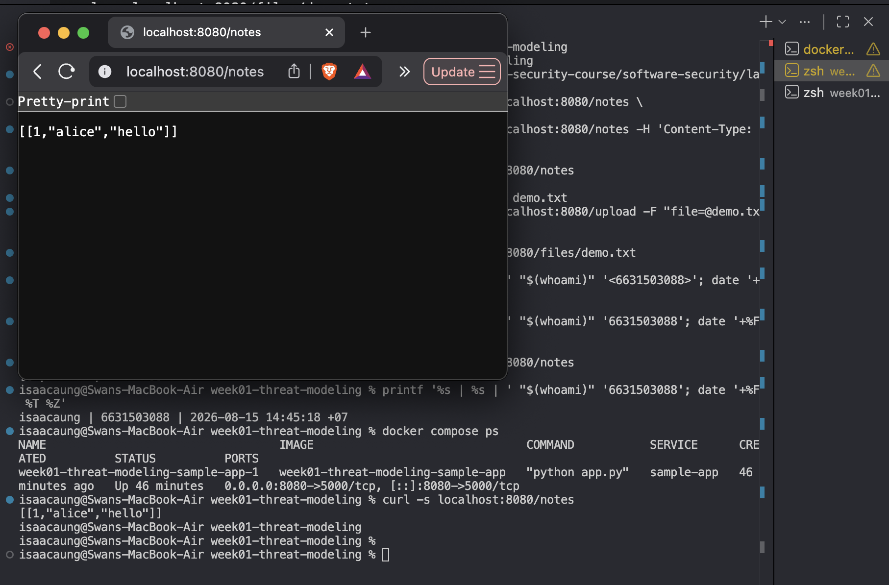
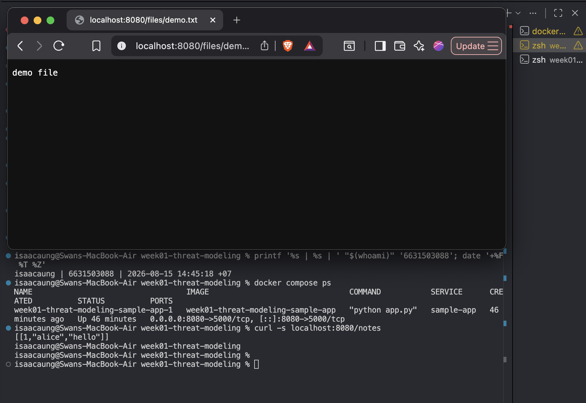
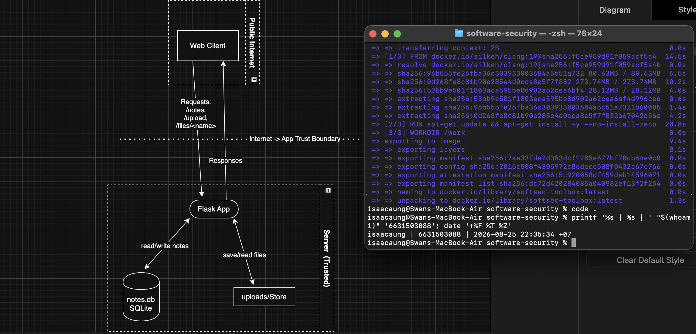
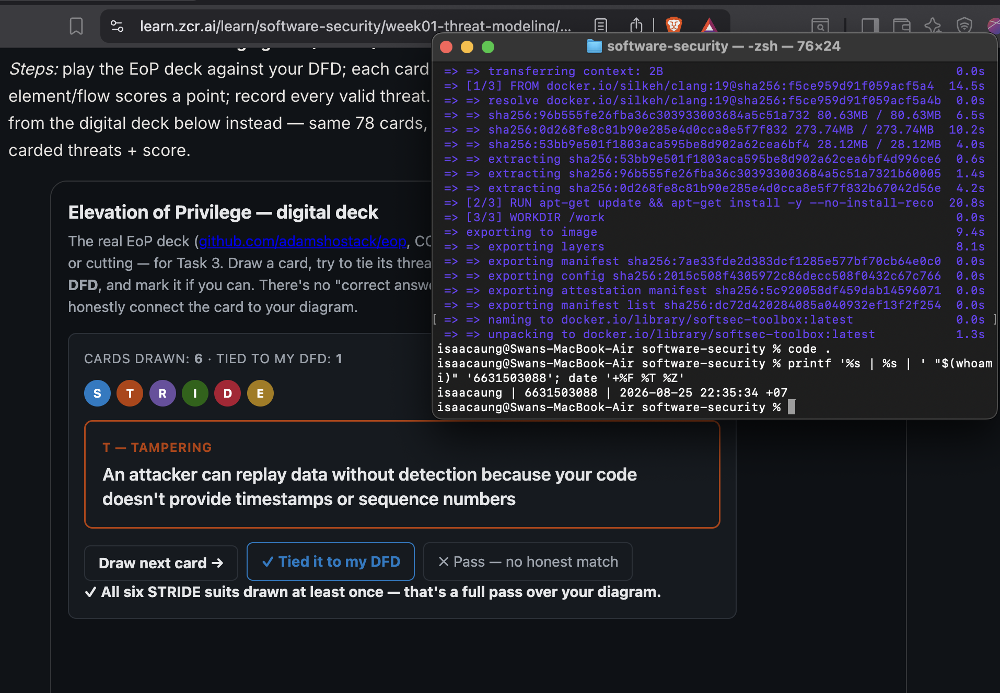
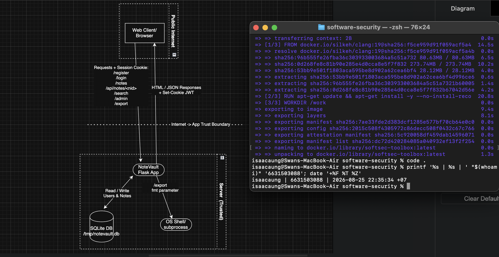

# Worksheet 1 — Security Mindset & Threat Modeling (3 hrs)

> **Course:** Software Security (KOSEN69) · **Week 1**
> **Aligned to:** OWASP 2025 A06 Insecure Design · CWE-501 (Trust Boundary Violation)
> **Signature game:** "Elevation of Privilege" (Microsoft STRIDE card deck)

> **Ethics note:** This week is *modeling only* — you analyze design, you do **not** attack the app. Run the sample app only on your own VM/localhost. Never apply these techniques to systems you do not own or lack written permission to test.

## Part 1 — Student Information
| Name | Student ID | Date | Group |
|---|---|---|---|
| Swan Htut Oakkar Aung | 6631503088 | 2026-08-15 | The Imposter (Team 2) |

AI use disclosure: ChatGPT was used for guidance, explanation, and review during the lab. Commands, code changes, outputs, and security findings were verified against my own local environment and course materials.

## Part 2 — Lecture Questions
Answer in your own words (2–4 sentences each).
1. Define the CIA triad and give one concrete failure example for each of the three properties.

   The CIA triad means confidentiality, integrity, and availability. Confidentiality is about keeping data secret from unauthorized people, integrity is about keeping data accurate and unmodified, and availability is about making sure the system stays usable when needed. A confidentiality failure would be an attacker reading private notes, an integrity failure would be someone changing another user's data, and an availability failure would be a denial-of-service attack that makes the site unreachable.

2. What is a *trust boundary*, and why does data crossing one deserve extra scrutiny?

   A trust boundary is the point where data moves from one level of trust to another, such as from the public internet into a server application. Data crossing that boundary deserves extra scrutiny because the system can no longer assume it is safe, well-formed, or honest. If the application trusts input too early, the attacker can use that crossing point to inject bad data, impersonate someone else, or trigger unsafe behavior.

3. Explain "attack surface." Name two things that increase it in a web app.

   Attack surface is the total number of places where an attacker can interact with a system and try to influence it. In a web app, every endpoint, form, uploaded file, cookie, API, and admin interface adds more possible entry points. Two things that increase attack surface are adding more public routes and accepting more kinds of untrusted input such as file uploads.

4. What does each STRIDE letter map to, and which security property does each threat violate?

   STRIDE stands for Spoofing, Tampering, Repudiation, Information Disclosure, Denial of Service, and Elevation of Privilege. Spoofing violates authenticity, tampering violates integrity, repudiation violates accountability, information disclosure violates confidentiality, denial of service violates availability, and elevation of privilege violates authorization. The model helps map common attacker goals to concrete weaknesses in a system design.

5. What does "Secure by Design" (CISA) mean, and how does it differ from bolting security on after release?

   Secure by Design means security is treated as a default engineering requirement from the beginning instead of as an optional extra. The system should be designed so that unsafe behavior is hard to reach and secure behavior is the normal path. This is different from bolting security on after release, where developers first ship risky design choices and then try to patch symptoms later.

## Part 3 — Hands-on Lab (180 min)
**Learning goals:** build a data-flow diagram (DFD), apply STRIDE to a real Flask app, rank risks, and propose mitigations.
**Prerequisites:** Docker + Docker Compose in your VM; a drawing tool (draw.io / paper + photo); the Elevation of Privilege deck (print or virtual) — free print-and-play PDF at [github.com/adamshostack/eop](https://github.com/adamshostack/eop).

**Environment setup**
```bash
cd labs/week01-threat-modeling
docker compose up --build           # starts sample-app on http://localhost:8080
curl -s -X POST localhost:8080/notes -H 'Content-Type: application/json' \
     -d '{"owner":"alice","body":"hello"}'   # observe behavior, do not attack
curl -s localhost:8080/notes

echo "demo file" > demo.txt
curl -s -X POST localhost:8080/upload -F "file=@demo.txt"   # observe behavior, do not attack
curl -s localhost:8080/files/demo.txt
```

Source to model lives in `sample-app/app.py`. Template to fill: `THREAT-MODEL-TEMPLATE.md` (copy it, do not edit the original).

**What to submit per task:** the threat/element identified + a screenshot (DFD, table, or running app) + a 2–3 sentence mitigation.

**Task 0 — Onboarding (5 min)** · *Goal:* prove the environment works. *Steps:* `docker compose up`, hit `/notes` and `/files/<name>`, read `sample-app/app.py`. *Deliverable:* screenshot of the running app + the JSON response.

**Answer:**

I ran `docker compose up` and confirmed that the `sample-app` container was running on `http://localhost:8080`. I then accessed `/notes` and received the JSON response `[[1,"alice","hello"]]`, which showed that the app and database were working locally. I also reviewed `sample-app/app.py` and confirmed the three main flows for this lab: `/notes`, `/upload`, and `/files/<name>`.

**Evidence:**





**Task 1 — Draw the DFD (25 min)** · *Goal:* map the system. *Steps:* identify the external entity (web client), the process (Flask app), the data store (`notes.db` SQLite), the `uploads/` store, and the flows for `/notes`, `/upload`, `/files/<name>`; mark the Internet→app trust boundary with a dashed line. *Deliverable:* DFD image embedded in your copy of the template.

**Answer:**

I drew a DFD for the sample app showing the web client as the external entity, the Flask app as the main process, `notes.db` as the data store, and `uploads/` as the file store. I also mapped the main request flows for `/notes`, `/upload`, and `/files/<name>`, and marked the Internet-to-application crossing as the main trust boundary. This diagram shows where untrusted input first enters the system and where it can reach internal storage.

**Evidence:**



**Task 2 — STRIDE the elements (30 min)** · *Goal:* enumerate threats per element. *Steps:* for each element fill the S/T/R/I/D/E grid. Ground it in real code: `/notes` accepts a client-supplied `owner` with no auth (Spoofing); `/upload` saves raw `f.filename` — arbitrary-file-write (Tampering) — and echoes the resolved save path back in its response (Information disclosure); `/files/<name>` reads it back but is comparatively defended (see Task 5); no logging anywhere (Repudiation). *Deliverable:* completed STRIDE table.

**Answer:**

I applied STRIDE to each exposed flow in the sample app and focused on how untrusted input crosses into the Flask process and reaches storage. The highest-risk issues are `/notes`, which trusts a client-supplied owner and exposes all notes without authentication, and `/upload`, which saves a raw filename directly into the file store. The table below summarizes the main threats for each element.

| Element | S | T | R | I | D | E |
|---|---|---|---|---|---|---|
| `/notes` | Yes | Yes | Yes | Yes | Yes | No |
| `/upload` | No | Yes | Yes | Yes | Yes | Yes |
| `/files/<name>` | No | No | Yes | Yes | Yes | No |

**Explanation of the grid:**

**Element: `/notes`**

| STRIDE | Analysis |
|---|---|
| S | Yes - the client can claim any `owner` value with no authentication. |
| T | Yes - anyone can add or alter application data by posting arbitrary note content. |
| R | Yes - there is no logging, so note creation cannot be tied to a real actor. |
| I | Yes - `GET /notes` returns all stored notes with no access control. |
| D | Yes - repeated requests or oversized input could fill the database or exhaust the service. |
| E | No - there is no separate privilege model in this route, so it is mainly spoofing and tampering rather than privilege escalation. |

**Element: `/upload`**

| STRIDE | Analysis |
|---|---|
| S | No - the route does not model user identity directly. |
| T | Yes - raw `f.filename` is written to disk, so attacker-controlled filenames can tamper with the file store. |
| R | Yes - uploads are not logged, so the app cannot prove who uploaded which file. |
| I | Yes - uploaded data becomes retrievable later and the response confirms what was saved. |
| D | Yes - repeated or large uploads could consume disk space and degrade availability. |
| E | Yes - if path control lets an attacker overwrite unintended files, they may gain capabilities beyond normal file upload behavior. |

**Element: `/files/<name>`**

| STRIDE | Analysis |
|---|---|
| S | No - this route does not authenticate a caller as another identity. |
| T | No - this endpoint reads files rather than modifying them, and `send_from_directory` gives some path-handling protection. |
| R | Yes - file access is not logged, so reads cannot be attributed. |
| I | Yes - any accessible uploaded file can be read back with no access control. |
| D | Yes - repeated file requests or large downloads could be used to consume server resources. |
| E | No - this route mainly exposes confidentiality and availability risk, not a direct privilege boundary bypass. |

**Task 3 — Elevation of Privilege game (20 min)** · *Goal:* find threats you missed. *Steps:* play the EoP deck against your DFD; each card you can tie to a real element/flow scores a point; record every valid threat. No printer or scissors? Draw from the digital deck below instead — same 78 cards, same rule. *Deliverable:* list of carded threats + score.

```sim
eop-deck
```

**Answer:**

**Cards drawn:** 6  
**Valid threats tied to my DFD:** 1  
**Score:** 1

**Tampering — Replay attack:** A state-changing `POST /notes` request can be replayed because the application does not use a timestamp, nonce, sequence number, or other replay-detection mechanism. If the same request is sent again, the Flask app accepts it again and inserts another note into `notes.db`.

The other five cards were passed because they did not honestly match the Week 1 sample-app DFD.

**Evidence:**



**Task 3b — Systems-level pass (25 min) 🔭** · *Goal:* find what the per-element grid cannot see. Tasks 2 and 3 enumerate threats **one element at a time**, and that is exactly where threat models are known to stop short — students taught STRIDE alone reliably identify component threats and *discount system-level ones* ([Joshi et al., ASEE 2024](https://arxiv.org/abs/2404.16632)). So do a second pass over the **whole** diagram:


- **Trust boundaries end-to-end.** Follow one request from the client to `notes.db` and back. List every boundary it crosses. Which crossing has no check on it?
- **Assume one element is fully owned.** Pick the Flask process, then the `uploads/` store. For each: what does the attacker now *reach* — not what is it, but where does it get them?
- **Chain two "low" findings.** Find two threats you or the EoP deck rated minor that combine into something you would not accept. Write the chain as `A → B → consequence`.
- **One-line system claim.** Finish: "Even if every element-level mitigation in Task 8 is implemented, this system still fails if ___."

Use the simulation below before you start — toggle a component to attacker-controlled and watch what it reaches:

```sim
trust-boundary
```

*Deliverable:* the boundary list, two owned-element reachability notes, one written chain, and the system claim.

**Answer:**

**Trust boundaries end-to-end**
- For a `/notes` request, the request crosses the Internet -> App trust boundary when it moves from the public Web Client into the Flask App. The Flask App then reads or writes `notes.db` inside the same trusted server zone, so that flow does not cross another trust boundary. The response crosses the same Internet -> App boundary in the opposite direction when it returns to the client.
- For an `/upload` request, the request also crosses the Internet -> App trust boundary when it enters the Flask app. The Flask app then writes to the `uploads/` store inside the same trusted server zone. A later `/files/<name>` response crosses the Internet -> App boundary again when data is returned to the client.
- The weakest crossing is the inbound Internet -> App boundary because client-controlled `owner`, `body`, and `filename` values enter the application there without sufficient identity, authorization, or validation checks.

**Assume one element is fully owned**
- If the Flask process is fully owned, the attacker can reach both `notes.db` and the `uploads/` store, read and change application data, and serve attacker-chosen content back to clients.
- If the `uploads/` store is fully owned, the attacker can replace, delete, or control files that the application later serves through `/files/<name>`. This can lead to unauthorized content exposure or attacker-controlled content being returned to clients, but control of the store alone does not prove access to `notes.db` or the Flask application code.

**Chain two low findings**
- No authentication on `/upload` plus no authorization on `/files/<name>` leads to a simple attacker workflow: upload a file first, then retrieve it or share the path later, which turns two weak-looking design issues into persistent unauthorized file hosting and disclosure.

**One-line system claim**
- Even if every element-level mitigation in Task 8 is implemented, this system still fails if the Flask process is compromised, because that single process has direct access to both `notes.db` and the `uploads/` store.

**Task 4 — Abuse cases & attacker personas (20 min)** · *Goal:* think like specific adversaries. *Steps:* define 2 personas (e.g. a curious logged-in user; an anonymous internet attacker) and write 2 abuse cases each against the sample app, tied to DFD elements. *Deliverable:* 4 abuse cases.

**Answer:**

I used two attacker personas: an anonymous internet attacker and a curious low-skill user who can interact with the app but should not control other people's data. The abuse cases below are tied directly to the `/notes`, `/upload`, and `/files/<name>` flows in the DFD and show how weak trust-boundary handling turns simple features into attacker opportunities.

**Persona 1: Anonymous internet attacker**
1. The attacker sends `POST /upload` requests without authentication and stores arbitrary files in the `uploads/` store. **DFD element:** web client -> Flask app -> `uploads/` store.
2. The attacker guesses or reuses filenames and reads uploaded content through `GET /files/<name>` with no authorization check. **DFD element:** web client -> Flask app -> `uploads/` store -> Flask app -> client.

**Persona 2: Curious low-skill user**
1. The user sends `POST /notes` with another person's `owner` value and creates notes while pretending to be that user. **DFD element:** web client -> Flask app -> `notes.db`.
2. The user reads all stored notes from `GET /notes` even though they should only be allowed to see their own data. **DFD element:** web client -> Flask app -> `notes.db` -> Flask app -> client.

**Task 5 — Path-traversal deep-dive (25 min)** · *Goal:* analyze the riskiest flow. *Steps:* trace `/upload` → `/files/<name>`; explain how `../` in a filename escapes `uploads/`; sketch the secure design (`secure_filename`, store outside web root, allow-list extensions). *Deliverable:* the data flow + secure-design note.

**Answer:**

The risky flow is `web client -> Flask app -> uploads/ store -> Flask app -> client`. In `/upload`, the app saves `f.filename` directly with `os.path.join(UPLOAD_DIR, f.filename)`, so a filename containing `../` can try to escape the intended `uploads/` directory and write somewhere else on the server. Later, `/files/<name>` returns files from the upload area, so unsafe handling at the upload step can affect what the app stores and later serves back.

The secure design is to normalize or reject attacker-controlled filenames before they become a path component, for example by using `secure_filename()`, storing files outside the web-facing path, generating server-side filenames instead of trusting the client name, and allowing only approved file extensions. This reduces the risk of traversal, arbitrary file overwrite, and untrusted content exposure through the file-serving route.

**Task 6 — Threat-model the project target (30 min)** · *Goal:* kick off your term project. *Steps:* stop the sample-app first (`docker compose down` — both apps bind host port 8080), then run **NoteVault** (`cd ../../project/starter-app && docker compose up`), draw a quick DFD, and list the top 3 STRIDE threats you'd investigate. *Deliverable:* NoteVault DFD + top-3 threats (reuse these in your project report — `project/REPORT-TEMPLATE.md` in the repo root).

**Answer:**

I created a quick DFD for NoteVault with the web client as the external entity, the Flask app as the main process, the session cookie in the browser as the authentication state, the SQLite database (`/tmp/notevault.db`) as the main data store, and the export subprocess as a privileged internal component. The main trust boundary is the public client crossing into the Flask app, and the highest-risk flows are login, note access, admin access, search, and export.

**Evidence:**



**Top 3 STRIDE threats to investigate**
1. **Elevation of Privilege — `/register`:** I would investigate whether a user can supply `role=admin` during registration. Because the application accepts the role from client input and stores it in the `users` table, an attacker may be able to create an administrator account without authorization.
2. **Information Disclosure:** I would investigate whether a logged-in user can read another user's notes through the note API or other flows that do not enforce ownership checks.
3. **Tampering / Elevation of Privilege:** I would investigate whether the `/export` feature lets user-controlled input reach a shell command and affect the server beyond normal export behavior.

**Task 7 — Security requirements (15 min)** · *Goal:* turn threats into testable requirements. *Steps:* write 3 security requirements as acceptance criteria ("the system must … so that …"), each mapped to a threat from Task 2 or Task 6. *Deliverable:* 3 testable security requirements.

**Answer:**

1. **Authentication and ownership check for notes:** The system must require an authenticated session before creating or returning note data, and it must bind every note action to the logged-in user rather than trusting a client-supplied owner value, so that spoofing and unauthorized note access from Task 2 and Task 6 are prevented.

2. **Safe file-upload design:** The system must reject unsafe filenames, generate server-side filenames, and store uploaded files only in an approved directory with access controls, so that traversal, arbitrary file overwrite, and unauthorized file retrieval from Task 2 are prevented.

3. **Safe command execution:** The system must never pass raw user input directly into shell execution, and export behavior must use a fixed allow-listed format handled without `shell=True`, so that the export feature in Task 6 cannot be abused to tamper with the server or gain extra capability.

**Task 8 — Defend / fix it: rank & mitigate (25 min) 🛡️** · *Goal:* turn threats into action you can prove. *Steps:* rank the top 5 threats by likelihood × impact; propose one concrete mitigation each (e.g., auth on `/notes`, `secure_filename()` + allowlist for `/upload`, request logging for Repudiation, size/rate limits for DoS). Then **pick one and actually implement it** in your fork.

*Deliverable — the top-5 table, plus for the one you implemented:*
1. the **diff** (commit hash on your `wk01` branch),
2. **evidence it works**: the request that succeeded before your change and is refused after — both outputs,
3. **why it closes the class, not the instance** (2–3 sentences). `secure_filename()` on one endpoint is an instance fix; *"no user-supplied string ever becomes a path component"* is a class fix. Say which yours is, and if it's an instance fix, say what the class fix would be.

**Answer:**

| Rank | Threat, risk, and mitigation |
|---|---|
| 1 | **Path traversal or arbitrary file write through `/upload` using attacker-controlled filenames**. **Likelihood x Impact:** High x High. **Mitigation:** Reject unsafe filenames, normalize names, and store uploads with server-controlled filenames only. |
| 2 | **Unauthorized file disclosure through `/files/<name>`**. **Likelihood x Impact:** High x Medium. **Mitigation:** Require authorization checks before serving uploaded files and avoid predictable filenames. |
| 3 | **Spoofing through `/notes` by trusting a client-supplied `owner` value**. **Likelihood x Impact:** High x Medium. **Mitigation:** Require authentication and bind note ownership to the server-side user identity. |
| 4 | **Information disclosure through `GET /notes` returning all notes**. **Likelihood x Impact:** Medium x High. **Mitigation:** Limit note retrieval to authorized owners and apply access-control checks on every read. |
| 5 | **Denial of service through repeated or large uploads**. **Likelihood x Impact:** Medium x Medium. **Mitigation:** Enforce file-size limits, upload quotas, and rate limiting. |

**Implemented mitigation:** reject unsafe upload filenames in `/upload`

**Deliverable output 1 — Commit hash on `wk01`:** `cc8ad7e608adf73467e0cad43fc8a834155e211e`

Commit link: [https://github.com/6631503088/software-security/commit/cc8ad7e608adf73467e0cad43fc8a834155e211e](https://github.com/6631503088/software-security/commit/cc8ad7e608adf73467e0cad43fc8a834155e211e)


**Diff excerpt:**

```diff
+from werkzeug.utils import secure_filename
...
 @app.route("/upload", methods=["POST"])
 def upload():
     f = request.files["file"]
-    f.save(os.path.join(UPLOAD_DIR, f.filename))
-    return {"saved": f.filename}
+    original_name = f.filename or ""
+    safe_name = secure_filename(original_name)
+    if not safe_name or original_name != os.path.basename(original_name) or safe_name != original_name:
+        return jsonify(error="invalid filename"), 400
+    f.save(os.path.join(UPLOAD_DIR, safe_name))
+    return {"saved": safe_name}
```

**Deliverable output 2 — Evidence it works**

**Before the fix**

Request:

```bash
curl -s -X POST localhost:8080/upload -F 'file=@demo.txt;filename=../escape.txt'
```

Output:

```json
{"saved":"../escape.txt"}
```

This request succeeded before the fix, and inspection inside the container showed the file was written outside the intended upload directory as `/app/escape.txt`.

**After the fix**

Request:

```bash
curl -i -s -X POST localhost:8080/upload -F 'file=@demo.txt;filename=../escape.txt'
```

Output:

```http
HTTP/1.1 400 BAD REQUEST
Content-Type: application/json

{"error":"invalid filename"}
```

**Control check: safe upload still works**

```bash
curl -i -s -X POST localhost:8080/upload -F 'file=@demo.txt;filename=demo.txt'
```

```http
HTTP/1.1 200 OK
Content-Type: application/json

{"saved":"demo.txt"}
```

**Deliverable output 3 — Why it closes the class, not only the instance**

This is mainly an **instance fix** for the `/upload` endpoint because it blocks traversal-style filenames at that one path. The broader **class fix** would be to ensure that no user-supplied string ever becomes a storage path component at all, for example by generating server-side file identifiers and separating storage names from user-visible filenames.

> **Why this is weighted.** Fewer than half of working developers can spot a security hole in code, and being shown vulnerabilities does not by itself teach you to find or close them. Exploiting is the half that feels like progress; defending is the half that transfers to your job.

## Part 4 — Reflection
1. Map your top finding to a CWE and to OWASP A06 (Insecure Design); explain the mapping in one sentence.

   My top finding maps to **CWE-22: Path Traversal** because the application lets a user-controlled filename influence where a file is written on the server, and it also fits **OWASP A06: Insecure Design** because the upload feature was designed to trust external path data without a safe storage model.

2. Name one real-world breach caused by a design flaw (not a missing patch) and what design control would have prevented it.

   The **2019 Capital One breach** is a good example because the attacker moved from a web-layer weakness into overly broad cloud permissions and reached sensitive data. A stronger **least-privilege design** for the IAM role, together with tighter isolation around metadata access, would have reduced the blast radius and prevented that design from exposing so much data.

3. Of your five mitigations, which gives the most risk reduction per unit of effort, and why?

   Rejecting unsafe upload filenames gives the most risk reduction per unit of effort because it removes the highest-risk file-write path with a small and targeted code change. It does not solve every storage problem by itself, but it quickly blocks traversal-style inputs that could otherwise lead to arbitrary file placement and more serious compromise.

## Grading rubric (100)
| Criterion | Points |
|---|---|
| Lecture questions (Part 2) | 20 |
| Exploitation + evidence (DFD + STRIDE table + EoP findings + screenshots) | 40 |
| Defense (top-5 ranking + mitigations) | 25 |
| Reflection (CWE/OWASP mapping + breach + best mitigation) | 15 |

**Assessed within the rows above** (they are not extra points — they are what those points are for):
- **Systems-level reasoning** (inside *Exploitation + evidence*, Task 3b): does the model reach past single elements to boundaries, reachability and chains? Scored with the STRIDE + systems-thinking rubrics of [Joshi et al. 2024](https://arxiv.org/abs/2404.16632).
- **Defensive proof** (inside *Defense*, Task 8): a claimed mitigation with no before/after evidence scores at most half. A mitigation you can show closing a *class* scores full.
- **Adversarial thinking** (across the whole sheet): do the abuse cases, personas and chains show you reasoning as an attacker with goals and constraints — or just listing categories? This is the course's central disposition and it is assessed, not assumed.

---

## Evidence & Integrity (required)

- **Identity proof:** every screenshot/diagram must show a terminal running `printf '%s | %s | ' "$(whoami)" '<YOUR-STUDENT-ID>'; date '+%F %T %Z'` **in the
  same image as the evidence**. When the evidence is a browser page, a DevTools panel or a
  rendered response, put that terminal **beside the browser and capture the whole screen** — a
  cropped window carries nothing that identifies you, and the lab's own output is
  byte-identical for the whole cohort *by design*, so the stamp is the only thing that makes
  the shot yours. Generic or borrowed evidence is not accepted.
- **Personalized flag (if this lab issues one):** N/A for this Week 1 modeling lab
  *Flags are unique per student — submitting another student's flag is a violation. How to submit: **learn.zcr.ai/submit** (full guide: `SUBMISSION.md` in the repo root).*
- **Explain in your own words** *(graded on your reasoning, not copied text):*
  1. What did you do, and **why did the vulnerability work**?
  2. **Why does your fix actually stop it** — and what could still break it?

**Answer:**

1. I traced the file-upload path from the client to the Flask app and then to the `uploads/` storage area, and I verified that the app originally accepted a filename like `../escape.txt`. The vulnerability worked because the application trusted the client-supplied filename and used it directly in `os.path.join(UPLOAD_DIR, f.filename)`, so attacker-controlled path data influenced where the server wrote the file.

2. My fix stops it by rejecting filenames that are unsafe after normalization and by refusing names that do not match a plain basename, which blocks traversal-style input before it reaches the filesystem. It could still be broken by a broader unsafe design elsewhere if another endpoint ever lets user input become a path component again, which is why the stronger class fix is server-generated storage names everywhere.

---

## 🤖 Audit the AI (required)

AI is a power tool you must **distrust** — you are graded on your *critique*, not the AI's answer.

1. Ask an AI assistant to exploit **or** fix this week's vulnerability. Paste its full answer.
2. **Find what's wrong or risky** in it — insecure code, a subtly incomplete fix, a hallucinated API/function/CVE, a missed edge case, or wrong reasoning. Quote the exact line(s).
3. Produce the **correct, verified** version yourself and explain in 2–3 sentences why the AI's output was insufficient.

> Disclose your AI use in the Part 1 table. This task counts toward your **Defense + Reflection** score.

**Answer:**

1. **AI answer I audited**

   ```python
   from werkzeug.utils import secure_filename

   @app.route("/upload", methods=["POST"])
   def upload():
       f = request.files["file"]
       filename = secure_filename(f.filename)
       f.save(os.path.join(UPLOAD_DIR, filename))
       return {"saved": filename}
   ```

   The AI explained that `secure_filename()` fixes the path traversal problem because it removes dangerous characters and makes the filename safe before saving.

2. **What is wrong or risky in the AI answer**

   The risky line is `filename = secure_filename(f.filename)` followed immediately by `f.save(os.path.join(UPLOAD_DIR, filename))` with no extra validation or rejection path. This is incomplete because it silently rewrites the attacker input instead of explicitly rejecting unsafe names, it does not handle the case where normalization produces an empty filename, and it still keeps a user-controlled filename as a storage path component. The reasoning is also too broad: saying "`secure_filename()` fixes the path traversal problem" overstates the guarantee and ignores the stronger design rule that storage names should ideally be generated by the server.

3. **Correct, verified version**

   ```python
   from werkzeug.utils import secure_filename

   @app.route("/upload", methods=["POST"])
   def upload():
       f = request.files["file"]
       original_name = f.filename or ""
       safe_name = secure_filename(original_name)
       if not safe_name or original_name != os.path.basename(original_name) or safe_name != original_name:
           return jsonify(error="invalid filename"), 400
       f.save(os.path.join(UPLOAD_DIR, safe_name))
       return {"saved": safe_name}
   ```

   I verified this version by sending `filename=../escape.txt` before and after the change. Before the fix, the request succeeded and wrote `/app/escape.txt`; after the fix, the same request returned `400 BAD REQUEST` with `{"error":"invalid filename"}`. The AI output was insufficient because it offered a weaker fix without proving refusal behavior, while my verified version explicitly rejects unsafe input and demonstrates that the dangerous request no longer works.

---

## 🧠 Comprehension & Prompt (required)

**A. Explain in Plain English (EiPE).** In 2–3 sentences, in your own words, describe what this week's vulnerable code/endpoint actually *does* and *why it is exploitable* — explain the mechanism, don't dump jargon.

**B. Prompt Problem.** Write a **single prompt** that makes an AI produce a *correct, secure* fix for one finding. Run it: does the exploit now fail? If not, refine the prompt and try again. Submit the **final prompt + the verified result**.

**Answer:**

**A. Explain in Plain English (EiPE)**

The `/upload` endpoint takes a file from the user and saves it on the server using the filename that the user provides. It is exploitable because the app originally trusted that filename too much, so a malicious name like `../escape.txt` could influence where the file was written instead of staying safely inside the intended upload folder.

**B. Prompt Problem**

**Final prompt**

```text
You are fixing a Flask file-upload vulnerability. The current code uses `f.save(os.path.join(UPLOAD_DIR, f.filename))`. Produce a secure fix for the `/upload` route that rejects traversal-style or unsafe filenames, returns HTTP 400 with a JSON error for invalid names, still allows safe uploads, and does not rely on `shell=True` or any unrelated changes. Use Python/Flask code only and explain why the fix is secure.
```

**Verified result**

Using a fix based on that prompt, I verified that the exploit request with `filename=../escape.txt` no longer succeeds. Before the fix, `curl -s -X POST localhost:8080/upload -F 'file=@demo.txt;filename=../escape.txt'` returned `{"saved":"../escape.txt"}` and wrote the file outside the upload directory; after the fix, `curl -i -s -X POST localhost:8080/upload -F 'file=@demo.txt;filename=../escape.txt'` returned `HTTP/1.1 400 BAD REQUEST` with `{"error":"invalid filename"}`. A normal upload with `filename=demo.txt` still succeeded, so the final prompt produced a fix that blocked the exploit without breaking the safe case.
*Graded on the prompt's precision and your verification — this trains problem decomposition and AI literacy (Denny et al. 2024).*
