# Worksheet 2 — Secure SDLC & Tooling (3 hrs)

> **Course:** Software Security (KOSEN69) · **Week 2**
> **Aligned to:** OWASP 2025 (A05 Injection [CWE-89, CWE-78], A04 Cryptographic Failures [CWE-327], A02 Security Misconfiguration [CWE-798, CWE-489]) · CWE-798, CWE-89, CWE-78, CWE-327, CWE-489
> **Signature game:** "Bug Triage Race" (scan → triage; score = true positives − misclassified)

> **Ethics note:** The scanners run only against the provided `vulnerable-repo/` on your own machine. Do not point SAST/secret scanners at third-party repos or production systems without authorization. Treat any secret you find here as fake lab data.

## Part 1 — Student Information
| Name | Student ID | Date | Group |
|---|---|---|---|
| Swan Htut Oakkar Aung | 6631503088 | 2026-09-03 | The Imposter (Team 2) |

AI use disclosure: ChatGPT was used for guidance, explanation, and review during the lab. Commands, code changes, outputs, and security findings were verified against my own local environment and course materials.

## Part 2 — Lecture Questions
Answer in your own words (2–4 sentences each).
1. Distinguish SAST, DAST, and SCA — what does each see, and when in the SDLC does each run?

   SAST reads source code without running the application, so it can identify patterns such as a string-built SQL query while code is being written or in CI. DAST probes a running application from the outside, normally during testing or deployment, and observes exploitable behavior rather than source lines. SCA examines dependency manifests and lockfiles during the build or CI stage to find known vulnerabilities in third-party packages.

2. What is secret scanning, and why do hardcoded secrets keep ending up in repos?

   Secret scanning searches files and commit history for strings that look like credentials, API keys, tokens, or passwords. Hardcoded secrets reach repositories when developers put configuration directly in source code for convenience, use test values that look real, or accidentally commit local environment files. A commit-time or CI scan helps catch them before the code is shared or deployed.

3. What does "shift-left / DevSecOps" mean in practice for a CI pipeline?

   Shift-left means moving security checks earlier in the development lifecycle, when defects are cheaper and easier to correct. In a CI pipeline, this means automatically running checks such as SAST, secret scanning, SCA, and tests on commits or pull requests. DevSecOps treats these checks as a normal engineering gate, for example failing the build on a HIGH or CRITICAL finding.

4. Why is coverage-guided fuzzing considered the dominant modern bug-finding technique?

   Coverage-guided fuzzing repeatedly mutates inputs and keeps inputs that execute new paths in the program, which explores far more useful behavior than unguided random testing. When paired with sanitizers such as ASan, it can turn a rare memory error into a reproducible crash with a useful stack trace. It finds implementation bugs that do not necessarily match a static-analysis rule or obvious code pattern.

5. Define true positive vs. false positive in scanner triage, and why misclassifying both directions is costly.

   A true positive is a scanner finding that represents a real security issue, while a false positive is a reported issue that is not actually exploitable or relevant. Treating a false positive as real wastes investigation and remediation time and makes developers lose trust in the tool. Treating a true positive as false leaves a real vulnerability unfixed, so accurate triage is necessary to prioritize risk correctly.


## Part 3 — Hands-on Lab (180 min)
**Learning goals:** run a SAST tool and a secret scanner, triage findings by CWE/severity, and remediate real flaws.
**Prerequisites:** Docker installed; internet to pull the Semgrep/Gitleaks images.

**Environment setup**
```bash
cd labs/week02-sdlc-tooling
cat scan.sh                 # see exactly what it runs
bash scan.sh                # Semgrep (p/default + p/owasp-top-ten) then Gitleaks on ./vulnerable-repo
```
Target under scan: `vulnerable-repo/app.py` (plus `requirements.txt`). It contains five planted flaws.

**What to submit per task:** the command/payload run + a screenshot of the finding + a 2–3 sentence mitigation.

**Task 0 — Onboarding (5 min)** · *Goal:* confirm tooling. *Steps:* run `bash scan.sh`; confirm both Semgrep and Gitleaks sections produce output. *Deliverable:* screenshot showing both tools ran.

**Command run:** `bash scan.sh`

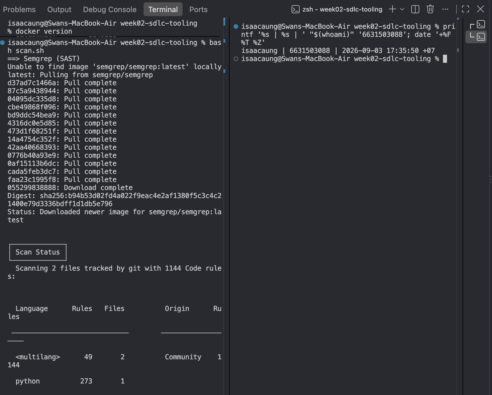

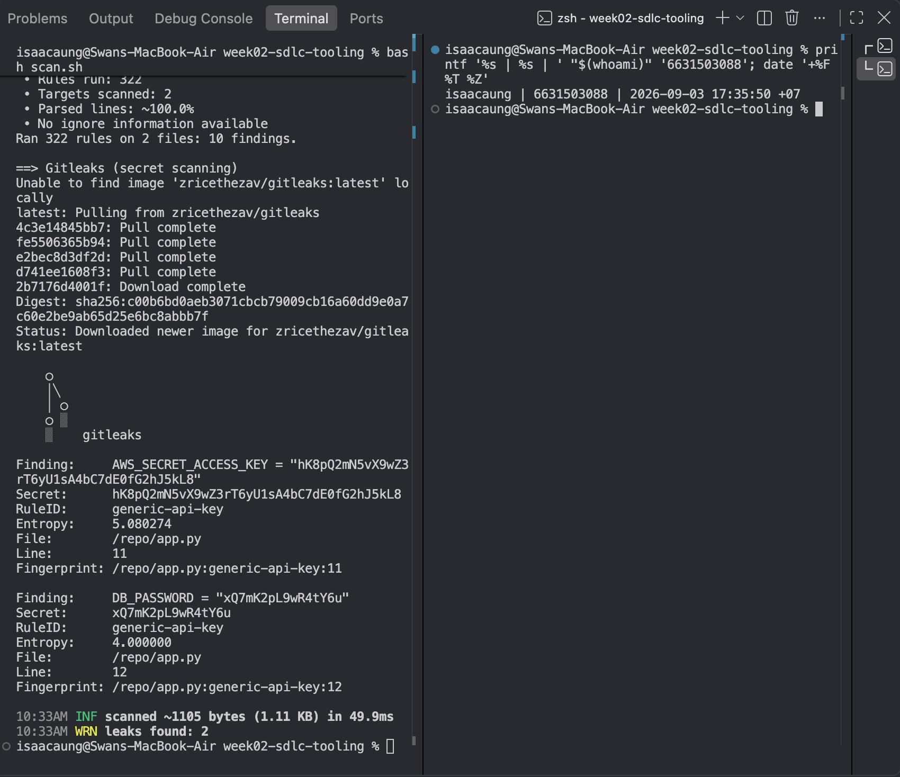

Semgrep completed and reported 10 findings, while Gitleaks completed and reported 2 potential secrets, confirming that both tools are installed and able to scan the lab target. These results still need triage; confirmed findings will be fixed in the source code rather than merely suppressed in scanner output.

**Task 1 — SAST sweep with Semgrep (25 min)** · *Goal:* find code flaws. *Steps:* read the Semgrep output; locate the SQL injection in `/user` (CWE-89, string-formatted query), the OS command injection in `/ping` (CWE-78, `shell=True`), the weak `md5` password hash (CWE-327), and `debug=True` (CWE-489). *Deliverable:* one screenshot per finding with the file:line.

**Command run:** `docker run --rm -v "$PWD/vulnerable-repo:/src" semgrep/semgrep semgrep --config p/default --config p/owasp-top-ten /src`

**1. SQL injection in `/user` (CWE-89, `app.py:19`)**

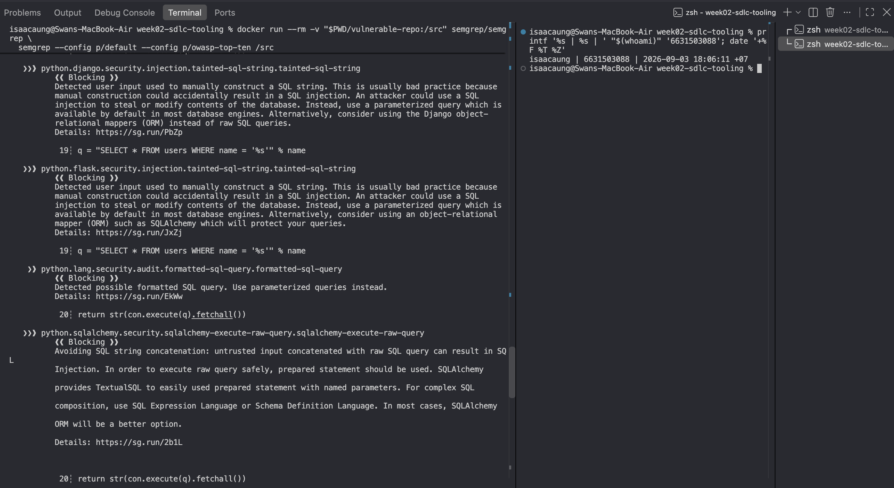

The query must use a parameter placeholder, such as `SELECT * FROM users WHERE name = ?`, and pass `name` separately to `execute`. This keeps user input as data instead of allowing it to change the SQL command.

**2. OS command injection in `/ping` (CWE-78, `app.py:26`)**

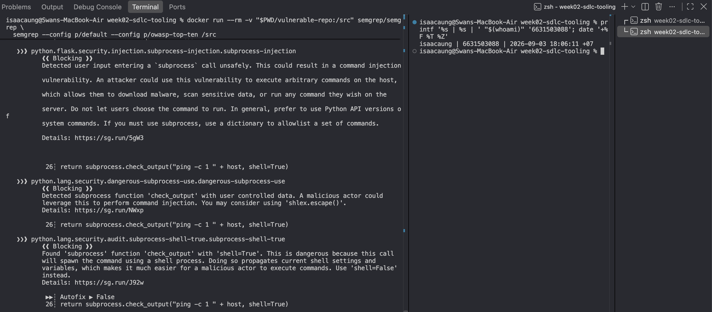

The application should remove `shell=True` and call the command with an argument list, while validating the host value against an allowlist. This prevents a client-controlled value from being interpreted by a shell as additional commands.

**3. Weak MD5 password hash (CWE-327, `app.py:30`)**

**4. Flask debug mode enabled (CWE-489, `app.py:33`)**

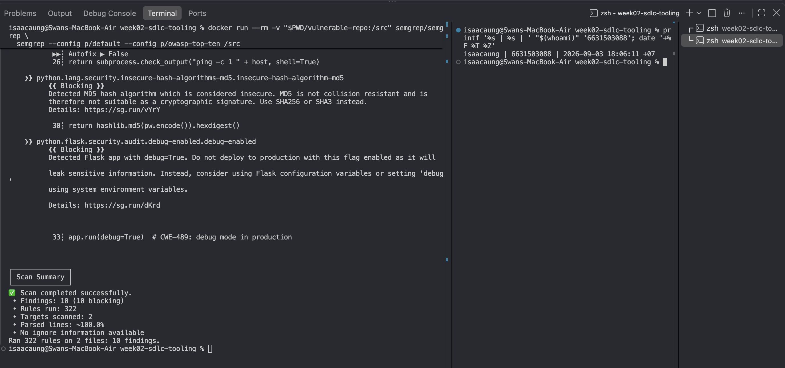

Passwords should be stored with a purpose-built password hash such as Argon2 or bcrypt, not MD5. These algorithms are intentionally slow and salted, making stolen password hashes harder to crack.

Production must set Flask debug mode to `False` and use separate development configuration when debugging is needed. This avoids exposing detailed error information or an interactive debugger to users.

**Task 2 — Secret scan with Gitleaks (15 min)** · *Goal:* find leaked credentials. *Steps:* read the Gitleaks output; identify `AWS_SECRET_ACCESS_KEY` and `DB_PASSWORD` (CWE-798). *Deliverable:* screenshot + the rule that fired for each.

**Command run:** `docker run --rm -v "$PWD/vulnerable-repo:/repo" zricethezav/gitleaks:latest detect --no-git -s /repo -v`

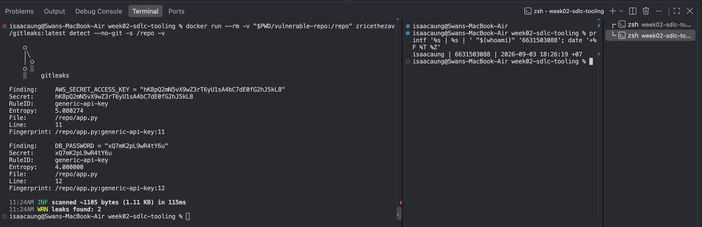

| Finding | File:line | Rule ID | CWE |
|---|---|---|---|
| `AWS_SECRET_ACCESS_KEY` | `app.py:11` | `generic-api-key` | CWE-798 |
| `DB_PASSWORD` | `app.py:12` | `generic-api-key` | CWE-798 |

Both credentials should be removed from source code and supplied at runtime through environment variables or a secrets manager. If either value had been real, it would need to be revoked or rotated because committing a secret makes it potentially exposed. Commit-time and CI secret scans can prevent the same mistake from reaching the shared repository again.

**Task 3 — Bug Triage Race (30 min)** · *Goal:* triage accurately. *Steps:* build a table with columns *Tool | File:Line | CWE | Severity | TP/FP | Fix idea*; mark at least 3 true positives and 1 likely false positive and justify each. (Score = TP − misclassified.) *Deliverable:* the completed triage table.

| Tool | File:Line | CWE | Severity | TP/FP | Fix idea |
|---|---|---|---|---|---|
| Semgrep | `app.py:19` | CWE-89 | High | TP | Use a parameterized SQLite query with a `?` placeholder. |
| Semgrep | `app.py:26` | CWE-78 | Critical | TP | Remove `shell=True`, use an argument list, and validate the host. |
| Semgrep | `app.py:30` | CWE-327 | High | TP | Replace MD5 with Argon2 or bcrypt. |
| Semgrep | `app.py:33` | CWE-489 | Medium | TP | Disable Flask debug mode in production. |
| Gitleaks | `app.py:11` | CWE-798 | High | TP | Remove the AWS key from code and load it from a secret store or environment variable. |
| Gitleaks | `app.py:12` | CWE-798 | High | TP | Remove the database password from code and load it from a secret store or environment variable. |
| Semgrep | `app.py:20` | CWE-89 | Low | Likely FP | No change for this rule; it is a SQLAlchemy-specific rule, but this app uses `sqlite3`. |

The first six entries are true positives because source inspection confirms the vulnerable code or hardcoded credentials. The final finding is a likely false positive for that specific rule: the real SQLite injection is on line 19, but the rule at line 20 assumes a SQLAlchemy API that this application does not use.

**Task 4 — Fuzzing intro (10 min)** · *Goal:* see coverage-guided fuzzing find a bug SAST won't. *Steps:* in the `labs/toolbox` container (Apple clang has no libFuzzer runtime), build `clang -g -fsanitize=address,fuzzer harness.c -o fuzz`, then **seed the corpus** and run it:
`mkdir -p corpus && printf 'FUZ' > corpus/seed && ./fuzz corpus`. It crashes almost immediately with an AddressSanitizer heap-buffer-overflow at `harness.c:23` (the `data[3]` read with no `size > 3` check). Seeding matters: an unseeded `./fuzz` has to rediscover the magic bytes by chance and often finds nothing for minutes — that unpredictability is itself worth a sentence in your write-up. (The deep fuzzing+exploit lab is Week 11.) *Deliverable:* the ASan crash output (or a screenshot) + a 2-sentence note on why fuzzing finds this bug when a linter/SAST pass over the same 4-line check would not.

**Commands run inside the `softsec-toolbox` container:** `clang -g -fsanitize=address,fuzzer harness.c -o fuzz`; `mkdir -p corpus`; `printf 'FUZ' > corpus/seed`; `./fuzz corpus`

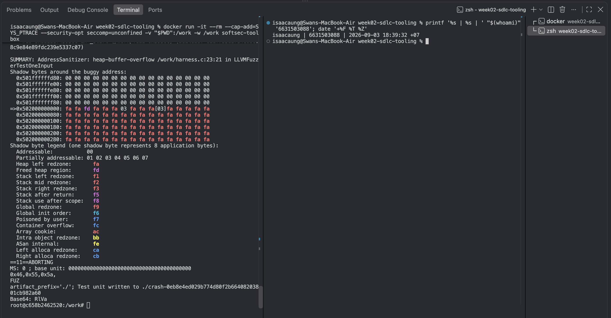

The seeded `FUZ` input reaches `data[3]` when the buffer contains only three bytes, so AddressSanitizer reports a heap-buffer-overflow at `harness.c:23`. Fuzzing executes and mutates the compiled program to reach this input-dependent path, whereas a pattern-based SAST or linter may not recognize this specific missing bounds check.

**Task 5 — Scan the project target (40 min)** · *Goal:* apply the tools to your term project. *Steps:* run Semgrep + Gitleaks against **NoteVault** (`../../project/starter-app`); also run an SCA scan: `docker run --rm -v "$PWD/../../project/starter-app:/src" aquasec/trivy fs /src`. *Deliverable:* a findings list (tool, file:line/CVE, CWE) — reuse it in your project vuln report.

**Commands run:**

```bash
docker run --rm -v "$PWD/../../project/starter-app:/src" semgrep/semgrep semgrep --config p/default --config p/owasp-top-ten /src
docker run --rm -v "$PWD/../../project/starter-app:/repo" zricethezav/gitleaks:latest detect --no-git -s /repo -v
docker run --rm -v "$PWD/../../project/starter-app:/src" aquasec/trivy fs /src
```

**Semgrep evidence**

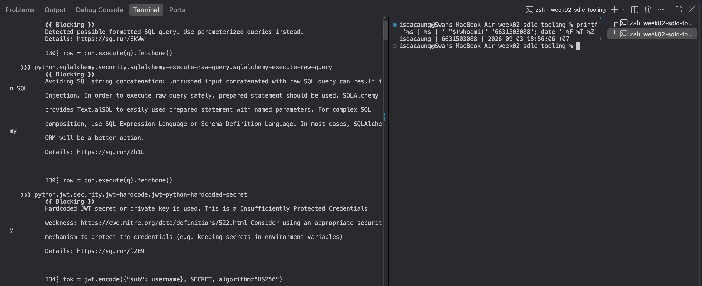

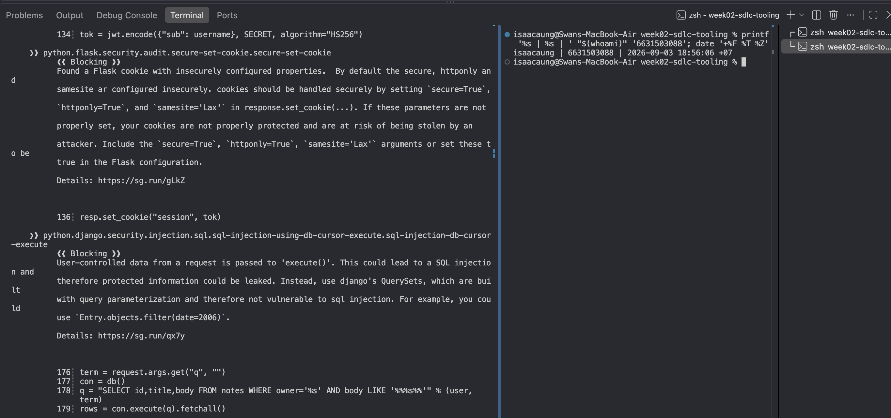

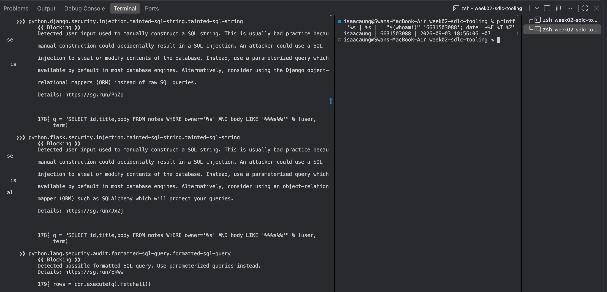

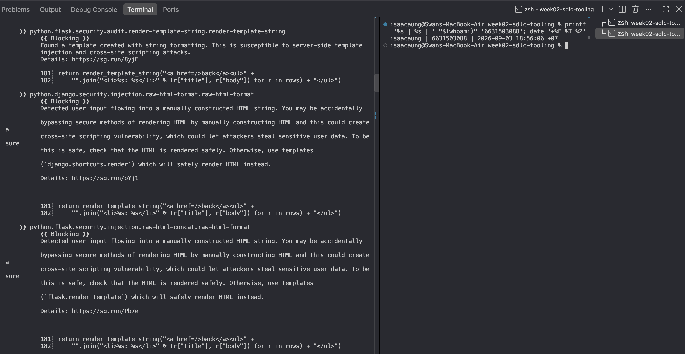

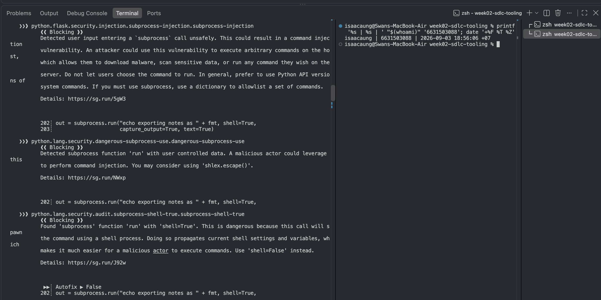

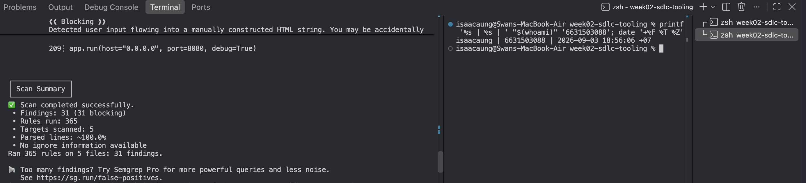

**Gitleaks evidence**

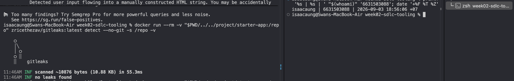

**Trivy evidence**

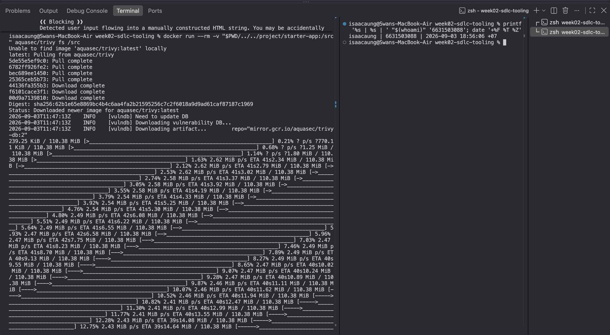

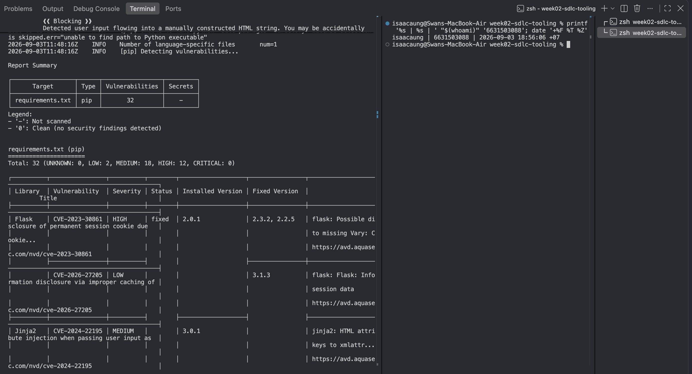

**NoteVault Explicit Findings List:**

| Tool | File:Line / CVE | Finding / Description | CWE |
|---|---|---|---|
| Semgrep | `app.py:68` | Weak unsalted MD5 password hashing (`hashlib.md5`) | CWE-916 / CWE-327 |
| Semgrep | `app.py:83` | JWT decode allows `none` algorithm token forgery | CWE-327 / CWE-347 |
| Semgrep | `app.py:23` | Hardcoded JWT secret key (`SECRET = "notevault-dev-secret"`) | CWE-798 |
| Semgrep | `app.py:108` | String concatenation SQL injection in search endpoint | CWE-89 |
| Semgrep | `app.py:184` | Server-Side Template Injection via `render_template_string` | CWE-1336 / CWE-94 |
| Trivy | `requirements.txt` / CVE-2022-39227 | Vulnerable PyJWT version (< 2.4.0) allows signature bypass | CWE-347 |

**Task 6 — Build a security CI gate (25 min)** · *Goal:* automate the scan (previews Week 15). *Steps:* adapt `../week15-devsecops-pipeline/security-ci.yml` into a workflow that runs Semgrep + Trivy + Gitleaks and **fails on HIGH/CRITICAL**; run it locally (`act`) or commit to your fork and read the Actions log. *Deliverable:* the workflow file + a screenshot of a failing run.

**Workflow file:** [`.github/workflows/week02-security-ci.yml`](../../.github/workflows/week02-security-ci.yml)

**Commit:** [`213e82f01a5ce84b3cc189e5251e99fad9147177`](https://github.com/6631503088/software-security/commit/213e82f01a5ce84b3cc189e5251e99fad9147177)

**Failed GitHub Actions run:** [Week 2 Security CI, run 2](https://github.com/6631503088/software-security/actions/runs/33757173266)

| Gate | Result | Verified outcome |
|---|---|---|
| Semgrep | Failed | The SAST gate found 31 NoteVault findings. |
| Trivy | Failed | The dependency/configuration gate found HIGH and CRITICAL issues. |
| Gitleaks | Passed | No real-looking committed secret was detected in NoteVault. |

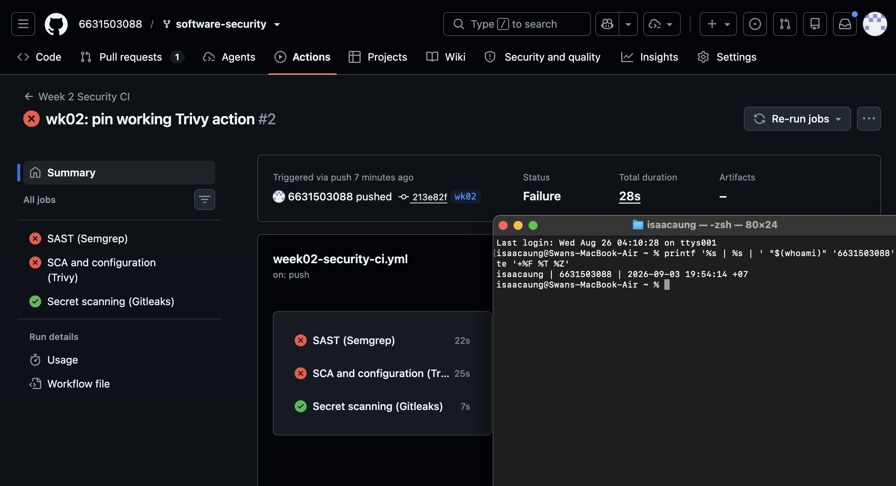

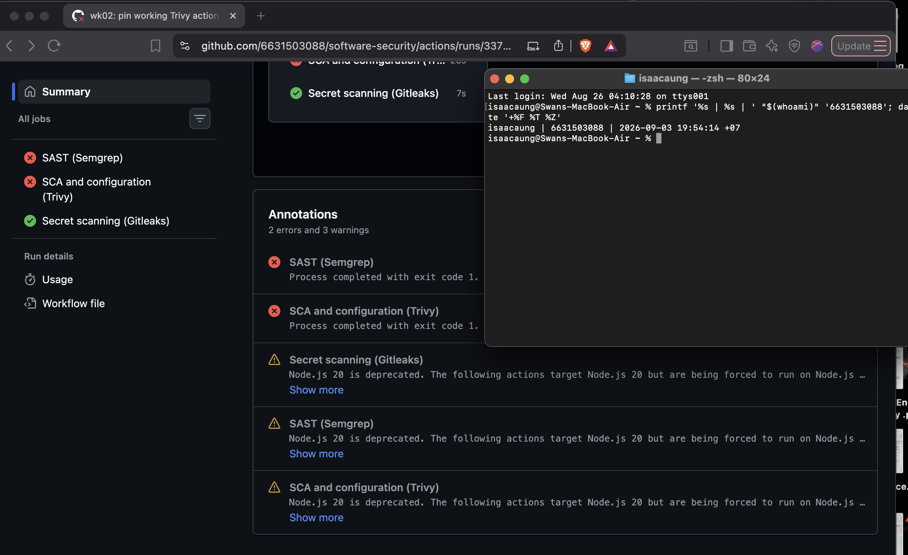

The workflow scans `project/starter-app` with Semgrep, Trivy, and Gitleaks on every push to `wk02` and on manual dispatch. The Semgrep and Trivy jobs fail the workflow when findings reach their configured gate, while the Gitleaks job fails only if a committed secret is detected.

**Task 7 — SAST blind spots (20 min)** · *Goal:* see what scanners miss. *Steps:* find one real bug in `vulnerable-repo/app.py` (or NoteVault) that Semgrep did **not** flag, and explain why a pattern-based tool missed it. *Deliverable:* the bug + a 2-sentence explanation.

**Broken object-level authorization in NoteVault `/api/notes/<nid>` (CWE-639 / CWE-862)**

**Commands run:** `curl -i -c /tmp/notevault-task7-cookies.txt -X POST http://localhost:8080/login -d 'username=alice&password=alicepw'`; `curl -i -b /tmp/notevault-task7-cookies.txt http://localhost:8080/api/notes/2`

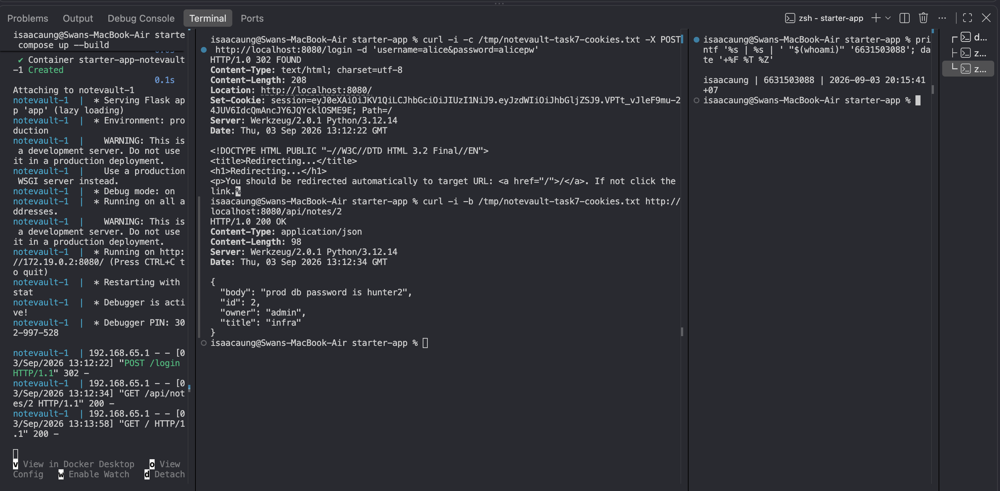

An authenticated Alice session can request `/api/notes/2` and receive the admin-owned note because the query filters only on the note ID, not on the current user's ownership. Semgrep did not flag this application-specific authorization relationship because the SQL is parameterized; the endpoint must query by both ID and owner, or explicitly authorize an administrator before returning another user's note.

**Task 8 — Defend / fix it (10 min)** · *Goal:* remediate the planted flaws in `vulnerable-repo/app.py`. *Steps:* rewrite `/user` to use a parameterized query (`?` placeholder); remove `shell=True` and pass an argument list in `/ping`; move both secrets to environment variables; replace `md5` with bcrypt/argon2; set `debug=False`. *Deliverable:* a before/after diff for each fix mapped to its CWE.

**Remediation commit:** [`f180038`](https://github.com/6631503088/software-security/commit/f180038)

| CWE | Before | After | Why the fix closes the issue |
|---|---|---|---|
| CWE-89 | SQL was built with `"... '%s'" % name`. | `execute("... name = ?", (name,))` uses a bound parameter. | The database treats `name` as data rather than SQL syntax. |
| CWE-78 | `/ping` concatenated `host` into a command with `shell=True`. | It validates an IP address and calls `check_output(["ping", "-c", "1", host])`. | No shell interprets client input, and non-IP input is rejected with HTTP 400. |
| CWE-798 | AWS and database credentials were hardcoded in `app.py`. | Both values are read with `os.environ[...]`. | Secrets are supplied by the deployment environment and are no longer committed to source control. |
| CWE-327 | Passwords were hashed with `hashlib.md5(...)`. | Passwords use `bcrypt.hashpw(..., bcrypt.gensalt())`. | Bcrypt is salted and deliberately slow, unlike MD5. |
| CWE-489 | Flask started with `debug=True`. | Flask starts with `debug=False`. | The production server no longer exposes Flask's debug facilities. |

**Verification:** `python3 -m py_compile vulnerable-repo/app.py` passed. In an isolated Python container with placeholder environment secrets, bcrypt successfully verified a stored password and `/ping?host=127.0.0.1%3Bwhoami` returned HTTP 400; the post-fix Semgrep scan reported 0 findings and Gitleaks reported no leaks.

## Part 4 — Reflection
1. Map two of your findings to their CWE and to the matching OWASP 2025 category.

The string-formatted `/user` query is **CWE-89: SQL Injection** and maps to [OWASP A05:2025 Injection](https://owasp.org/Top10/2025/A05_2025-Injection/). Flask `debug=True` is **CWE-489: Active Debug Code** and maps to [OWASP A02:2025 Security Misconfiguration](https://owasp.org/Top10/2025/A02_2025-Security_Misconfiguration/).

2. Name a real-world breach caused by a hardcoded/leaked secret or an injection flaw, and what control would have caught it pre-release.

Uber's 2016 breach involved attackers accessing its Amazon S3 datastore using an AWS access key posted in a private GitHub repository, according to the [FTC complaint](https://www.ftc.gov/system/files/documents/commission_decision_volumes/volume-166/decision_volume_166_new_word_format.pdf). Pre-commit and CI secret scanning, together with short-lived credentials and MFA for repository access, could have prevented or limited this exposure.

3. Which single tool (SAST vs. secret scanning) gave the highest-value findings on this repo, and why?

SAST gave the highest value because it identified exploitable behavior in `/user`, `/ping`, password storage, and debug configuration, not only exposed values. Secret scanning was still essential because it found two committed credentials that SAST does not reliably classify as secrets.

## Grading rubric (100)
| Criterion | Points |
|---|---|
| Lecture questions (Part 2) | 20 |
| Exploitation + evidence (scan output + triage table + screenshots) | 40 |
| Defense (remediated `app.py` with before/after diffs) | 25 |
| Reflection (CWE/OWASP mapping + breach + tool value) | 15 |

---

## Evidence & Integrity (required)

- **Identity proof:** every screenshot/diagram must show a terminal running `printf '%s | %s | ' "$(whoami)" '<YOUR-STUDENT-ID>'; date '+%F %T %Z'` **in the
  same image as the evidence**. When the evidence is a browser page, a DevTools panel or a
  rendered response, put that terminal **beside the browser and capture the whole screen** — a
  cropped window carries nothing that identifies you, and the lab's own output is
  byte-identical for the whole cohort *by design*, so the stamp is the only thing that makes
  the shot yours. Generic or borrowed evidence is not accepted.
- **Personalized flag (if this lab issues one):** N/A — no personalized flag issued
  *Flags are unique per student — submitting another student's flag is a violation. How to submit: **learn.zcr.ai/submit** (full guide: `SUBMISSION.md` in the repo root).*
- **Explain in your own words** *(graded on your reasoning, not copied text):*
  1. What did you do, and **why did the vulnerability work**?

I ran Semgrep, Gitleaks, Trivy, and a seeded fuzzer, then confirmed the NoteVault authorization flaw by reading an admin note while logged in as Alice. The planted vulnerabilities worked because client-controlled input was treated as SQL or shell syntax, secrets were committed in source, MD5 is not suitable for password storage, and debug mode exposed development-only behavior.

  2. **Why does your fix actually stop it** — and what could still break it?

The fixes bind SQL parameters, avoid a shell and accept only IP literals, load secrets from the environment, use bcrypt, and disable debug mode; each removes the unsafe interpretation or exposure point. The controls could still fail if later code reintroduces string-built SQL, permits arbitrary command arguments, logs environment secrets, or deploys an insecure configuration, so CI scans and code review remain necessary.

---

## 🤖 Audit the AI (required)

AI is a power tool you must **distrust** — you are graded on your *critique*, not the AI's answer.

1. Ask an AI assistant to exploit **or** fix this week's vulnerability. Paste its full answer.

**Prompt sent to AI:** `How should I fix the Flask /ping endpoint that builds a ping command from request.args["host"]?`

**Full AI answer:**

> Change the endpoint to `return subprocess.check_output("ping -c 1 " + shlex.quote(host), shell=False)`. Quoting the host prevents an attacker from adding another command, and `shell=False` makes the command safe.

2. **Find what's wrong or risky** in it — insecure code, a subtly incomplete fix, a hallucinated API/function/CVE, a missed edge case, or wrong reasoning. Quote the exact line(s).

The line `subprocess.check_output("ping -c 1 " + shlex.quote(host), shell=False)` is incorrect: with `shell=False`, Python does not split that string into an executable and arguments, so it can try to execute a program literally named `ping -c 1 ...`. The claim that `shlex.quote(host)` is sufficient is also risky because quoting is for shell parsing, while the secure design is to avoid the shell completely and validate the allowed host format.

3. Produce the **correct, verified** version yourself and explain in 2–3 sentences why the AI's output was insufficient.

```python
try:
    ipaddress.ip_address(host)
except ValueError:
    return "host must be an IP address", 400
return subprocess.check_output(["ping", "-c", "1", host])
```

This version validates the input as an IP literal and passes a fixed argument list directly to `subprocess`, so `;whoami` is not interpreted as shell syntax. I verified the applied version in an isolated container: `/ping?host=127.0.0.1%3Bwhoami` returned HTTP 400.

> Disclose your AI use in the Part 1 table. This task counts toward your **Defense + Reflection** score.

---

## 🧠 Comprehension & Prompt (required)

**A. Explain in Plain English (EiPE).** In 2–3 sentences, in your own words, describe what this week's vulnerable code/endpoint actually *does* and *why it is exploitable* — explain the mechanism, don't dump jargon.

The vulnerable app accepts a name to look up a user and a host to ping, but it originally joined those values directly into SQL and a shell command. An attacker could supply characters with special meaning, causing the database or shell to do something different from the intended lookup or ping.

**B. Prompt Problem.** Write a **single prompt** that makes an AI produce a *correct, secure* fix for one finding. Run it: does the exploit now fail? If not, refine the prompt and try again. Submit the **final prompt + the verified result**.

**Final prompt:** `Fix only the Flask /ping endpoint. Treat host as untrusted: accept IPv4 or IPv6 literals only with ipaddress.ip_address(), return HTTP 400 for anything else, and run ping through subprocess.check_output with the fixed list ["ping", "-c", "1", host]. Do not use shell=True, string command construction, shlex.quote, or hostnames. Show the exact replacement code and a test for the payload 127.0.0.1;whoami.`

**Verified result:** I applied the resulting approach in `vulnerable-repo/app.py` and tested it in an isolated Python container. The payload `127.0.0.1;whoami` was rejected with HTTP 400, while bcrypt password verification also passed; the post-fix Semgrep scan reported 0 findings and Gitleaks reported no leaks.
*Graded on the prompt's precision and your verification — this trains problem decomposition and AI literacy (Denny et al. 2024).*
