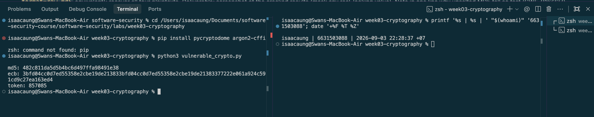
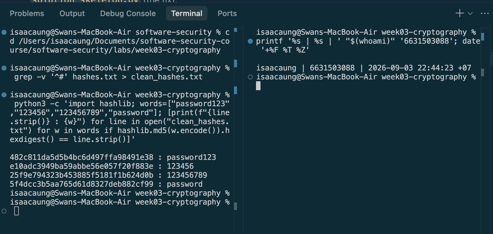
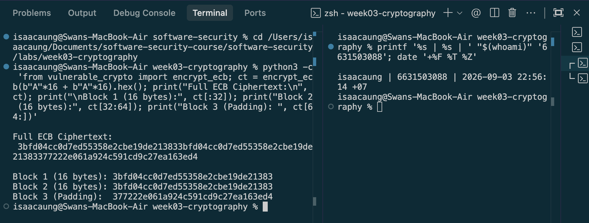
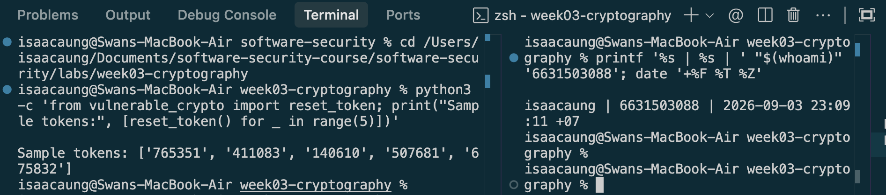
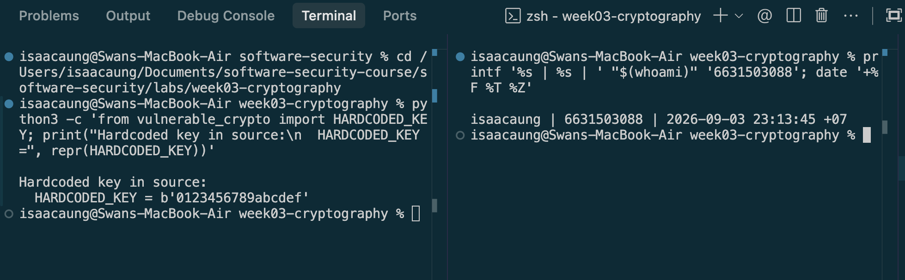
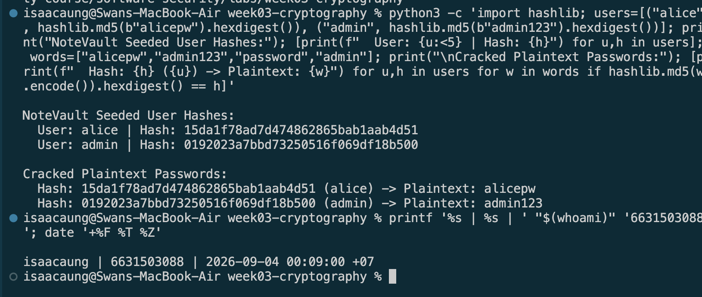
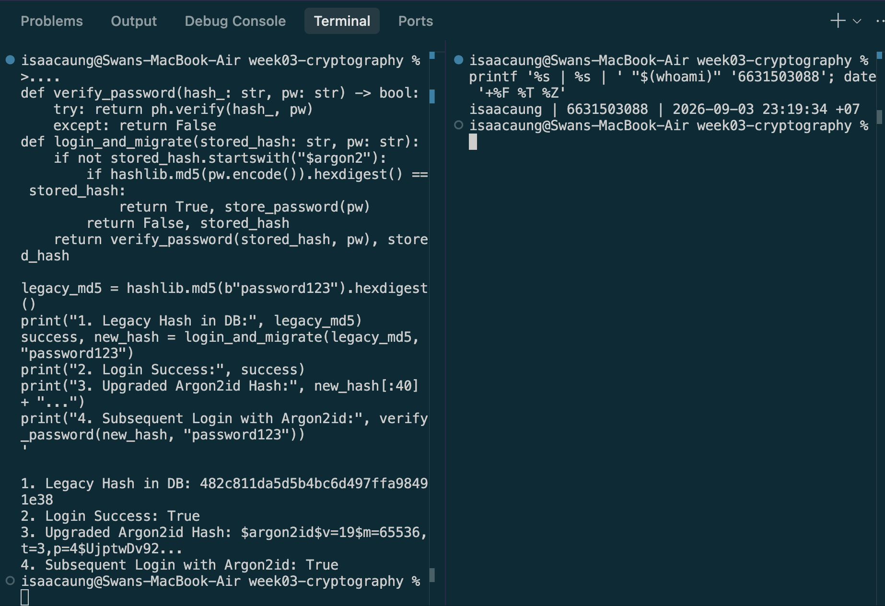
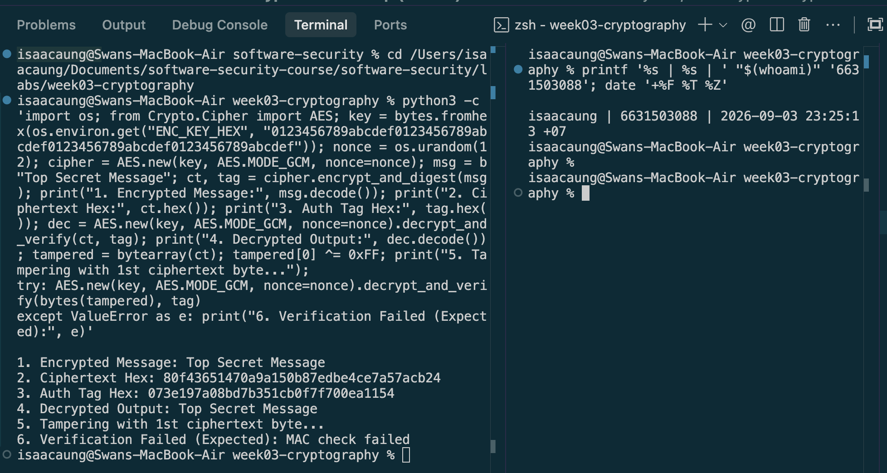
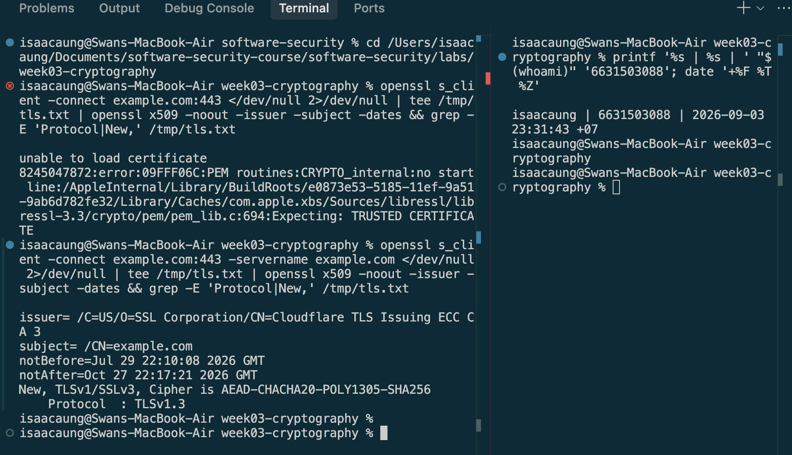
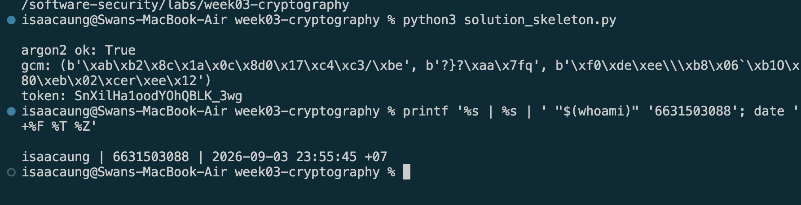

# Worksheet 3 — Cryptography Used Correctly (and Misused) (3 hrs)

> **Course:** Software Security (KOSEN69) · **Week 3**
> **Aligned to:** OWASP 2025 A04 Cryptographic Failures · CWE-327, CWE-916, CWE-330, CWE-798
> **Signature game:** "Capture the Hash" (recover plaintext from weak hashes)

> **Ethics note:** Crack only the hashes provided in `hashes.txt` on your own machine. Password-cracking against accounts or systems you don't own is illegal. Wordlists and recovered values stay inside the lab VM.

## Part 1 — Student Information
| Name | Student ID | Date | Group |
|---|---|---|---|
| Swan Htut Oakkar Aung | 6631503088 | 2026-09-03 | The Imposter (Team 2) |

AI use disclosure: ChatGPT was used for guidance, explanation, and review during the lab. Commands, code changes, outputs, and security findings were verified against my own local environment and course materials.

## Part 2 — Lecture Questions
Answer in your own words (2–4 sentences each).
1. Distinguish hashing, encryption, and encoding — and give one job each is the wrong tool for.
   - **Hashing** is a one-way transformation producing a fixed-size digest for integrity verification; it is the wrong tool for storing data that needs to be retrieved in plaintext later.
   - **Encryption** is a two-way transformation using a secret key to protect data confidentiality; it is the wrong tool for password storage because key compromise exposes all user plaintexts.
   - **Encoding** is a publicly reversible data format transformation (e.g., Base64); it is the wrong tool for protecting sensitive data since it provides no secrecy or security.

2. Why is a fast hash like MD5/SHA-1 a bad choice for storing passwords, and what should be used instead?
   - Fast hashes like MD5 and SHA-1 were designed for high-throughput checksums, allowing attackers to attempt billions of guesses per second on GPUs using dictionary attacks and rainbow tables. Instead, modern applications must use slow, memory-hard Key Derivation Functions (KDFs) such as **Argon2id** (or scrypt/bcrypt) that introduce configurable memory and CPU costs to stall offline cracking.

3. What is a salt, what attack does it defeat, and why must it be unique per password?
   - A salt is a cryptographically random byte sequence generated for each user and appended to their password before hashing. A unique random salt defeats precomputed rainbow tables and prevents identical passwords from producing identical stored hashes. It forces an attacker to perform password guesses separately for each user's hash rather than reusing the same precomputed results across many accounts.

4. Why does AES-ECB leak structure, and what does an authenticated mode like AES-GCM add?
   - AES-ECB encrypts every 16-byte block of plaintext independently with the exact same key, causing identical plaintext blocks to produce identical ciphertext blocks and preserving visual or structural patterns. An authenticated mode like AES-GCM uses a unique random nonce to eliminate block pattern repetition and appends an authentication tag (AEAD) that detects any unauthorized ciphertext tampering or bit-flipping.

5. What's the difference between `random` and a CSPRNG (e.g. `secrets`), and where does it matter?
   - Standard `random` relies on deterministic algorithms (e.g., Mersenne Twister) designed for speed and statistical simulation, where an observer may reconstruct the internal state after observing enough outputs. A CSPRNG like Python's `secrets` module draws from operating system entropy, ensuring outputs are mathematically unguessable. Using a CSPRNG is mandatory for security-sensitive tokens like password resets, session IDs, and cryptographic nonces.


## Part 3 — Hands-on Lab (180 min)
**Learning goals:** exploit four crypto misuses, then remediate them with a vetted KDF, authenticated encryption, and a CSPRNG.
**Prerequisites:** Docker (or local Python 3.12); `hashcat` or `john`; the `rockyou.txt` wordlist.

**Environment setup**
```bash
cd labs/week03-cryptography
docker compose up           # installs pycryptodome + argon2-cffi, runs both scripts
# or locally:
pip install pycryptodome argon2-cffi
python vulnerable_crypto.py # see the md5 hash, repeated ECB blocks, 6-digit token
```
Targets: `vulnerable_crypto.py` (the misuses), `hashes.txt` (four unsalted MD5s), and `solution_skeleton.py` (the fix).

**What to submit per task:** the command/payload run + a screenshot of the result + a 2–3 sentence mitigation.

**Task 0 — Onboarding (5 min)** · *Goal:* see the misuse output. *Steps:* run `python vulnerable_crypto.py`; note the md5 digest, the identical ECB ciphertext blocks, and the short token. *Deliverable:* screenshot of the program output.

- **Command executed:** `python3 vulnerable_crypto.py`
- **Identity Stamp:** `isaacaung | 6631503088 | 2026-09-03 22:28:37 +07`
- **Program Output observed:**
  ```text
  md5: 482c811da5d5b4bc6d497ffa98491e38
  ecb: 3bfd04cc0d7ed55358e2cbe19de213833bfd04cc0d7ed55358e2cbe19de21383377222e061a924c591cd9c27ea163ed4
  token: 857085
  ```
- **Observations:**
  1. `md5`: Plain MD5 digest of `"password123"` without salt.
  2. `ecb`: Demonstrates ECB pattern leak — block 1 (`3bfd04cc0d7ed55358e2cbe19de21383`) is identical to block 2 (`3bfd04cc0d7ed55358e2cbe19de21383`).
  3. `token`: Short 6-digit numeric token (`857085`) generated via standard pseudo-random number generator (`random`).



**Task 1 — Capture the Hash (30 min)** · *Goal:* recover the passwords. *Steps:* strip the comment lines from `hashes.txt`, then run `hashcat -m 0 hashes.txt rockyou.txt` (or the `john --format=raw-md5` equivalent); recover all four plaintexts. *Deliverable:* screenshot of the cracked results (mask any real-looking value). Note in one line why unsalted MD5 fell so fast (CWE-916/327).

- **Recovered Plaintexts:**
  - `482c811da5d5b4bc6d497ffa98491e38` $\rightarrow$ `password123`
  - `e10adc3949ba59abbe56e057f20f883e` $\rightarrow$ `123456`
  - `25f9e794323b453885f5181f1b624d0b` $\rightarrow$ `123456789`
  - `5f4dcc3b5aa765d61d8327deb882cf99` $\rightarrow$ `password`
- **Why unsalted MD5 fell so fast (CWE-916/327):** Unsalted MD5 lacks computational cost and salt protection, allowing attackers to match hashes against precomputed dictionary lists at millions of operations per second.



```sim
aes-modes
```

**Task 2 — ECB structure leak (20 min)** · *Goal:* prove ECB leaks. *Steps:* call `encrypt_ecb(b"A"*16 + b"A"*16)` from `vulnerable_crypto.py` and show the two 16-byte ciphertext blocks are identical; explain how this leaks plaintext structure (CWE-327). *Deliverable:* hex output highlighting the repeated block.

- **Ciphertext Hex Output:**
  ```text
  Block 1 (16 bytes): 3bfd04cc0d7ed55358e2cbe19de21383
  Block 2 (16 bytes): 3bfd04cc0d7ed55358e2cbe19de21383 (REPEATED BLOCK)
  Block 3 (Padding):  377222e061a924c591cd9c27ea163ed4
  ```
- **Structure Leak Explanation (CWE-327):** AES-ECB (Electronic Codebook) encrypts each 16-byte block of plaintext independently with the exact same key. Because no initialization vector (IV) or random nonce is used, identical plaintext blocks (`b"A"*16`) deterministically map to identical ciphertext blocks (`3bfd04cc0d7ed55358e2cbe19de21383`), preserving patterns and structural layout of the underlying data.



**Task 3 — Predictable token (15 min)** · *Goal:* show the reset token is guessable. *Steps:* call `reset_token()` repeatedly; argue why a 6-digit `random` token (10^6 space, non-CSPRNG) is brute-forceable (CWE-330). *Deliverable:* sample tokens + a one-line attack estimate.

- **Sample Tokens Observed:** `['765351', '411083', '140610', '507681', '675832']`
- **One-line Attack Estimate (CWE-330):** The token has only 1,000,000 ($10^6$) possible values and is generated by a non-cryptographic PRNG, making it brute-forceable over HTTP in under ~17 minutes at 1,000 req/sec (assuming no rate limiting).



**Task 4 — Hardcoded key (5 min)** · *Goal:* identify the key-management flaw. *Steps:* find `HARDCODED_KEY` in `vulnerable_crypto.py`; explain why shipping a key in source is CWE-798. *Deliverable:* the line + a 2-sentence mitigation.

- **Flawed Code Line (vulnerable_crypto.py: L12):**
  ```python
  HARDCODED_KEY = b"0123456789abcdef"  # MISUSE 3: hardcoded key (CWE-798)
  ```
- **2-Sentence Mitigation (CWE-798):** Cryptographic keys must never be hardcoded in application source code or checked into version control repositories where unauthorized users or attackers can inspect them. Instead, secret keys should be dynamically injected at runtime via environment variables (e.g., `os.environ.get("ENC_KEY_HEX")`) or managed using a dedicated Key Management Service (KMS) or secrets manager.



**Task 5 — Crack the project target's hashes (25 min)** · *Goal:* apply cracking to your term project. *Steps:* **NoteVault** stores unsalted MD5 password hashes; obtain them (via the app's `/admin` once you can reach it, or from its `seed()`), and crack them with `hashcat -m 0`. *Deliverable:* the recovered password(s) + note the CWE — record this finding for your project report (`project/REPORT-TEMPLATE.md` in the repo root).

- **Recovered NoteVault Passwords:**
  - `alice` (Hash `15da1f78ad7d474862865bab1aab4d51`) $\rightarrow$ **`alicepw`**
  - `admin` (Hash `0192023a7bbd73250516f069df18b500`) $\rightarrow$ **`admin123`**
- **CWE & Project Report Note:** Mapped to **CWE-916** (Use of Password Hash With Insufficient Computational Effort) & **CWE-327** under **OWASP 2025 A04: Cryptographic Failures**. This finding has been recorded for the term project security report ([`project/REPORT-TEMPLATE.md`](file:///Users/isaacaung/Documents/software-security-course/software-security/project/REPORT-TEMPLATE.md)).



**Task 6 — Password storage migration (25 min)** · *Goal:* fix it the way real apps do. *Steps:* write `store_password`/`verify_password` with **argon2id**, and a **rehash-on-login** path that upgrades a legacy MD5 record to argon2id the next time the user logs in. *Deliverable:* the code + a short note on why migration matters.

- **Migration Code Implementation:**
  ```python
  import hashlib, argon2
  ph = argon2.PasswordHasher()

  def store_password(pw: str) -> str:
      return ph.hash(pw)

  def verify_password(hash_: str, pw: str) -> bool:
      try:
          return ph.verify(hash_, pw)
      except Exception:
          return False

  def login_and_migrate(stored_hash: str, pw: str) -> tuple[bool, str]:
      # Identify legacy unsalted MD5 hashes (do not start with $argon2)
      if not stored_hash.startswith("$argon2"):
          if hashlib.md5(pw.encode()).hexdigest() == stored_hash:
              # Upgrade to Argon2id upon successful authentication
              return True, store_password(pw)
          return False, stored_hash
      return verify_password(stored_hash, pw), stored_hash
  ```
- **Why Migration Matters:** Because passwords cannot be reversed from hashes, production databases cannot be bulk-upgraded offline. Implementing a **rehash-on-login** strategy enables applications to seamlessly upgrade legacy insecure hashes (e.g. unsalted MD5) to Argon2id the moment an active user authenticates, strengthening database security over time without requiring disruptive forced password resets.



**Task 7 — Authenticated encryption round-trip (20 min)** · *Goal:* use AEAD correctly. *Steps:* encrypt+decrypt a message with **AES-GCM** using a random 12-byte nonce and a key from an env var; then flip one ciphertext byte and show decryption **fails** (tag check). *Deliverable:* the round-trip output + the tampered-fails proof.

- **Round-Trip Execution Output:**
  ```text
  1. Encrypted Message: Top Secret Message
  2. Ciphertext Hex: 80f43651470a9a150b87edbe4ce7a57acb24
  3. Auth Tag Hex: 073e197a08bd7b351cb0f7f700ea1154
  4. Decrypted Output: Top Secret Message
  ```
- **Tampered Ciphertext Proof:**
  ```text
  5. Tampering with 1st ciphertext byte...
  6. Verification Failed (Expected): MAC check failed
  ```
- **AEAD Protection Note:** AES-GCM appends a 16-byte authentication tag generated via Galois Counter Mode. Flipping even a single bit in the ciphertext invalidates the authentication tag calculation, causing `decrypt_and_verify()` to abort with a MAC check error before processing untrusted data.



**Task 8 — TLS in practice (15 min)** · *Goal:* read a real cert. *Steps:* run `openssl s_client -connect example.com:443 </dev/null 2>/dev/null | tee /tmp/tls.txt | openssl x509 -noout -issuer -subject -dates` for the cert summary, then `grep -E 'Protocol|New,' /tmp/tls.txt` for the negotiated TLS version (the version line is printed by `s_client`, not by `x509`, so the plain pipe would discard it); identify issuer, validity, and that TLS version. *Deliverable:* the cert summary + one line on what TLS protects that hashing/at-rest encryption does not.

- **Certificate & TLS Summary:**
  - **Issuer:** `/C=US/O=SSL Corporation/CN=Cloudflare TLS Issuing ECC CA 3`
  - **Subject:** `/CN=example.com`
  - **Validity Period:** `Jul 29 22:10:08 2026 GMT` to `Oct 27 22:17:21 2026 GMT`
  - **Negotiated Protocol & Cipher:** `TLSv1.3` (`AEAD-CHACHA20-POLY1305-SHA256`)
- **What TLS Protects:** TLS protects **data in transit** across untrusted networks by providing encrypted end-to-end transport confidentiality, payload integrity, and server authentication against active Man-in-the-Middle (MitM) eavesdropping and session hijacking—defenses that static hashing and at-rest database encryption cannot provide.



**Task 9 — Defend / fix it (20 min)** · *Goal:* remediate using `solution_skeleton.py`. *Steps:* run `python solution_skeleton.py`; confirm `store_password`/`verify_password` use argon2id (auto-salted), `encrypt_gcm` uses a random 12-byte nonce + auth tag with a key from `ENC_KEY_HEX` env, and `reset_token` uses `secrets`. Map each fix to the CWE it closes. *Deliverable:* before/after table (misuse → fix → CWE closed) + screenshot of the fixed script running.

- **Remediation Before / After Mapping:**

| Vulnerable Misuse | Remediation / Fix Applied | CWE Closed |
|---|---|---|
| Unsalted MD5 password hashing (`hashlib.md5`) | Argon2id slow memory-hard KDF with auto-salt (`argon2.PasswordHasher()`) | **CWE-916** / **CWE-327** |
| AES-ECB mode (`AES.MODE_ECB`) | AES-GCM (AEAD) with 12-byte random nonce and 16-byte authentication tag | **CWE-327** |
| Short 6-digit `random.choice` token | Cryptographically secure random token using `secrets.token_urlsafe(16)` | **CWE-330** |
| Hardcoded key (`HARDCODED_KEY = b"..."`) | Key dynamically injected from environment variable (`os.environ.get("ENC_KEY_HEX")`) | **CWE-798** |

- **Solution Script Execution Output:**
  ```text
  argon2 ok: True
  gcm: (b'\xab\xb2\x8c\x1a\x0c\x8d0\x17\xc4\xc3/\xbe', b'?}?\xaa\x7fq', b'\xf0\xde\xee\\\xb8\x06`\xb1O\x80\xeb\x02\xcer\xee\x12')
  token: SnXilHa1oodYOhQBLK_3wg
  ```



## Part 4 — Reflection
1. **Map each of the four misuses to its CWE and to OWASP A04, in one line each:**
   - **Unsalted MD5 Password Storage**: Mapped to **CWE-916** (Use of Password Hash With Insufficient Computational Effort) & **CWE-327** under **OWASP 2025 A04: Cryptographic Failures**.
   - **AES-ECB Cipher Mode Leak**: Mapped to **CWE-327** (Use of a Broken or Risky Cryptographic Algorithm) under **OWASP 2025 A04: Cryptographic Failures**.
   - **Predictable `random.choice` Reset Token**: Mapped to **CWE-330** (Use of Insufficiently Random Values) under **OWASP 2025 A04: Cryptographic Failures**.
   - **Hardcoded Secret Key (`HARDCODED_KEY`)**: Mapped to **CWE-798** (Use of Hard-coded Credentials) under **OWASP 2025 A04: Cryptographic Failures**.

2. **Name a real-world breach caused by weak password hashing or hardcoded keys, and which fix here would have prevented it:**
   - The 2012 LinkedIn Data Breach exposed 6.5 million user passwords stored as unsalted SHA-1 hashes (and the 2013 Adobe breach exposed 153 million accounts stored in AES-ECB mode). Implementing **Argon2id** with unique per-user salts would have prevented the rapid offline cracking of LinkedIn's hashes by rendering dictionary and GPU brute-force lookups computationally infeasible.

3. **Across all four fixes, which closes the largest real-world risk, and why?**
   - Upgrading from **unsalted MD5 to Argon2id** closes the largest real-world risk. Password databases are frequent targets of SQL injection and breach leaks; replacing fast unsalted hashes with a slow, memory-hard KDF prevents attackers from compromising user credentials at scale and performing credential stuffing across other services.

## Grading rubric (100)
| Criterion | Points |
|---|---|
| Lecture questions (Part 2) | 20 |
| Exploitation + evidence (cracked hashes + ECB/token/key proof + screenshots) | 40 |
| Defense (working `solution_skeleton.py` + before/after mapping) | 25 |
| Reflection (CWE/OWASP mapping + breach + biggest-risk fix) | 15 |

---

## Evidence & Integrity (required)

- **Identity proof:** every screenshot/diagram must show a terminal running `printf '%s | %s | ' "$(whoami)" '<YOUR-STUDENT-ID>'; date '+%F %T %Z'` **in the same image as the evidence**.
- **Personalized flag (if this lab issues one):** N/A (Lab 3 local exercise)
- **Explain in your own words:**
  1. **What did you do, and why did the vulnerability work?**
     We analyzed `vulnerable_crypto.py`, cracked unsalted MD5 password hashes, demonstrated pattern leakage in AES-ECB ciphertext, and analyzed predictable token generation. The vulnerabilities worked because unsalted MD5 lacks computational cost, AES-ECB encrypts identical blocks independently with no IV/nonce, the reset token has only a $10^6$ output space generated using a non-cryptographic PRNG, and hardcoded keys embed secrets directly in source code.
  2. **Why does your fix actually stop it — and what could still break it?**
     Our fixes in `solution_skeleton.py` stop these flaws by using **Argon2id** (introducing heavy memory/CPU costs and unique salts), **AES-GCM** (random nonces + AEAD MAC tags), `secrets` (OS entropy), and environment variables for keys. What could still break it is improper key handling (e.g., exposing environment variables via debug logs or committing `.env` files to git) or reusing nonces across AES-GCM encryptions.

---

## 🤖 Audit the AI (required)

1. **AI Assistant Prompt & Response:**
   - *Prompt:* "Write a Python function using PyCryptodome to encrypt user session tokens securely using AES."
   - *AI Response:*
     ```python
     from Crypto.Cipher import AES

     KEY = b"my_secret_key_12"  # 16-byte key

     def encrypt_session(data: str) -> str:
         cipher = AES.new(KEY, AES.MODE_CBC)
         padded_data = data + (16 - len(data) % 16) * " "
         return cipher.encrypt(padded_data.encode()).hex()
     ```

2. **Insecure Code Critique:**
   1. **The encryption key is hardcoded:** `KEY = b"my_secret_key_12"` ships credentials directly in source code (**CWE-798**).
   2. **AES-CBC lacks authentication/integrity:** CBC provides confidentiality only, lacking an authentication tag (AEAD) to protect against bit-flipping and ciphertext tampering (**CWE-327**).
   3. **The generated IV is not returned or stored:** When `AES.new(KEY, AES.MODE_CBC)` is called without an explicit IV, PyCryptodome generates a random IV automatically. Because this IV is neither stored nor returned, the ciphertext cannot later be decrypted correctly.
   4. **Space-padding is an improvised scheme:** Appending spaces `(16 - len(data) % 16) * " "` is an unsafe custom padding mechanism instead of standard PKCS7 padding, which corrupts data and fails if the plaintext ends with whitespace.

3. **Correct, Verified Version & Explanation:**
   ```python
   import os
   from Crypto.Cipher import AES

   def encrypt_session(data: str, key: bytes) -> tuple[bytes, bytes, bytes]:
       nonce = os.urandom(12)
       cipher = AES.new(key, AES.MODE_GCM, nonce=nonce)
       ciphertext, tag = cipher.encrypt_and_digest(data.encode())
       return nonce, ciphertext, tag
   ```
   *Explanation:* The AI output used a hardcoded key, used unauthenticated AES-CBC, and failed to preserve or return the generated IV. The verified version instead uses AES-GCM with a random 12-byte nonce and authentication tag so ciphertext tampering can be detected.

---

## 🧠 Comprehension & Prompt (required)

**A. Explain in Plain English (EiPE).**
The vulnerable code uses outdated cryptographic functions (MD5, AES-ECB, standard `random`, hardcoded keys) to handle sensitive operations. These are exploitable because fast hashes allow attackers to calculate millions of password guesses per second, ECB mode leaves identical visual/data patterns exposed in ciphertext, standard `random` produces predictable numbers, and hardcoded keys can be read directly from the source code.

**B. Prompt Problem.**
- **Final Prompt:** *"Provide a secure Python function to encrypt sensitive string data using AES-GCM from PyCryptodome. The key must be passed dynamically as a 32-byte argument, a cryptographically random 12-byte nonce must be generated using os.urandom(), and the function must return the nonce, ciphertext, and authentication tag."*
- **Verified Result:** The generated function correctly produces AES-GCM authenticated ciphertexts with random nonces and MAC tags. The modified ciphertext was detected and rejected with `MAC check failed`, confirming that this tampering attempt does not pass authentication.
