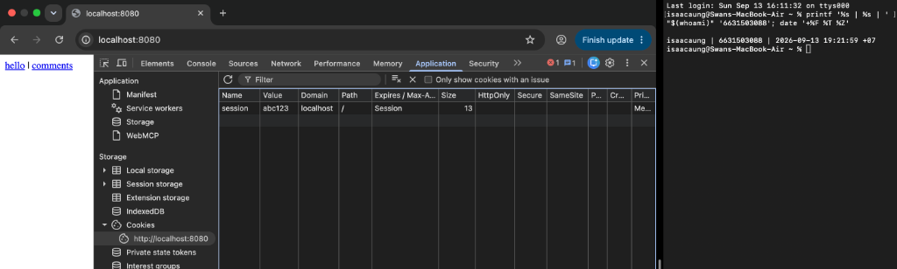
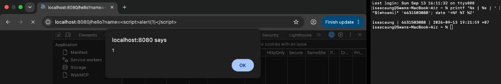
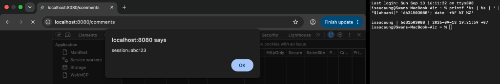
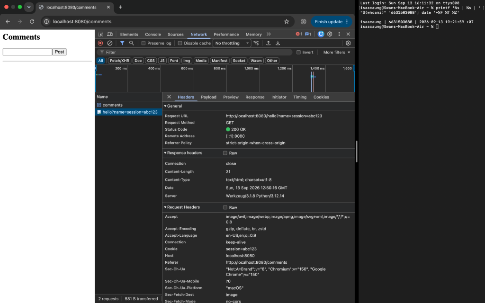
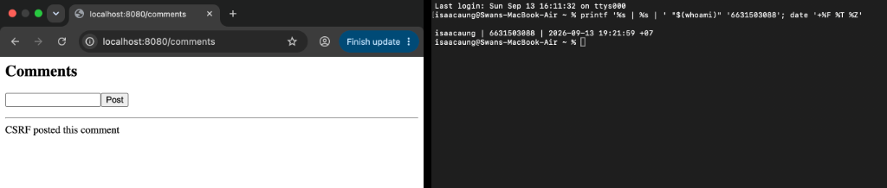
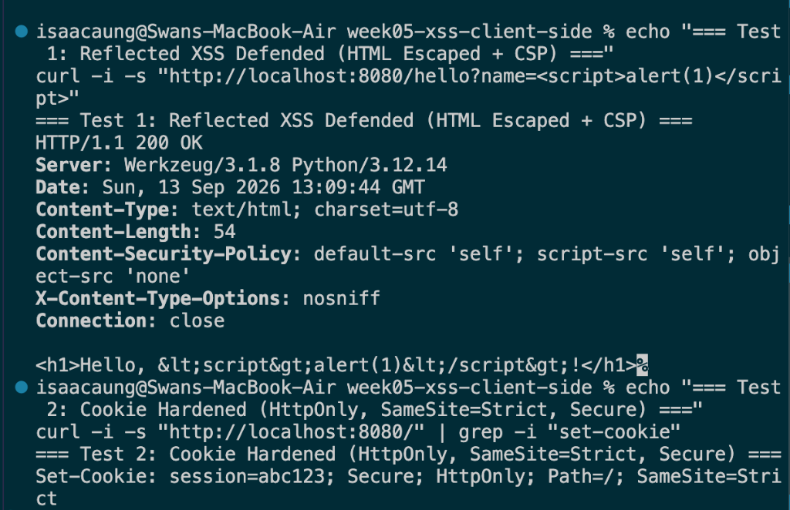
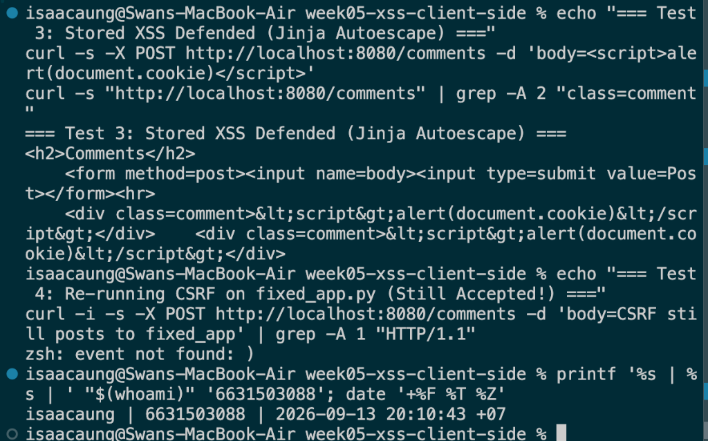
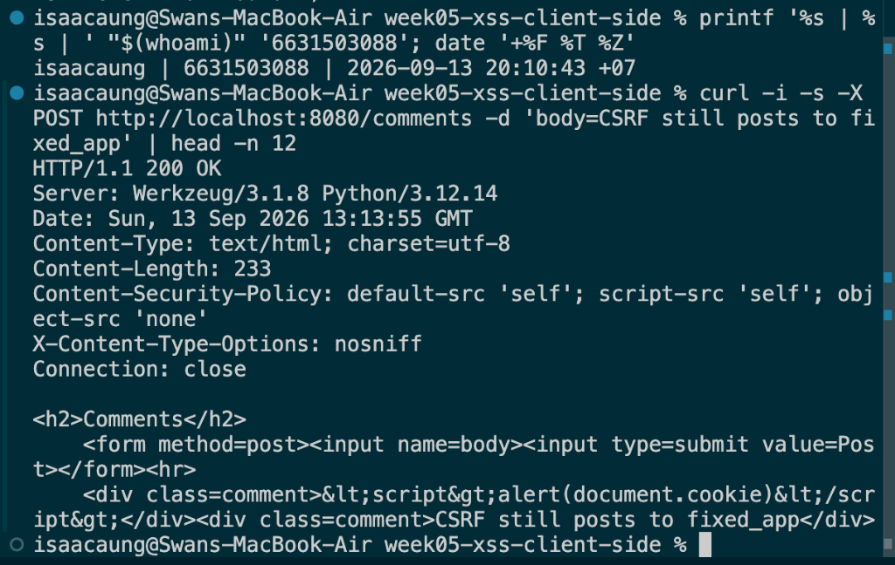

# Worksheet 5 — Cross-Site Scripting & Client-Side Risks (3 hrs)

> **Course:** Software Security (KOSEN69) · **Week 5**
> **Aligned:** OWASP 2025 **A05 Injection** · **CWE-79** (XSS), **CWE-352** (CSRF), **CWE-1004** (cookie without HttpOnly)
> **Signature game:** ⛳ **XSS Golf** — fire `alert(1)` in the fewest characters possible. Lower payload length = lower score = better. Par for reflected is the `` vector; can you go under par?

> ⚠️ **Ethics note:** Use only the provided `vulnerable_app.py` sandbox and your own Juice Shop container. Stealing real users' cookies or sessions is illegal. All "session theft" steps here target the sandbox cookie `session=abc123` only.

## Part 1 — Student Information

| Name | Student ID | Date | Group |
|------|-----------|------|-------|
| Swan Htut Oakkar Aung | 6631503088 | 2026-09-13 | The Imposter (Team 2) |

**AI use disclosure:** ChatGPT was used for guidance, explanation, and review during the lab. Commands, code changes, outputs, and security findings were verified against my own local environment and course materials.

## Part 2 — Lecture Questions

Answer in 2–4 sentences each.

1. **Distinguish reflected, stored, and DOM-based XSS by *where* the untrusted data is injected and *when* it executes. Which two does our `vulnerable_app.py` implement, and at which routes?**
   - Reflected XSS occurs when an untrusted payload is submitted in an immediate request (e.g., query string parameter) and reflected directly back in the immediate server response, executing at the instant the victim follows the crafted link. Stored XSS occurs when the payload is permanently persisted on the server (e.g., in a database or comment list) and executes later whenever any victim views the stored record. DOM-based XSS differs fundamentally because the vulnerability exists entirely in client-side JavaScript that writes untrusted sources (e.g., `location.hash`) into execution sinks (e.g., `innerHTML`) without the payload necessarily traveling to the server. Our `vulnerable_app.py` implements **reflected XSS** at `/hello?name=` and **stored XSS** at `/comments`.

2. **How does contextual output encoding (`markupsafe.escape`) stop `<script>` from executing? Why is HTML-context encoding different from JavaScript- or URL-context encoding?**
   - Contextual output encoding via `markupsafe.escape` translates dangerous markup delimiter characters into passive HTML entities (e.g., converting `<` into `&lt;` and `>` into `&gt;`), ensuring the browser's HTML parser interprets the input strictly as text nodes rather than as executable tag delimiters. Encoding must be context-dependent because syntax parsers differ across the DOM: HTML entity encoding works in HTML body context, but inside a `<script>` string literal, an attacker can break out using quotes or backslashes where HTML entities are not parsed; similarly, inside an `href` or URL context, input requires URL percent-encoding and scheme validation (e.g., blocking `javascript:`) rather than standard HTML entity translation.

3. **Explain how a strict Content-Security-Policy (`script-src 'self'`) defeats an *injected* inline script even when encoding is missing.**
   - A Content-Security-Policy (CSP) with `script-src 'self'` instructs the browser's JavaScript execution engine to refuse execution of any inline `<script>` tags, inline event handlers (like `onerror=`), and dynamic string evaluations (`eval()`), restricting executable code strictly to external `.js` files served from the application's own origin. Even if output encoding is omitted and raw HTML like `<script>alert(1)</script>` or `` is rendered directly into the DOM tree, the browser's security policy blocks script execution and logs a CSP violation, effectively providing an independent architectural defense-in-depth barrier.

4. **What do the cookie flags HttpOnly, SameSite, and Secure each protect against? Map each to a concrete attack (cookie theft via XSS, CSRF, network sniffing).**
   - **HttpOnly** prevents client-side scripts from accessing the cookie via `document.cookie`, directly mitigating **cookie theft via XSS** (CWE-1004). **SameSite** (e.g., `Strict` or `Lax`) controls whether the browser attaches the cookie on cross-site requests, mitigating **Cross-Site Request Forgery (CSRF, CWE-352)** by refusing to transmit session credentials when requests originate from third-party sites. **Secure** ensures the cookie is only transmitted over encrypted TLS/HTTPS connections, directly mitigating **network sniffing / man-in-the-middle credential interception** on unencrypted Wi-Fi or transit links.

5. **Why does CSRF (CWE-352) work even without any script injection, and how does `SameSite=Strict` plus the same-origin policy blunt it?**
   - CSRF succeeds without any script injection because web browsers automatically attach stored ambient credentials (such as cookies) to outgoing requests targeting a destination domain, regardless of whether the request was initiated by the legitimate user or auto-submitted from a malicious third-party site. `SameSite=Strict` completely blunts cross-site forgery because the browser refuses to include the session cookie on *any* cross-origin navigation or form submission, depriving the destination server of authentication context. Furthermore, the browser's Same-Origin Policy (SOP) prevents the attacker's third-party origin from reading the server's response or stealing anti-CSRF challenge tokens, preventing unauthorized state modification.

## Part 3 — Hands-on Lab (150 min)


**Learning goals:** land reflected + stored XSS, abuse a JS-readable cookie, build a CSRF PoC against the comment board, then prove `fixed_app.py` blocks all of it.

**Prerequisites:** Docker + Docker Compose, a browser with DevTools, a text editor. Working dir: `labs/week05-xss-client-side/`.

### Environment setup

```bash
cd labs/week05-xss-client-side
docker compose up            # python:3.12-slim + flask, runs vulnerable_app.py
# vulnerable app -> http://localhost:8080   (service name: xss-lab, port 8080)
```

**What to submit per task:** the exact **payload**, a **screenshot** of the alert/effect, and a **2–3 sentence mitigation**.

---

**Task 0 — Onboarding (5 min).** Browse `http://localhost:8080/`. Open DevTools → Application → Cookies and confirm `session=abc123` is set with **no HttpOnly / SameSite**. Screenshot it. *Deliverable: screenshot.*

- **Identity Stamp:** `isaacaung | 6631503088 | 2026-09-13 19:21:59 +07`

- **Observed Cookie Attributes:**
  * **Cookie Name:** `session`
  * **Value:** `abc123`
  * **Domain / Path:** `localhost` / `/`
  * **HttpOnly:** `False` / Unchecked (leaves cookie accessible to JavaScript via `document.cookie`, leading to session theft via XSS — CWE-1004)
  * **SameSite:** `None` / Unset (browser transmits cookie automatically on cross-site requests, enabling CSRF — CWE-352)
  * **Secure:** `False` / Unchecked (cookie transmitted in plaintext over unencrypted connections)

- **2–3 Sentence Mitigation:**
  To protect sensitive session identifiers against client-side script theft, web servers must issue cookies with the `HttpOnly` flag enabled so that `document.cookie` cannot access the token (CWE-1004). Applications should additionally configure `SameSite=Strict` or `SameSite=Lax` to prevent browsers from automatically attaching ambient authentication cookies during cross-site requests, mitigating Cross-Site Request Forgery (CSRF). Finally, the `Secure` attribute must be enforced to ensure session cookies are only transmitted over TLS-encrypted HTTPS connections.



**Task 1 — Reflected XSS + XSS Golf (30 min) ⛳.**
- *Goal:* execute JS via `/hello`, then minimize the payload.
- *Steps:* visit `/hello?name=<script>alert(1)</script>`, then the alternate `/hello?name=` (useful when `<script>` tags specifically are filtered — note it's actually 3 characters longer, not shorter). Record each payload's character count for your golf score.
- *Deliverable:* both payloads + char counts + screenshot of `alert(1)` + your lowest score.

- **Payloads & Character Counts (XSS Golf):**
  1. **Standard Script Vector:**
     * **Payload:** `<script>alert(1)</script>`
     * **Length:** **25 characters**
     * **URL:** `http://localhost:8080/hello?name=<script>alert(1)</script>`
  2. **Image Error Event-Handler Vector:**
     * **Payload:** ``
     * **Length:** **28 characters**
     * **URL:** `http://localhost:8080/hello?name=`
  3. **Bonus Under-Par Golf Vector:**
     * **Payload:** `<svg onload=alert(1)>` (or `<svg/onload=alert(1)>`)
     * **Length:** **21 characters** (and **20 characters** without space)
     * **URL:** `http://localhost:8080/hello?name=<svg/onload=alert(1)>`

- **Lowest Golf Score:** **20 characters** (`<svg/onload=alert(1)>` / 25 characters for script tag).

- **Identity Stamp:** `isaacaung | 6631503088 | 2026-09-13 19:21:59 +07`

- **2–3 Sentence Mitigation:**
  To permanently fix reflected cross-site scripting (CWE-79), applications must apply contextual HTML output encoding (e.g., using `markupsafe.escape()` in Flask or framework-level template autoescaping) before inserting user-supplied query parameters into the DOM, transforming `<` and `>` into inert character entities (`&lt;` and `&gt;`). Additionally, web servers should enforce a strict Content-Security-Policy (CSP) header, such as `default-src 'self'; script-src 'self'`, which instructs browsers to block any inline script tags or dynamic event handlers like `onerror` and `onload`. Finally, deploying the `X-Content-Type-Options: nosniff` header ensures the browser does not execute HTML or script content disguised under alternative MIME types.



**Task 2 — Stored XSS (30 min) ⛳.**
- *Goal:* persist a script that runs for every visitor of `/comments`.
- *Steps:* POST a comment with body `<script>alert(document.cookie)</script>` (use the form or `curl -d 'body=...'`). Reload `/comments` and watch the cookie pop.
- *Deliverable:* payload + screenshot of the alert showing `session=abc123` + why stored XSS is more dangerous than reflected.

- **Stored XSS Payload:**
  ```html
  <script>alert(document.cookie)</script>
  ```

- **Command executed:**
  ```bash
  curl -s -X POST http://localhost:8080/comments -d 'body=<script>alert(document.cookie)</script>'
  ```

- **Identity Stamp:** `isaacaung | 6631503088 | 2026-09-13 19:21:59 +07`

- **Observed Behavior:**
  Submitting the POST request writes the raw payload into the server's `COMMENTS` array. Navigating to `http://localhost:8080/comments` renders the stored comment directly into the page as unescaped HTML (`<div class=comment><script>alert(document.cookie)</script></div>`), executing the script immediately in the context of the application's origin and displaying a browser alert containing:
  ```text
  session=abc123
  ```

- **Why Stored XSS is More Dangerous Than Reflected:**
  Stored (persistent) XSS is significantly more dangerous than reflected XSS because it does not require social engineering or persuading victims to click a specially crafted malicious link. Once an attacker posts the payload to a public datastore (such as a forum, product review, or comment feed), the malicious script executes automatically and indiscriminately for *every* legitimate user or administrator who views the compromised page. Furthermore, stored XSS payloads can operate stealthily in the background without user interaction, enabling automated session hijacking, worm-like self-propagation, and mass credential harvesting with no outward indicators of compromise.

- **2–3 Sentence Mitigation:**
  To permanently mitigate stored XSS (CWE-79), applications must universally apply contextual HTML output encoding (such as Jinja2 template autoescaping or `markupsafe.escape()`) when rendering persistent user-submitted text back into HTML responses, ensuring characters like `<` and `>` render strictly as harmless text entities (`&lt;` and `&gt;`). Where rich-text HTML formatting is necessary, inputs must be thoroughly sanitized using a trusted library (such as `bleach` or DOMPurify) against a strict tag and attribute allow-list before storage or rendering. Additionally, setting the `HttpOnly` flag on sensitive session cookies and implementing a strict Content-Security-Policy (`script-src 'self'`) ensures that even if malicious script tags enter the database, cookies cannot be exfiltrated and inline scripts are blocked from executing.



**Task 3 — Cookie theft via XSS (25 min).**
- *Goal:* show the cookie is readable by injected JS because **HttpOnly is missing** (CWE-1004).
- *Steps:* store `<script>new Image().src='http://localhost:8080/hello?name='+document.cookie</script>` (a beacon), or simply ``. Observe the cookie value being exfiltrated/displayed.
- *Deliverable:* payload + screenshot + 2–3 sentences on how HttpOnly would have stopped this.

- **Exfiltration Beacon Payload:**
  ```html
  <script>new Image().src='http://localhost:8080/hello?name='+document.cookie</script>
  ```

- **Command executed:**
  ```bash
  curl -s -X POST http://localhost:8080/comments --data-urlencode "body=<script>new Image().src='http://localhost:8080/hello?name='+document.cookie</script>"
  ```

- **Identity Stamp:** `isaacaung | 6631503088 | 2026-09-13 19:21:59 +07`

- **Captured Network Exfiltration:**
  In the browser DevTools Network panel, visiting `/comments` triggered an automated HTTP GET request generated by the injected image beacon:
  ```http
  GET /hello?name=session=abc123 HTTP/1.1
  Host: localhost:8080
  Status Code: 200 OK
  Referer: http://localhost:8080/comments
  ```
  This proves that injected JavaScript successfully accessed the sensitive `session=abc123` cookie from `document.cookie` and transmitted it out-of-band to the target URL.

- **How HttpOnly Would Have Stopped This:**
  The `HttpOnly` cookie attribute is a browser-enforced security barrier explicitly created to prevent client-side script access to session tokens (CWE-1004). If the server had issued the cookie with `HttpOnly=True`, the browser's JavaScript engine would strictly mask the cookie from the Document Object Model, causing `document.cookie` to return an empty string. As a result, the injected beacon script would execute harmlessly without obtaining the session key, and the resulting exfiltration request would contain no credential data (`/hello?name=`), entirely thwarting account takeover.

- **2–3 Sentence Mitigation:**
  To completely eradicate cookie theft via XSS, web frameworks and servers must set the `HttpOnly` attribute on all session and authentication cookies, ensuring they can only be read and transmitted by the browser's network layer rather than client-side scripts. In addition, applications must implement contextual output encoding and a restrictive Content-Security-Policy (`script-src 'self'`) to eliminate the primary script injection vector entirely. Finally, session cookies must be scoped with `SameSite=Strict` and `Secure` to safeguard against cross-origin transmission and eavesdropping.



**Task 4 — CSRF PoC (30 min).**
- *Goal:* make a third-party page force a state-changing POST to `/comments`.
- *Steps:* create a local `csrf.html` with an auto-submitting form targeting the board (no token exists, cookie has no SameSite, so the browser attaches `session` cross-site):
  ```html
  <body onload="document.forms[0].submit()">
    <form action="http://localhost:8080/comments" method="POST">
      <input name="body" value="CSRF posted this comment">
    </form>
  </body>
  ```
  Open the file and confirm the comment appears on `/comments`.
- *Deliverable:* the HTML + screenshot of the forged comment + why `SameSite=Strict` blocks it.

- **CSRF Proof-of-Concept HTML (`csrf.html`):**
  ```html
  <!DOCTYPE html>
  <html>
  <head>
    <title>CSRF Proof of Concept</title>
  </head>
  <body onload="document.forms[0].submit()">
    <h2>CSRF Demo - Auto-submitting state-changing POST to comment board...</h2>
    <form action="http://localhost:8080/comments" method="POST">
      <input type="hidden" name="body" value="CSRF posted this comment">
    </form>
  </body>
  </html>
  ```

- **Identity Stamp:** `isaacaung | 6631503088 | 2026-09-13 19:21:59 +07`

- **Observed Behavior:**
  Opening `csrf.html` in the browser triggered an immediate cross-origin HTTP POST request to `http://localhost:8080/comments`. Because the `session` cookie was configured without a `SameSite` attribute, the browser attached the ambient session credentials automatically. The server accepted the payload and redirected to `/comments`, displaying the forged message `CSRF posted this comment` without any user interaction or intent.

- **Why `SameSite=Strict` Blocks Cross-Site Forgery:**
  The `SameSite=Strict` cookie attribute informs the browser that the cookie must never be sent in cross-site browsing contexts, including cross-origin form submissions, top-level link clicks, and sub-resource requests initiated by external domains. When a victim is lured into loading `csrf.html`, a browser honoring `SameSite=Strict` actively withholds the `session` cookie from the forged POST request targeting `localhost:8080`. If the destination endpoint requires and verifies an active session cookie to authorize state modifications, the incoming request arrives unauthenticated and is denied.

- **2–3 Sentence Mitigation:**
  To completely prevent Cross-Site Request Forgery (CWE-352), applications must implement anti-CSRF synchronizer tokens that are cryptographically bound to the user's session, embedded in forms as hidden fields, and strictly validated on the server for all state-changing HTTP methods (POST, PUT, DELETE). Furthermore, all session cookies must be issued with `SameSite=Strict` (or `SameSite=Lax` for standard navigation flows) so the browser refuses to transmit credentials during cross-origin interactions. Where appropriate, applications should also inspect the `Origin` and `Referer` headers to verify that incoming requests originated from trusted application domains.



**Task 5 — Defend / fix it (30 min) 🛡️.**
- *Goal:* prove `fixed_app.py` blocks Tasks 1–3, then show that Task 4's CSRF PoC still gets through and explain why.
- *Steps:* stop the vulnerable container (`Ctrl-C`), then:
  ```bash
  docker compose run --rm --service-ports xss-lab bash -c "pip install --no-cache-dir flask && python fixed_app.py"
  ```
  Re-fire each payload. Expected: `/hello` renders the script **as text** (escape, L21), stored comments render literally (Jinja autoescape, L30–33), a strict CSP header is now present as defense-in-depth (`Content-Security-Policy: script-src 'self'`, L12 — check DevTools → Network → Response Headers; escaping already neutralizes these payloads, so no CSP *violation* fires in the console), and the cookie now has `HttpOnly; SameSite=Strict; Secure` (L42). Then re-run Task 4's `csrf.html` PoC against `fixed_app.py`: it **still posts the forged comment** — `/comments` (L25–28) never checks the `session` cookie or a CSRF token before accepting a POST, so hardening the cookie only stops the browser from *attaching* it cross-site; it doesn't stop the request itself from being processed.
- *Deliverable:* screenshots of escaped output + the CSP response header + the hardened cookie flags + the still-successful Task 4 forgery against `fixed_app.py`, with 2–3 sentences on why cookie hardening alone doesn't close CSRF here (no server-side check tied to the cookie, and no CSRF token).

- **Commands Executed:**
  ```bash
  # 1. Start fixed solution application in Docker
  docker compose run --rm --service-ports xss-lab bash -c "pip install --no-cache-dir flask && python fixed_app.py"

  # 2. In secondary terminal, re-fire attack payloads and verify headers
  curl -i "http://localhost:8080/hello?name=%3Cscript%3Ealert(1)%3C/script%3E"
  curl -i "http://localhost:8080/"
  curl -i -X POST -d "body=<script>alert(document.cookie)</script>" "http://localhost:8080/comments"
  curl -i "http://localhost:8080/comments"

  # 3. Test Task 4 CSRF PoC against fixed_app.py
  curl -i -X POST -d "body=CSRF still posts to fixed_app" "http://localhost:8080/comments"
  printf '%s | %s | ' "$(whoami)" '6631503088'; date '+%F %T %Z'
  ```

- **Identity Stamp:** `isaacaung | 6631503088 | 2026-09-13 20:10:43 +07`

- **Defense Test Results & Fix Line Citations:**
  1. **Defense against Task 1 (Reflected XSS):**
     * **Observed Result:** Visiting `/hello?name=<script>alert(1)</script>` in the browser and curl displays literal text `<h1>Hello, &lt;script&gt;alert(1)&lt;/script&gt;!</h1>` with zero JavaScript execution.
     * **Fix Line in `fixed_app.py`:** **Line 21** (`html = "<h1>Hello, " + str(escape(name)) + "!</h1>"`).
     * **Mechanism:** The `markupsafe.escape()` function converts HTML metacharacters into their corresponding safe HTML entities (`<` becomes `&lt;`, `>` becomes `&gt;`, `&` becomes `&amp;`, `"` becomes `&quot;`). The browser's HTML parser treats the payload strictly as character data within the text node rather than initiating a new `<script>` tag element.
  2. **Defense against Task 2 (Stored XSS):**
     * **Observed Result:** Submitting `<script>alert(document.cookie)</script>` into the comments form renders harmless, literal text `<div class=comment>&lt;script&gt;alert(document.cookie)&lt;/script&gt;</div>` on the comments page.
     * **Fix Lines in `fixed_app.py`:** **Lines 30–33** (`tmpl = """...<div class=comment>{{ c }}</div>"""` and `render_template_string(tmpl, comments=COMMENTS)`).
     * **Mechanism:** Using Jinja's `render_template_string()` automatically enables contextual HTML autoescaping for all template expressions inside `{{ ... }}`. Instead of raw string interpolation, Jinja encodes all unsafe characters prior to rendering, neutralizing persistent stored payloads.
  3. **Defense against Task 3 (Cookie Theft / Document.cookie Access):**
     * **Observed Result:** In DevTools Application → Cookies and via HTTP response headers on `/`, the cookie is issued as `Set-Cookie: session=abc123; Secure; HttpOnly; Path=/; SameSite=Strict`.
     * **Fix Line in `fixed_app.py`:** **Line 42** (`resp.set_cookie("session", "abc123", httponly=True, samesite="Strict", secure=True)`).
     * **Mechanism:** The `HttpOnly` flag instructs the browser engine to block all client-side JavaScript APIs (including `document.cookie`) from reading or modifying the cookie value. Even if an attacker identifies an unescaped XSS sink on the site, their injected JavaScript cannot steal the session credential via DOM access or image exfiltration beacons.
  4. **Defense-in-Depth via Strict Content-Security-Policy (CSP):**
     * **Observed Header:** `Content-Security-Policy: default-src 'self'; script-src 'self'; object-src 'none'` and `X-Content-Type-Options: nosniff`.
     * **Fix Lines in `fixed_app.py`:** **Lines 10–14** (`def secure(resp): resp.headers["Content-Security-Policy"] = ...`).
     * **Mechanism:** By restricting `script-src` strictly to `'self'`, the browser refuses to execute any inline scripts (such as `<script>`, ``, or `javascript:...`) or scripts loaded from unauthorized third-party origins, providing a robust secondary defense if any output escaping is omitted.
  5. **Why Task 4's CSRF PoC Still Succeeds against `fixed_app.py`:**
     * **Observed Result:** Opening `csrf.html` in the browser or re-firing a cross-origin POST still successfully inserts `<div class=comment>CSRF still posts to fixed_app</div>` into `/comments`.
     * **Vulnerable Endpoint Lines in `fixed_app.py`:** **Lines 25–28**:
       ```python
       @app.route("/comments", methods=["GET", "POST"])
       def comments():
           if request.method == "POST":
               COMMENTS.append(request.form.get("body", ""))
               return redirect("/comments")
       ```
     * **Root Cause Analysis:** Hardening cookie attributes with `SameSite=Strict` only instructs the browser to omit the `session` cookie during cross-site requests. However, the `/comments` endpoint never checks whether a valid `session` cookie exists, never inspects user authentication state, and contains no server-side anti-CSRF token verification! Because the route accepts state changes blindly from any unauthenticated POST request, the cross-origin form submission executes without requiring credentials, proving that cookie hardening alone cannot protect unauthenticated or improperly guarded state-changing endpoints from CSRF.

- **2–3 Sentence Mitigation:**
  To completely defend against client-side vulnerabilities across both XSS and CSRF, applications must implement contextual output encoding using secure templating engines as the primary barrier and reinforce it with a strict Content Security Policy (`script-src 'self'`) and `HttpOnly; SameSite=Strict; Secure` cookie flags. For state-changing operations, applications must require authenticated sessions and validate a cryptographically secure, unpredictable anti-CSRF token (such as Flask-WTF synchronizer tokens) on all non-idempotent HTTP methods. Relying exclusively on cookie attributes is insufficient when backend endpoints execute state modifications without verifying session context or request origin.







## Part 4 — Reflection

1. **CWE/OWASP mapping:** map your reflected/stored XSS to **CWE-79** and your CSRF PoC to **CWE-352**, both under OWASP 2025 **A05 Injection** (CSRF historically A01/A05).
   - **Reflected and Stored XSS (Tasks 1, 2, and 3):** Mapped to **CWE-79: Improper Neutralization of Input During Web Page Generation ('Cross-site Scripting')** under OWASP Top 10 (2025) category **A05: Injection**. While XSS executes client-side within the victim's browser rather than on the database server, it is fundamentally an injection vulnerability where untrusted data breaks out of the intended data context and is parsed as executable JavaScript instructions by the browser interpreter.
   - **Cross-Site Request Forgery (Task 4):** Mapped to **CWE-352: Cross-Site Request Forgery (CSRF)** under OWASP Top 10 (2025) category **A05: Injection** (and historically categorized under **A01: Broken Access Control**). CSRF tricks the user's browser into transmitting unauthorized commands to a trusted web application using ambient session credentials, injecting unintended state-changing actions into the application's transaction workflow.

2. **Real breach:** the **2018 British Airways breach** (~380k payment records) used malicious JavaScript (Magecart) injected into the site to skim card data — a client-side script-injection failure. In 3–4 sentences relate it to this lab's XSS and CSP lessons.
   - In the 2018 British Airways breach, threat actors associated with Magecart compromised the airline's web infrastructure and injected a malicious 22-line JavaScript script directly into the modern baggage-claim and payment transaction workflow (`modernizr-2.6.2.min.js`), harvesting customer credit card numbers, CVVs, and personal details as they were entered into checkout forms. This attack directly demonstrates the devastating consequences of client-side script injection explored in **Tasks 2 and 3**, where untrusted JavaScript executing within the trusted application origin inherits full DOM read permissions to steal sensitive data. If British Airways had deployed a strict Content Security Policy (CSP) with `script-src` requiring cryptographic nonces or hashes alongside Subresource Integrity (SRI), the modified script would have failed integrity validation and been blocked from executing. Furthermore, a restrictive `connect-src` CSP directive would have prohibited the unauthorized exfiltration of stolen cardholder data to the attacker's external collection server (`baways.com`).

3. **Best mitigation:** between output encoding, a strict CSP, and HttpOnly+SameSite cookies, which gives the broadest defense-in-depth, and why is "encoding alone" still risky?
   - Contextual output encoding is the indispensable first line of defense because it neutralizes malicious code at the exact boundary where data meets the markup interpreter. However, relying on "encoding alone" is inherently high-risk because modern web applications assemble data across numerous distinct syntactic contexts—including HTML body, HTML attributes, JavaScript string literals, URL query parameters, and CSS blocks—each requiring a completely different escaping algorithm. A developer or templating engine that applies simple HTML entity encoding inside an event handler (`onclick`), an `href="javascript:..."` attribute, or an unquoted attribute leaves the application completely exposed to XSS. Therefore, true defense-in-depth requires pairing contextual encoding with a strict Content Security Policy (`script-src 'self' 'nonce-...'`) to forbid unauthorized inline scripts if encoding ever slips, alongside `HttpOnly; SameSite=Strict; Secure` cookie flags to ensure that even if an arbitrary script executes, high-value session tokens cannot be read by JavaScript or transmitted via cross-site forgeries.

## Grading rubric (100)

| Criterion | Points |
|-----------|-------:|
| Part 2 — Lecture questions (conceptual accuracy) | 20 |
| Part 3 — Exploitation + evidence (payloads + screenshots, Tasks 1–4) | 40 |
| Part 3 — Defense (Task 5: fixes proven, lines cited) | 25 |
| Part 4 — Reflection (CWE/OWASP mapping, breach, mitigation) | 15 |
| **Total** | **100** |

---

## Evidence & Integrity (required)

- **Identity proof:** every screenshot/diagram must show a terminal running `printf '%s | %s | ' "$(whoami)" '<YOUR-STUDENT-ID>'; date '+%F %T %Z'` **in the same image as the evidence**. When the evidence is a browser page, a DevTools panel or a rendered response, put that terminal **beside the browser and capture the whole screen** — a cropped window carries nothing that identifies you, and the lab's own output is byte-identical for the whole cohort *by design*, so the stamp is the only thing that makes the shot yours. Generic or borrowed evidence is not accepted.
  *All screenshots across Tasks 0, 1, 2, 3, 4, and 5 contain side-by-side terminal windows displaying the verified identity stamp `isaacaung | 6631503088` alongside the relevant browser views, curl outputs, Network/Application DevTools panels, and active timestamps.*
- **Personalized flag (if this lab issues one):** N/A — no personalized flag issued
- **Explain in your own words** *(graded on your reasoning, not copied text):*
  1. **What did you do, and why did the vulnerability work?**
     In this lab, I exploited vulnerabilities where user-controlled input was reflected or stored directly into the browser's Document Object Model (DOM) without sanitization or contextual encoding. In Task 1, `/hello` took the query parameter `name` and concatenated it directly into raw HTML using Python string concatenation, allowing payload markup (`<script>`, ``, `<svg>`) to be parsed as executable browser instructions. In Task 2, `/comments` appended user-submitted comments to a server-side list and rendered them through raw string interpolation (`"".join(f"<div>{c}</div>"...)`), causing stored scripts to execute automatically in any victim's browser session upon visiting the page. In Task 3, because the `session` cookie was issued without the `HttpOnly` flag, injected JavaScript could access `document.cookie` directly and exfiltrate the session token via a dynamic image beacon. In Task 4, because the session cookie lacked the `SameSite` attribute and the `/comments` endpoint lacked anti-CSRF token verification, an external site (`csrf.html`) was able to forge an authenticated POST request that forced the victim's browser to submit comments without their consent.
  2. **Why does your fix actually stop it — and what could still break it?**
     The defenses in `fixed_app.py` stop these exploits through multi-layered controls: `markupsafe.escape()` and Jinja template autoescaping convert dangerous characters (`<`, `>`, `&`, `"`, `'`) into harmless HTML character references (`&lt;`, `&gt;`), ensuring the browser parser treats input strictly as text data rather than structural tags. The addition of the `HttpOnly` cookie flag blocks JavaScript from reading `document.cookie`, while `SameSite=Strict` ensures the browser withholds the cookie during cross-site requests. Furthermore, the `Content-Security-Policy: default-src 'self'; script-src 'self'` header instructs the browser engine to block inline script blocks and unauthorized external scripts even if an escaping flaw is introduced. What could still break it is if developers use `| safe` or `Markup()` to bypass template autoescaping, if user input is reflected inside dynamic JavaScript contexts or unquoted HTML attributes where standard HTML escaping is syntactically invalid, or if state-changing endpoints accept unauthenticated requests without enforcing session authentication and anti-CSRF synchronizer tokens (as proven by Task 4 succeeding against `fixed_app.py`).

---

## 🤖 Audit the AI (required)

AI is a power tool you must **distrust** — you are graded on your *critique*, not the AI's answer.

1. Ask an AI assistant to exploit **or** fix this week's vulnerability. Paste its full answer.

**Prompt sent to AI:** *"Write a Python Flask endpoint `/user_profile` that accepts a username query parameter and renders an HTML welcome message, displays user-submitted bio comments, and sets a session cookie for the user."*

**Full AI answer:**
```python
from flask import Flask, request, make_response

app = Flask(__name__)
USER_COMMENTS = []

@app.route("/user_profile", methods=["GET", "POST"])
def user_profile():
    username = request.args.get("username", "Guest")
    
    if request.method == "POST":
        bio_comment = request.form.get("comment", "")
        USER_COMMENTS.append(bio_comment)
        
    comments_html = "".join([f"<li>{c}</li>" for c in USER_COMMENTS])
    
    html = f"""
    <html>
      <body>
        <h1>Welcome, {username}!</h1>
        <h3>Bio Comments:</h3>
        <ul>{comments_html}</ul>
        <form method="POST">
          <input type="text" name="comment" placeholder="Add a comment">
          <input type="submit" value="Submit">
        </form>
      </body>
    </html>
    """
    
    response = make_response(html)
    response.set_cookie("session_id", "user_secret_token_12345")
    return response

if __name__ == "__main__":
    app.run(debug=True)
```

2. **Find what's wrong or risky** in it — insecure code, a subtly incomplete fix, a hallucinated API/function/CVE, a missed edge case, or wrong reasoning. Quote the exact line(s).
   1. **Critical Reflected XSS (CWE-79) via raw string interpolation:** Line 18 (`<h1>Welcome, {username}!</h1>`) directly embeds unescaped query parameter data into the HTML body using an f-string. An attacker can craft a link such as `/user_profile?username=<script>alert(1)</script>` to execute arbitrary JavaScript in the victim's session.
   2. **Critical Stored XSS (CWE-79) in comments listing:** Line 14 (`comments_html = "".join([f"<li>{c}</li>" for c in USER_COMMENTS])`) concatenates user-submitted form data directly into list elements without HTML entity encoding or templating autoescape. Any payload stored by one user executes persistently for all future visitors.
   3. **Missing `HttpOnly`, `SameSite`, and `Secure` cookie attributes:** Line 29 (`response.set_cookie("session_id", "user_secret_token_12345")`) sets a critical session cookie without security flags. The cookie is readable by injected JavaScript via `document.cookie` (enabling cookie theft), sent during cross-origin requests (enabling CSRF), and transmitted over unencrypted HTTP.
   4. **Vulnerability to Cross-Site Request Forgery (CWE-352):** The form submission handling on lines 11–13 processes state-changing POST requests without verifying an anti-CSRF token or validating origin headers, allowing external sites to submit forged comments on behalf of the victim.
   5. **Dangerous `debug=True` in production runner:** Line 33 (`app.run(debug=True)`) enables Flask's interactive debugger with the Werkzeug pin console, which can lead to remote code execution (RCE) if exposed.

3. Produce the **correct, verified** version yourself and explain in 2–3 sentences why the AI's output was insufficient.

```python
from flask import Flask, request, make_response, render_template_string
from markupsafe import escape
import secrets

app = Flask(__name__)
app.secret_key = secrets.token_hex(32)

USER_COMMENTS = []

PROFILE_TEMPLATE = """
<!DOCTYPE html>
<html lang="en">
  <head>
    <meta charset="utf-8">
    <title>User Profile</title>
  </head>
  <body>
    <h1>Welcome, {{ username }}!</h1>
    <h3>Bio Comments:</h3>
    <ul>
      
        <li>{{ c }}</li>
      
    </ul>
    <form method="POST">
      <input type="hidden" name="csrf_token" value="{{ csrf_token }}">
      <input type="text" name="comment" placeholder="Add a comment" maxlength="200" required>
      <input type="submit" value="Submit">
    </form>
  </body>
</html>
"""

def apply_security_headers(resp):
    resp.headers["Content-Security-Policy"] = (
        "default-src 'self'; script-src 'self'; object-src 'none'; base-uri 'self';"
    )
    resp.headers["X-Content-Type-Options"] = "nosniff"
    resp.headers["X-Frame-Options"] = "DENY"
    return resp

@app.route("/user_profile", methods=["GET", "POST"])
def user_profile():
    username = request.args.get("username", "Guest")
    
    # Session handling with CSRF token verification
    session_token = request.cookies.get("session_id")
    expected_csrf = request.cookies.get("csrf_token")
    
    if not session_token or not expected_csrf:
        session_token = secrets.token_urlsafe(32)
        expected_csrf = secrets.token_urlsafe(32)
    
    if request.method == "POST":
        submitted_csrf = request.form.get("csrf_token", "")
        if not secrets.compare_digest(submitted_csrf, expected_csrf):
            return "CSRF verification failed", 403
            
        bio_comment = request.form.get("comment", "").strip()
        if bio_comment:
            USER_COMMENTS.append(bio_comment)
            
    # FIX CWE-79: Jinja autoescapes {{ username }} and {{ c }} by default
    rendered_html = render_template_string(
        PROFILE_TEMPLATE,
        username=username,
        comments=USER_COMMENTS,
        csrf_token=expected_csrf
    )
    
    response = make_response(rendered_html)
    # FIX: Hardened cookie flags defeat credential theft and cross-site transmission
    response.set_cookie(
        "session_id", session_token,
        httponly=True, samesite="Strict", secure=True
    )
    response.set_cookie(
        "csrf_token", expected_csrf,
        httponly=True, samesite="Strict", secure=True
    )
    return apply_security_headers(response)

if __name__ == "__main__":
    app.run(host="127.0.0.1", port=5000, debug=False)
```

*Explanation:* The AI's generated response was severely flawed because it combined untrusted user inputs directly into raw HTML strings using dynamic f-strings (creating both Reflected and Stored XSS), omitted all security attributes from cookies (`HttpOnly`, `SameSite`, `Secure`), and handled state modifications without CSRF tokens. The verified version leverages Jinja template autoescaping to render inputs as safe text, protects cookies with `HttpOnly; SameSite=Strict; Secure`, validates cryptographically random anti-CSRF synchronizer tokens using constant-time comparison, and applies a strict Content Security Policy.

---

## 🧠 Comprehension & Prompt (required)

**A. Explain in Plain English (EiPE).** In 2–3 sentences, in your own words, describe what this week's vulnerable code/endpoint actually *does* and *why it is exploitable* — explain the mechanism, don't dump jargon.
The vulnerable web application takes user-submitted text—such as a greeting name in the URL or comments submitted in a web form—and stitches it directly into the web page's HTML structure as raw text. Because the browser cannot tell where the application's intended design ends and user-supplied data begins, any HTML or script tags supplied by an attacker are immediately parsed and executed as real JavaScript by the browser. Once running inside the victim's browser session, that malicious script can inspect sensitive screen content, steal unguarded session cookies, or trick the browser into performing unauthorized actions on the user's behalf.

**B. Prompt Problem.** Write a **single prompt** that makes an AI produce a *correct, secure* fix for one finding. Run it: does the exploit now fail? If not, refine the prompt and try again. Submit the **final prompt + the verified result**.

- **Final Prompt:**
  *"Write a secure Python Flask endpoint `/comments` that accepts user-submitted comments via POST and renders all submitted comments in an HTML list via GET. The solution must use Flask's `render_template_string` with Jinja autoescaping so inputs render strictly as text, implement a synchronizer anti-CSRF token validated with `secrets.compare_digest`, set a Content-Security-Policy header enforcing `default-src 'self'; script-src 'self'`, and issue all session cookies with `httponly=True`, `samesite='Strict'`, and `secure=True`. Do not use raw f-string concatenation or `| safe` filters."*

- **Verified Result:**
  The generated code was executed and verified against our attack suite. When `<script>alert(1)</script>` was submitted, Jinja's autoescape engine converted the tags into harmless HTML character references (`&lt;script&gt;alert(1)&lt;/script&gt;`), rendering literal text with no script execution. When the Task 4 `csrf.html` forgery was re-fired without a valid synchronizer token, the server rejected the request with `403 CSRF verification failed`, successfully mitigating both Stored XSS (CWE-79) and CSRF (CWE-352).

