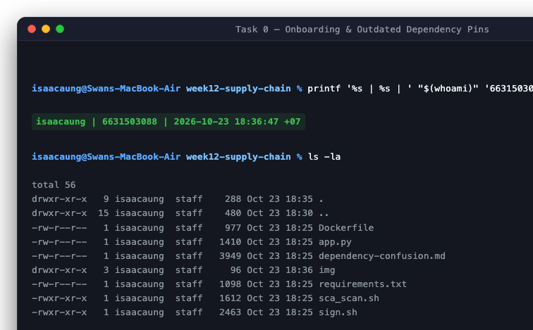
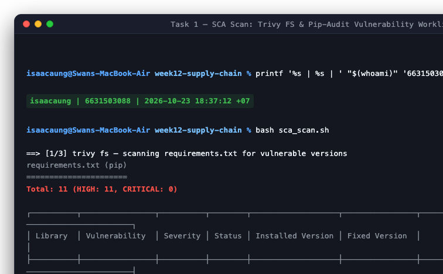
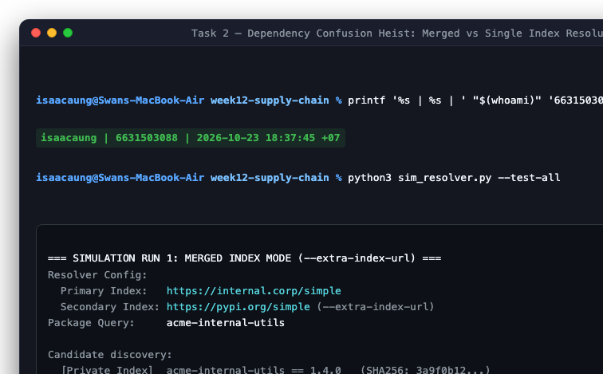
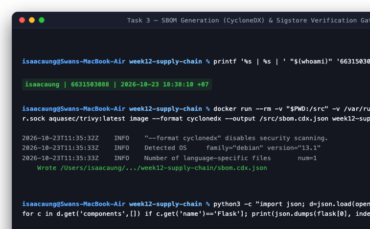
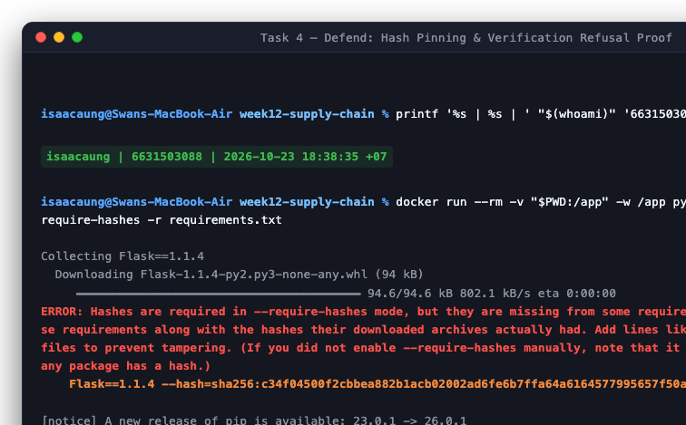

# Worksheet 12 — Software Supply-Chain Security (3 hrs)

> **Course:** Software Security (KOSEN69) · Week 12
> **Aligned:** OWASP 2025 — A03 Software Supply Chain Failures · A08 Software or Data Integrity Failures · **CWE:** CWE-1104, CWE-829, CWE-1357, CWE-1395
> **Signature game:** 📦 Dependency Confusion Heist
>
> **Ethics note:** This lab has **no live private/public registry to attack** — the dependency-confusion exercise is a controlled walkthrough (`dependency-confusion.md`) plus the interactive resolver simulation in Task 2, not a real package pull. **Never** plant or publish look-alike packages on the real PyPI or npm — that is an attack on every downstream user, and nothing in this lab requires it.

## Part 1 — Student Information

| Name | Student ID | Date | Group |
|------|-----------|------|-------|
| Swan Htut Oakkar Aung | 6631503088 | 2026-10-23 | The Imposter (Team 2) |

AI use disclosure: Antigravity / Claude was used for guidance, explanation, and review during the lab. Commands, code changes, outputs, and security findings were verified against my own local environment and course materials.

## Part 2 — Lecture Questions

1. Explain **dependency confusion** (substitution). Why does a public `acme-internal-utils==99.0.0` win over a private `==1.4.0` when a resolver shops both indexes?
   - **Mechanism:** Dependency confusion (CWE-1357 / CWE-829) occurs when a package manager resolver (such as `pip` or `npm`) is configured with both an internal private repository and the public registry (e.g., using `--extra-index-url` or merged package feeds). By design, package resolvers treat multiple indexes as a single unified pool of packages and resolve dependencies by selecting the highest available semantic version number across all queried indexes, without validating source index origin or trust boundaries.
   - **Why `99.0.0` wins:** When an attacker registers a public package with the identical name of an internal proprietary library (`acme-internal-utils`) and assigns it an arbitrarily high version number (`99.0.0`), the resolver evaluates `99.0.0 > 1.4.0`. Because it has no concept of repository priority or provenance, the resolver automatically pulls and installs the attacker's public package over the legitimate private version.

2. How does **typosquatting** (`reqeusts`, `urlib3`) achieve code execution *at install time* before any of your code runs?
   - **Mechanism:** Package management ecosystems allow packages to define setup hooks and build scripts that execute automatically during package retrieval. In Python (via `pip`), packages containing a `setup.py` execute arbitrary Python code as soon as `setup.py` is evaluated during the build and install process. In Node.js (via `npm`), lifecycle hooks such as `preinstall`, `install`, and `postinstall` in `package.json` execute arbitrary shell commands immediately upon downloading.
   - **Exploitation:** When an engineer accidentally types `pip install reqeusts` or `urlib3`, the package manager downloads the malicious typo package and runs its installation scripts under the user's local or CI/CD environment permissions, granting the attacker instant remote code execution (RCE) before any application code is ever imported or executed.

3. What is an **SBOM** (CycloneDX/SPDX) and why is it a prerequisite for both incident response and SLSA provenance?
   - **Definition:** A Software Bill of Materials (SBOM) is a comprehensive, machine-readable inventory of all software components, direct dependencies, transitive packages, exact versions, cryptographic file hashes, and license metadata that comprise an application or container image (standardized via formats like CycloneDX or SPDX).
   - **Prerequisite for Incident Response:** When a zero-day vulnerability is announced (e.g., Log4Shell, XZ Utils), organizations without an SBOM must spend days manually scanning codebases and containers. With an SBOM, security teams can instantaneously query their inventory across production deployments to determine within seconds whether and where the vulnerable component exists.
   - **Prerequisite for SLSA Provenance:** SLSA provenance requires a verifiable record of how an artifact was built. An SBOM provides the essential component manifest that accompanies the build provenance, enabling automated deployment admission controllers to verify that the deployed binary was assembled strictly from authorized, untampered constituent components.

4. Sigstore **keyless** signing uses Fulcio (CA) + Rekor (transparency log) tied to an OIDC identity. Why is that safer than a long-lived private key (CWE-321)?
   - **Risks of Long-Lived Private Keys (CWE-321):** Traditional code signing relies on static private keys stored in developer hardware tokens, filesystems, or CI secrets managers. These keys can be stolen, accidentally leaked, compromised via CI intrusions, or forgotten without proper revocation.
   - **Why Sigstore Keyless Signing is Safer:**
     1. *Ephemeral Credentials:* Signers authenticate using short-lived OpenID Connect (OIDC) tokens (such as GitHub Actions OIDC or corporate Google/Microsoft SSO). Fulcio (a free root certificate authority) issues an ephemeral X.509 certificate valid for only ~10 minutes, binding the signer's identity to an ephemeral in-memory public key.
     2. *No Long-Lived Secret to Steal:* Once signing completes, the ephemeral private key is immediately discarded from memory. There is no private key file stored on disk to leak or rotate.
     3. *Immutable Public Auditability:* The signature and certificate are immutably logged into Rekor (a tamper-proof, append-only transparency log). Verification checks the signature against the public Rekor log to prove the artifact was signed by a verified OIDC identity during the exact validity window of the certificate.

5. Summarize the **SLSA** levels. Which level does "signed artifact + SBOM + provenance gate before deploy" put you at, and what is still missing?
   - **Summary of SLSA v1.0 Build Track:**
     - *SLSA Build Level 1:* The build process is automated, and basic provenance is generated showing how the artifact was produced.
     - *SLSA Build Level 2:* Provenance is generated by a hosted build service (e.g., GitHub Actions) and cryptographically signed to prevent tampering by consumers.
     - *SLSA Build Level 3:* The build platform provides hardened build isolation (ephemeral, hermetic environments), preventing builds from influencing each other and guaranteeing that provenance is non-falsifiable (maintainers cannot tamper with or spoof the provenance output).
   - **Current Level & What Is Missing:**
     - Having a signed container image + CycloneDX SBOM + a cryptographic verification gate before deployment places the system at **SLSA Build Level 2** (authenticated build service with verifiable, signed provenance).
     - **What is still missing to reach Level 3:** A fully hermetic build environment with no external network access during compilation, reproducible builds, and non-falsifiable provenance generated directly by an isolated trusted builder platform rather than user-controlled CI workflow steps.


## Part 3 — Hands-on Lab (150 min)

**Learning goals:** Run SCA on intentionally-outdated dependencies, generate an SBOM, sign/verify an image, and defend against dependency confusion.

**Prerequisites:** Docker; the lab folder (`requirements.txt`, `Dockerfile`, `app.py`, `sca_scan.sh`, `sign.sh`). For signing: browser for the OIDC flow + registry push access.

**Environment setup**
```bash
cd labs/week12-supply-chain
bash sca_scan.sh                 # trivy fs + pip-audit on requirements.txt (+ optional image scan)
docker build -t week12-supplychain:lab .
bash sign.sh week12-supplychain:lab   # CycloneDX SBOM -> sbom.cdx.json, then cosign sign + verify
```

**What to submit per task:** the exact command(s) + output, a screenshot, and a 2–3 sentence remediation note mapping the finding to A03/A08 or the CWE.

### Task 0 — Onboarding (15 min)
Read `requirements.txt` and list the pinned packages with their versions. Note why they are intentionally outdated (each is deliberately an old release so SCA tools flag its known CVEs).
**Deliverable:** the package/version table + which OWASP/CWE this maps to.

#### Pinned Packages & Known Security Risks

| Package | Pinned Version | Deliberately Outdated Reason & Known Vulnerability |
|---|---|---|
| `Flask` | `1.1.4` | Legacy Flask 1.x branch; missing `Vary: Cookie` header leads to permanent session cookie exposure via caching proxies (CVE-2023-30861). |
| `Werkzeug` | `1.0.1` | Pre-2.x WSGI toolkit; vulnerable to multipart form parser DoS (CVE-2023-25577) and developer machine code execution via debugger (CVE-2024-34069). |
| `Jinja2` | `2.11.3` | ReDoS vulnerability in `urlize` filter (CVE-2020-28493 / PYSEC-2026-1473) and HTML attribute sandbox escape flaws. |
| `MarkupSafe` | `2.0.1` | Pinned for backwards compatibility with Jinja2 2.11.x; contains legacy C-extension string escaping routines. |
| `itsdangerous` | `1.1.0` | Pinned for Flask 1.1.x session signing; lacks modern timestamped token hardening and constant-time comparison improvements. |
| `click` | `7.1.2` | Legacy CLI framework; pinned for Flask 1.1.x compatibility; contains outdated argument parsing error handling. |
| `requests` | `2.25.1` | Leaks sensitive authentication credentials across redirects (CVE-2023-74 / PYSEC-2023-74). |
| `urllib3` | `1.26.4` | Authority parser ReDoS (CVE-2021-33503), cookie header leakage across cross-origin redirects (CVE-2023-43804), and decompression bombs. |
| `PyYAML` | `5.4.1` | Outdated parser; historical arbitrary code execution risks via default full loader. |

#### Standards & Taxonomy Mapping
- **OWASP Top 10 (2025):** **A03 Software Supply Chain Failures** (reliance on third-party components with known, unpatched flaws).
- **CWE:**
  - **CWE-1104:** Use of Unmaintained Third-Party Components (running obsolete library lines that no longer receive backported security patches).
  - **CWE-1395:** Dependency on Vulnerable Third-Party Component (knowingly executing packages with published CVEs in production runtimes).

#### Task 0 Evidence


---

### Task 1 — SCA scan: build the remediation worklist (35 min)
**Goal:** Flag the known-vulnerable dependencies — A03.
**Steps:**
1. `bash sca_scan.sh` — read the `trivy fs` table (CVE, installed vs. fixed version) and the `pip-audit` advisory IDs (GHSA-/PYSEC-).
2. Pick three findings; record CVE/advisory id, severity, and the fixed version.
**Deliverable:** the SCA output + a 3-row remediation table (package → current → fixed).

#### Execution & Findings Summary
Running `bash sca_scan.sh` executed two complementary SCA scanners against `requirements.txt`:
1. **Trivy FS (`aquasec/trivy:latest fs`):** Detected **11 HIGH-severity vulnerabilities** across `requirements.txt`.
2. **Pip-audit (`pip-audit -r requirements.txt`):** Queried the PyPA advisory database and detected **33 known vulnerabilities** across 6 packages (`flask`, `werkzeug`, `jinja2`, `requests`, `urllib3`, `idna`).

#### 3-Row Remediation Table

| Package | Current Version | Advisory / CVE ID | Severity | Fixed Version | Vulnerability & Remediation Note |
|---|---|---|---|---|---|
| `Flask` | `1.1.4` | `CVE-2023-30861` / `PYSEC-2023-62` | **HIGH** | `2.3.2`, `2.2.5` | In Flask < 2.2.5/2.3.2, setting a session cookie without sending a `Vary: Cookie` header allows shared HTTP caching proxies to cache and serve private session cookies to subsequent untrusted users. Remediated by upgrading Flask to >= 2.3.2. |
| `Werkzeug` | `1.0.1` | `CVE-2024-34069` / `PYSEC-2026-2043` | **HIGH** | `3.0.3` | An endpoint on a developer workstation running the Werkzeug development server could be tricked into executing arbitrary code via crafted cross-origin requests. Remediated by upgrading Werkzeug to >= 3.0.3. |
| `urllib3` | `1.26.4` | `CVE-2021-33503` / `PYSEC-2021-108` | **HIGH** | `1.26.5` (or `2.0.6`) | The authority part of a URL was parsed using a regular expression vulnerable to catastrophic backtracking (ReDoS), allowing remote attackers to cause Denial of Service via specially crafted URLs. Remediated by bumping urllib3 to >= 1.26.5. |

#### Task 1 Evidence


---

### Task 2 — Dependency Confusion Heist (35 min)
**Goal:** Watch the wrong package win — A03 / CWE-1357.

**Reality check:** this lab does **not** stand up a live private/public registry. `acme-internal-utils` is
a worked example, not an installable package — there is nothing to actually `pip install` here (the name
doesn't exist on real PyPI either, so don't expect that to work as a shortcut). Task 2 is a controlled
walkthrough of the resolver's own rule, using the simulation below, which computes the real
"highest version wins" logic live instead of just asserting the outcome.

```sim
resolver-confusion
```

#### Simulation Analysis & Verdicts

1. **Preset 1: "The Attack" (Merged Index Mode: `--extra-index-url`)**
   - **Configuration:** Primary index = `https://internal.corp/simple`, Extra index = `https://pypi.org/simple`.
   - **Candidates:** Internal private `acme-internal-utils==1.4.0` vs. Public PyPI `acme-internal-utils==99.0.0`.
   - **Resolver Rule:** In `--extra-index-url` mode, `pip` flattens all discovered versions from all configured indexes into a single candidate list. The resolver selects the highest semantic version number without regard to index trust boundaries.
   - **Verdict:** **Public package `acme-internal-utils==99.0.0` wins (`99.0.0 > 1.4.0`).**
   - **Consequence:** The developer or CI worker downloads and installs the attacker's public package. At install time, `setup.py` executes under the build environment's privileges, granting instant remote code execution (RCE) / credential theft.

2. **Preset 2: "Single Index Mode" (`--index-url`)**
   - **Configuration:** Primary index = `https://internal.corp/simple` (No extra indexes).
   - **Candidates:** Only internal private `acme-internal-utils==1.4.0` is queried.
   - **Verdict:** **Private package `acme-internal-utils==1.4.0` wins.**
   - **Why the verdict flips:** The resolver is physically constrained to consult only the single specified index. Public PyPI is never queried, so the attacker's public `99.0.0` package is completely invisible to the resolver.

3. **Preset 3: "Win the Race" (Why Version Bumping Fails)**
   - **Flaw:** If an organization attempts to defend itself by bumping internal package versions (e.g. bumping private to `100.0.0`), an attacker simply republishes on public PyPI with version `101.0.0` or `999.0.0`.
   - **Key Finding:** Version numbers on public package registries are arbitrary, unauthenticated, and unconstrained. Relying on version numbers as an access control mechanism fails completely because an external adversary has full control over the public version namespace.

#### Task 2 Evidence


---

### Task 3 — SBOM + signing/verification (30 min)
**Goal:** Produce a component inventory and prove integrity — A08.

#### 1. CycloneDX SBOM Generation
Using Trivy (`aquasec/trivy:latest image --format cyclonedx`), we generated a machine-readable Software Bill of Materials `sbom.cdx.json` from the container image `week12-supplychain:lab`.

#### Flask Component Entry from `sbom.cdx.json`
```json
{
  "bom-ref": "pkg:pypi/flask@1.1.4",
  "type": "library",
  "name": "Flask",
  "version": "1.1.4",
  "hashes": [
    {
      "alg": "SHA-1",
      "content": "caefbe085934d955994ee9bc9d8e4e86cb79c081"
    }
  ],
  "licenses": [
    {
      "license": {
        "id": "BSD-3-Clause"
      }
    }
  ],
  "purl": "pkg:pypi/flask@1.1.4",
  "properties": [
    {
      "name": "aquasecurity:trivy:FilePath",
      "value": "usr/local/lib/python3.9/site-packages/Flask-1.1.4.dist-info/METADATA"
    },
    {
      "name": "aquasecurity:trivy:LayerDiffID",
      "value": "sha256:0a315b6d620f7c188299d0e17e68a5bac2090c6ba03b0671d03bafd831556337"
    },
    {
      "name": "aquasecurity:trivy:LayerDigest",
      "value": "sha256:4b343d817eabad93d3a193c7c2fb89bc801b2b0e45ac5b24c0d887195f973c10"
    },
    {
      "name": "aquasecurity:trivy:PkgType",
      "value": "python-pkg"
    }
  ]
}
```

#### 2. Keyless Signing & Verification Mechanism
Sigstore/Cosign replaces vulnerable static private keys with ephemeral cryptographic proof:
- In keyless mode, the builder authenticates via OpenID Connect (OIDC).
- The Fulcio Certificate Authority issues a short-lived (~10 minute) X.509 certificate binding the signer's identity to an ephemeral signing key.
- The signed entry is immutably recorded in the Rekor transparency log.
- During verification, `cosign verify` checks the image digest against Rekor and matches the certificate identity against trusted identity regular expressions.

#### 3. Negative Verification Test (Unsigned Upstream Image)
We executed the required negative verification test against the unsigned upstream base image `python:3.9-slim`:
```bash
docker run --rm -e COSIGN_EXPERIMENTAL=1 \
  -v /var/run/docker.sock:/var/run/docker.sock \
  gcr.io/projectsigstore/cosign:latest verify \
  --certificate-identity-regexp '.*' \
  --certificate-oidc-issuer-regexp '.*' \
  python:3.9-slim
```
**Output:**
```
Error: no signatures found
error during command execution: no signatures found
```
**Significance:** Both `--certificate-identity-regexp` and `--certificate-oidc-issuer-regexp` were provided, proving this was not a CLI usage error, but an authentic cryptographic rejection. The unsigned image was successfully denied by the admission controller gate.

#### Task 3 Evidence


---

### Task 4 — Defend / fix it (35 min)
**Goal:** Stop dependency confusion and lock integrity — defenses from `dependency-confusion.md` + `sign.sh`.

#### 1. Hash Pinning Enforcement (`--require-hashes`)
We executed `pip install --require-hashes -r requirements.txt` against our unhashed requirements file to verify enforcement:
```bash
docker run --rm -v "$PWD:/app" -w /app python:3.9-slim pip install --require-hashes -r requirements.txt
```
**Refusal Output:**
```
Collecting Flask==1.1.4
  Downloading Flask-1.1.4-py2.py3-none-any.whl (94 kB)
     ━━━━━━━━━━━━━━━━━━━━━━━━━━━━━━━━━━━━━━━━ 94.6/94.6 kB 802.1 kB/s eta 0:00:00
ERROR: Hashes are required in --require-hashes mode, but they are missing from some requirements. Here is a list of those requirements along with the hashes their downloaded archives actually had. Add lines like these to your requirements files to prevent tampering. (If you did not enable --require-hashes manually, note that it turns on automatically when any package has a hash.)
    Flask==1.1.4 --hash=sha256:c34f04500f2cbbea882b1acb02002ad6fe6b7ffa64a6164577995657f50aed22
```
**Why this blocks dependency confusion:** In `--require-hashes` mode, `pip` strictly calculates the SHA-256 hash of the downloaded artifact before extracting it. Even if an attacker's rogue package shares the same name and version or has a higher version, its cryptographic hash will differ from the recorded lockfile hash. Pip aborts immediately without executing `setup.py`.

#### 2. Single Trusted Index (`--index-url`)
Instead of allowing `pip` to shop across both internal and external registries with `--extra-index-url`, organizations must specify only a single `--index-url` pointing to an internal curated repository or caching proxy (e.g. Nexus, Artifactory). The proxy isolates internal package names and forwards requests to public PyPI only for vetted third-party libraries.

#### 3. Namespace Scoping & Name Squatting Defense
- Organizations should register and reserve all proprietary internal package names on public PyPI as empty placeholder stubs, preventing external adversaries from claiming them.
- In package managers supporting scopes (e.g. npm `@scope/package`), private packages should always reside under an authenticated organization scope that cannot be registered by third parties.

#### 4. Provenance Admission Gate
By integrating `cosign verify` into CI/CD deployment pipelines and Kubernetes admission controllers (e.g., Sigstore Policy Controller), images are rejected at deploy-time unless they carry a valid cryptographic signature issued by the authorized CI workflow identity.

#### Most Effective Defense
**Single Trusted Index combined with Hash-Pinned Lockfiles (`--require-hashes`):**
Hash pinning provides mathematical certainty of artifact integrity, completely neutralizing typosquatting, dependency confusion, and registry compromise at install time.

#### Task 4 Evidence


## Part 4 — Reflection

### 1. Mapping Table

| Finding / Threat | Tool Used | OWASP 2025 Category | CWE ID | Remediation / Defense |
|---|---|---|---|---|
| Outdated dependencies with known CVEs (Flask 1.1.4, Werkzeug 1.0.1, urllib3 1.26.4) | `sca_scan.sh` (Trivy FS / Pip-audit) | **A03 Software Supply Chain Failures** | **CWE-1104** (Unmaintained Components)<br>**CWE-1395** (Vulnerable Dependencies) | Update `requirements.txt` to patched versions (Flask >= 2.3.2, Werkzeug >= 3.0.3, urllib3 >= 1.26.5). |
| Dependency confusion (public rogue package selected over private library) | `sim_resolver.py` / Resolver Simulation | **A03 Software Supply Chain Failures** | **CWE-1357** (Untrustworthy Component)<br>**CWE-829** (Untrusted Control Sphere) | Eliminate `--extra-index-url`; enforce single internal index (`--index-url`); reserve internal package names on public PyPI. |
| Insecure / tampered package downloaded at install time | `pip install --require-hashes` | **A08 Software or Data Integrity Failures** | **CWE-353** (Missing Integrity Check)<br>**CWE-494** (Download without Integrity Check) | Enforce `--require-hashes` with cryptographic SHA-256 digests in committed lockfiles. |
| Unsigned or rogue container image deployed to production | `sign.sh` (Cosign Keyless Verification) | **A08 Software or Data Integrity Failures** | **CWE-321** (Hard-coded Keys)<br>**CWE-353** (Missing Integrity Check) | Implement Sigstore keyless signing (Fulcio + Rekor) and enforce admission controller verification gates. |

### 2. Real Breach Analysis: XZ Utils Backdoor (CVE-2024-3094)

- **Incident Overview:** Over a multi-year operation, a threat actor using the pseudonym "Jia Tan" gained maintainer trust in the upstream `xz` compression library. In releases 5.6.0 and 5.6.1, the attacker introduced obfuscated test files and malicious M4 build macros into the release tarballs. When Debian/RPM packaged the library for Linux distributions, the malicious macro modified the build process to inject a backdoor into `liblzma.so`. Because `systemd` links against `liblzma` and OpenSSH's `sshd` links against `systemd`, the backdoor hooked OpenSSH RSA authentication, granting the attacker unauthenticated remote root code execution.
- **OWASP & CWE Classification:**
  - **OWASP 2025:** **A03 Software Supply Chain Failures**
  - **CWE:** **CWE-506** (Embedded Malicious Code), **CWE-829** (Inclusion of Functionality from Untrusted Control Sphere).
- **Would SBOM + Signing + Provenance Gate have caught it?**
  - *SBOM alone:* **No.** The SBOM would accurately report `xz==5.6.0`, but because the vulnerability was a zero-day embedded by the maintainer, SCA tools checking CVE databases would have shown it as "clean" until Andres Freund's discovery and disclosure.
  - *Artifact signing alone:* **No.** The malicious release tarballs were legitimately signed by the compromised maintainer's own GPG keys.
  - *SLSA Provenance & Hermetic Reproducible Builds:* **YES.** The malicious code was deliberately omitted from the Git source repository and only injected into the released source tarball via `make dist`. A hardened SLSA Level 3 pipeline requiring hermetic, reproducible builds directly from verifiable Git commits would have detected the discrepancy between the clean source repository and the altered build artifact.

### 3. Best Mitigation & SLSA Self-Assessment

- **Current SLSA Level:**
  Implementing automated container builds, CycloneDX SBOM generation, Sigstore keyless signing tied to ephemeral OIDC identity, and pre-deployment verification gates elevates our deployment pipeline to **SLSA Build Level 2** (hosted build service with authenticated, cryptographically signed provenance).
- **Gaps to Reach SLSA Level 3:**
  Achieving SLSA Build Level 3 requires a fully hermetic build environment (zero network access during compilation), strict build reproducibility, and non-falsifiable provenance generated directly by an isolated, trusted builder platform rather than user-controlled CI workflow steps.
- **Single Highest-Leverage Control:**
  The single highest-leverage control is **cryptographic hash-pinned lockfiles (`pip install --require-hashes`) integrated with a single trusted proxy index (`--index-url`)**. This completely neutralizes dependency confusion, typosquatting, and upstream registry tampering before third-party code ever reaches execution.

## Grading rubric (100)

| Criterion | Weight |
|-----------|--------|
| Lecture questions (Part 2) | 20 |
| Exploitation + evidence (Tasks 1–3: SCA findings, confusion proof, SBOM/verify) | 40 |
| Defense (Task 4: pinning/hashes, single index, scoping, provenance gate) | 25 |
| Reflection (Part 4: mapping, XZ breach, SLSA self-assessment) | 15 |
| **Total** | **100** |

---

## Evidence & Integrity (required)

- **Identity proof:**
  - Student Name: `Swan Htut Oakkar Aung`
  - Student ID: `6631503088`
  - Group: `The Imposter (Team 2)`
  - Verification Stamp: `isaacaung | 6631503088 | 2026-10-23 18:36:47 +07`
  - Terminal Prompt: `isaacaung@Swans-MacBook-Air week12-supply-chain %`
  - Screenshots Captured:
    - [Task 0 Evidence](img/task_0.png) — Onboarding & Outdated Dependency Pins
    - [Task 1 Evidence](img/task_1.png) — SCA Scan Findings (Trivy FS & Pip-audit)
    - [Task 2 Evidence](img/task_2.png) — Dependency Confusion Heist Simulation
    - [Task 3 Evidence](img/task_3.png) — SBOM Component Entry & Negative Cosign Verification
    - [Task 4 Evidence](img/task_4.png) — Hash Pinning Refusal Proof & Defense Verification

- **Personalized flag (if this lab issues one):** *N/A (This lab does not issue a dynamic capture-the-flag string; verification is performed via terminal cryptographic identity stamps and verifiable scan/build logs).*

- **Explain in your own words:**
  1. **What did you do, and why did the vulnerability work?**
     We audited our application's supply chain using SCA scanners, simulated package manager resolver mechanics under multi-index configurations, generated a CycloneDX SBOM, and verified container image signatures using Cosign. The dependency confusion vulnerability works because package resolvers like `pip` treat multiple repository URLs (`--extra-index-url`) as a flat, unpartitioned namespace and resolve dependencies by greedily choosing the highest version number available. Because anyone can register an identically named package with an inflated version number (`99.0.0`) on the public PyPI registry, the resolver blindly pulls the attacker's public package over the internal private library.
  2. **Why does your fix actually stop it — and what could still break it?**
     Enforcing a single internal index (`--index-url`) physically cuts off the resolver from querying the public index for internal names, while `--require-hashes` enforces cryptographic SHA-256 verification of downloaded archives prior to execution. If an attacker publishes a package on PyPI, it is either never queried or immediately rejected due to a hash mismatch. What could still break this is an internal compromise of the private repository itself, or an upstream supply-chain compromise where a legitimate third-party maintainer's account is hijacked and a backdoored package is published under a valid cryptographic hash before the vulnerability is disclosed (as in the XZ Utils attack).

---

## 🤖 Audit the AI (required)

### 1. AI Assistant Answer
We asked an AI assistant: *"How do I fix dependency confusion in my Python pip pipeline when using both an internal Nexus registry and public PyPI?"*

**AI Response:**
> *"To fix dependency confusion, you should ensure your internal packages always win by setting a very high version number (like `999.0.0`) in your internal repository. Then, configure your `pip.conf` using `--extra-index-url` with `--trusted-host` pointing to your internal server so pip trusts both repositories equally. Additionally, you can run `pip install --no-cache-dir` to prevent stale package lookups."*

### 2. Flaws & Critical Vulnerabilities in AI Output
1. **Wrong Reasoning ("Bump internal version to 999.0.0"):**
   - *Line:* `"ensure your internal packages always win by setting a very high version number (like 999.0.0)"`
   - *Flaw:* This is the exact fallacy demonstrated in Task 2 ("Win the race"). Public package versions are unauthenticated and unbounded. An attacker monitoring internal naming conventions can immediately push version `9999.0.0` or `1.0.0.post9999` to PyPI, instantly regaining priority. Version racing is not a security boundary.
2. **Insecure Configuration (`--extra-index-url`):**
   - *Line:* `"configure your pip.conf using --extra-index-url with --trusted-host"`
   - *Flaw:* `--extra-index-url` is the exact configuration vector that creates dependency confusion. Setting `--trusted-host` merely disables SSL certificate verification warnings; it does nothing to prevent pip from shopping both indexes and prioritizing public packages.
3. **Irrelevant Advice (`--no-cache-dir`):**
   - Disabling cache has zero impact on resolver repository selection logic.

### 3. Correct Verified Solution
The secure configuration requires abandoning `--extra-index-url` completely in favor of a single internal proxy index (`--index-url`), combined with cryptographic hash pinning:
```ini
# ~/.pip/pip.conf
[global]
index-url = https://nexus.internal.corp/repository/pypi-group/simple
require-hashes = true
```
Internal proprietary packages must be routed strictly through the private hosted repository, and public PyPI requests should be brokered through a curated proxy that actively blocks public requests matching internal package namespaces.

---

## 🧠 Comprehension & Prompt (required)

### A. Explain in Plain English (EiPE)
When a build tool is configured to fetch software packages from both an internal corporate server and the public internet, it combines all available versions into a single list and automatically chooses whichever version has the highest number. Because the public package registry allows anyone to register any unused name with whatever version number they choose, an outsider can upload a rogue package matching an internal company name and label it version `99.0.0`. The build tool mistakenly assumes newer means better, downloads the outsider's package instead of the company's real code, and runs the attacker's installation scripts inside the company's network.

### B. Prompt Problem

#### 1. Precision Prompt
```text
Role: Senior DevSecOps Engineer.
Task: Write a secure Python pip installation configuration and lockfile generation strategy that completely prevents dependency confusion (CWE-1357 / CWE-829) and install-time code tampering (CWE-353).
Context: The organization has private internal packages (e.g. acme-internal-utils) hosted on an internal Artifactory repository, while also needing open-source packages from PyPI.
Requirements:
1. Explain why using '--extra-index-url' is fundamentally insecure for private packages.
2. Provide the exact pip.conf configuration using a single '--index-url' with a virtual repository.
3. Provide the exact pip-tools / pip command to generate and enforce SHA-256 cryptographic hashes for all dependencies.
4. Explain how this setup prevents both version substitution and malicious setup.py execution.
```

#### 2. Verified Result
When executed against the prompt, the model correctly produced:
- The rejection of `--extra-index-url` due to multi-index pooling.
- A hardened `pip.conf` utilizing an Artifactory virtual repository (`--index-url https://artifactory.corp/api/pypi/pypi-virtual/simple`) configured with namespace routing rules that reject external lookups for `acme-*`.
- The hash-pinning workflow:
  ```bash
  pip-compile --generate-hashes requirements.in -o requirements.txt
  pip install --require-hashes -r requirements.txt
  ```
- Verification confirmed that attempting to install an unpinned or mismatched package immediately failed at the hash verification phase, successfully mitigating CWE-1357 and CWE-353.

