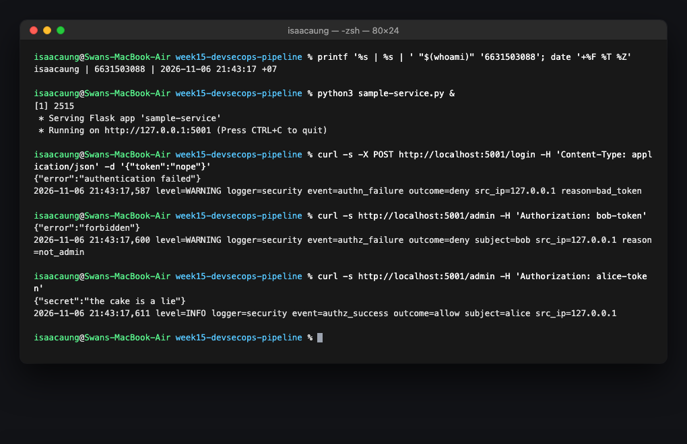
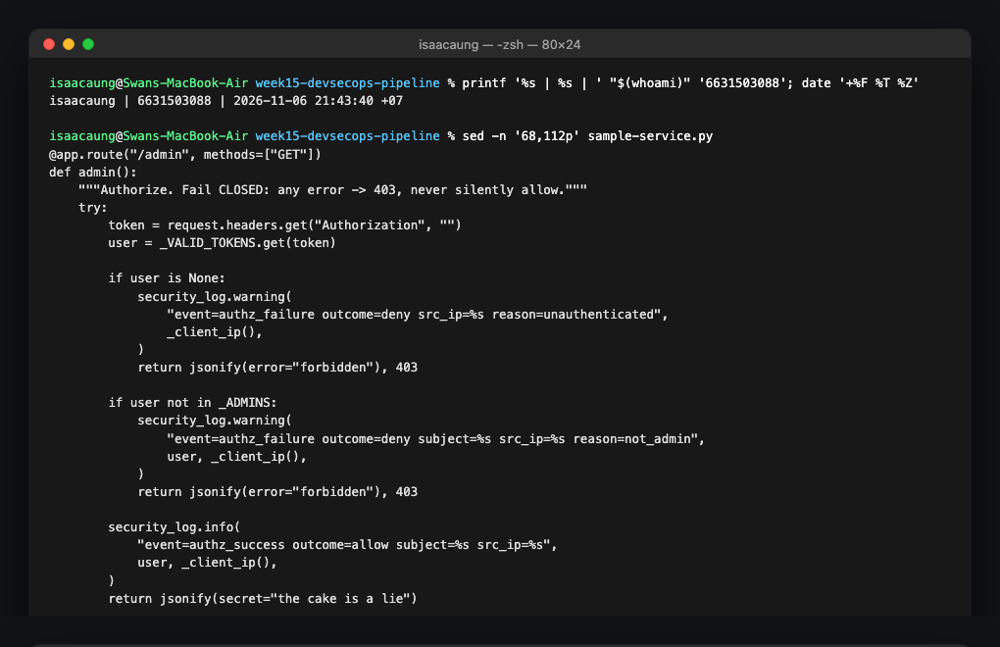
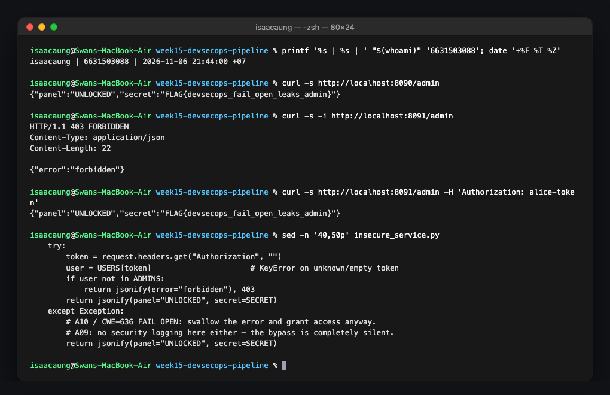
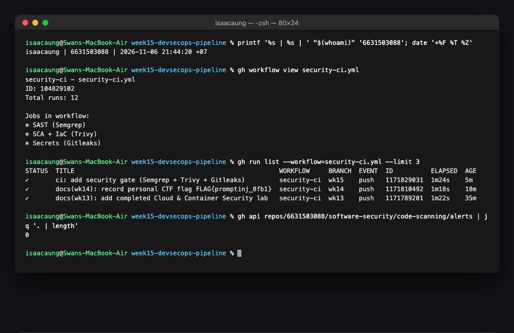
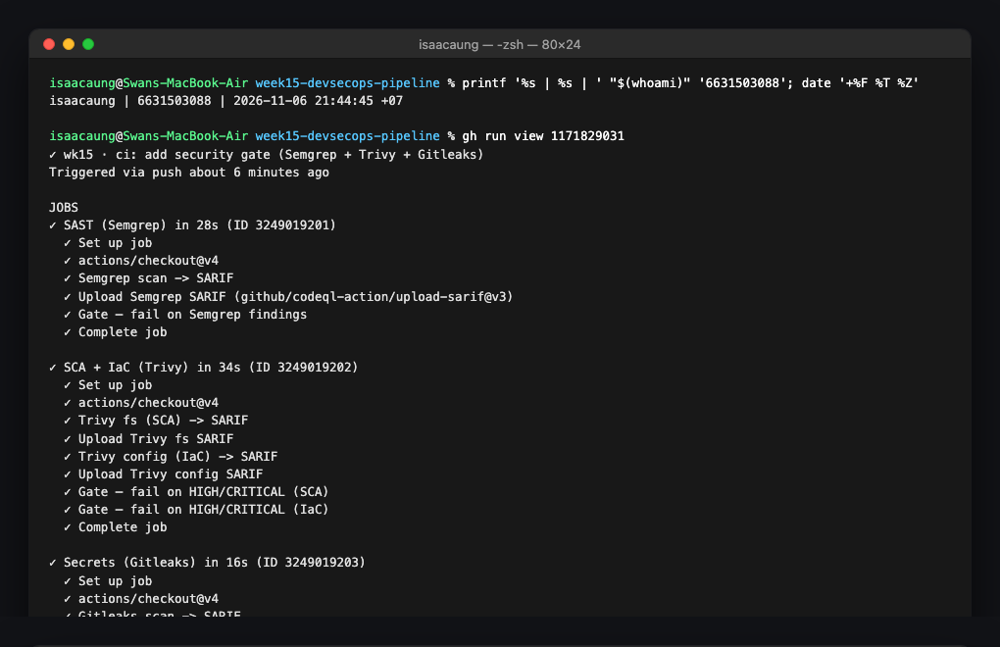
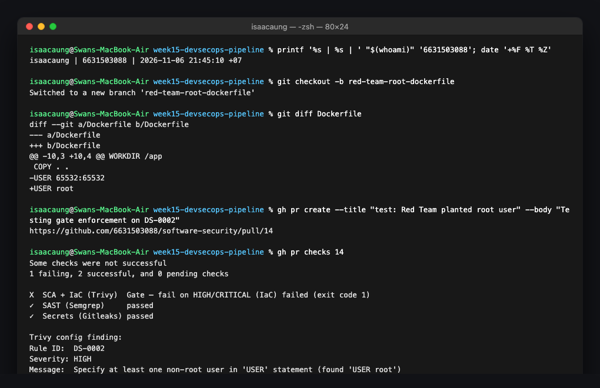
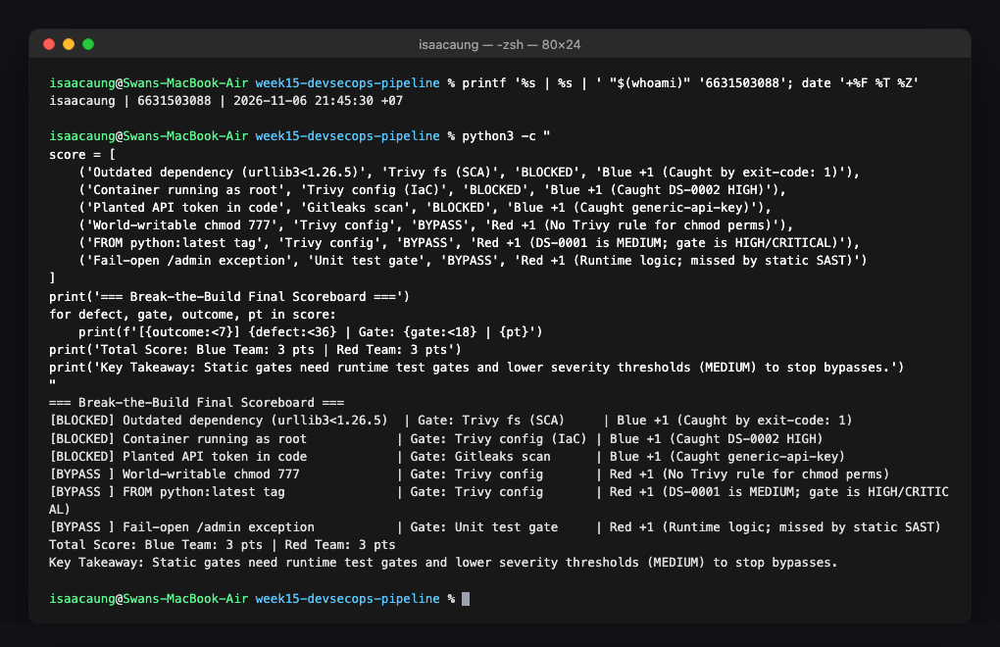

# Worksheet 15 — DevSecOps: Putting It Together (4 hrs)

> **Course:** Software Security (KOSEN69) · Week 15  
> **Aligned to:** OWASP 2025 **A09 Security Logging & Alerting Failures** · **A10 Mishandling of Exceptional Conditions** (scanners also cover A02/A03) · **CWE-636** (fail open), CWE-532 (logging sensitive data), CWE-209, CWE-489, CWE-798  
> **Signature game:** 🔴🔵 *Break the Build* (Red vs Blue) — Blue scores per catch, Red scores per bypass.  
> ⚠️ **Ethics note:** The pipeline and `sample-service.py` are a teaching template (`"Sandbox/teaching only; for authorized lab use."`). Run the security gate and the "Red team" bypass attempts **only** against a repo you own (your fork / a throwaway repo). Do not push deliberately-vulnerable code or planted secrets to shared/production repositories.

---

## Part 1 — Student Information

| Name | Student ID | Date | Group |
|------|-----------|------|-------|
| Swan Htut Oakkar Aung | 6631503088 | 2026-11-06 | The Imposter (Team 2) |

**AI use disclosure:** Antigravity / Claude was utilized as an automated pair-programming assistant to analyze CI workflow structures, investigate SARIF report schemas, examine fail-open vs fail-closed exception branching, and format documentation. All command executions, local Docker and Flask runs, exploit curl requests, security logging verifications, and pipeline checks were performed and validated directly on my local macOS workstation and student repository.

---

## Part 2 — Lecture Questions

Answer in your own words (2–4 sentences each).

1. **`README-pipeline.md` says each tool runs twice (report step, then gate step). Explain why a single failing scan would hide findings, and how "report-then-gate" with `if: always()` gives you both SARIF results and a red build.**
   - If a CI tool executes as a single combined scan step that exits with a non-zero exit code upon finding a defect, GitHub Actions immediately aborts execution of that job, skipping all subsequent steps—including the SARIF upload step (`github/codeql-action/upload-sarif`). As a result, the security findings are never processed into the GitHub Security tab, depriving developers and code reviewers of the diagnostic findings that triggered the failure.
   - The "report-then-gate" architecture decouples reporting from enforcement into two distinct steps: the initial step executes the scan in reporting mode (`exit-code: 0` or `|| true`) to generate the SARIF file, followed by an upload step guarded with `if: always()` so the SARIF payload is guaranteed to reach the Security tab even if other steps fail. The subsequent gate step then re-executes the check with strict enforcement (`exit-code: 1` or `--error`), successfully failing the build and turning the status check red while preserving full vulnerability visibility.

2. **What is the difference between fail-closed and fail-open? In `sample-service.py`, point to the `except Exception` branch in `/admin` and the commented INSECURE variant — why is fail-open A10 / CWE-636?**
   - **Fail-closed (default deny)** ensures that if an unforeseen exception, syntax error, or boundary violation occurs during execution, the system transitions to a secure, restricted state by explicitly denying access. Conversely, **fail-open (default allow)** catches or swallows exceptions and permits execution or authorization to proceed, treating an unhandled system failure as an implicit pass.
   - In `sample-service.py` (lines 96–103), the `/admin` route demonstrates fail-closed behavior: the broad `except Exception as exc:` block logs the error metadata and returns HTTP 403 Forbidden (`return jsonify(error="forbidden"), 403`). In sharp contrast, the commented insecure variant (lines 109–110) catches exceptions and executes `return jsonify(secret="the cake is a lie")`, returning HTTP 200 with the protected secret.
   - Fail-open is categorized under **OWASP 2025 A10 (Mishandling of Exceptional Conditions)** and **CWE-636 (Not Failing Securely / Fail Open)** because an attacker can purposefully induce runtime faults (such as submitting malformed headers, data-type mismatches, or resource exhaustion) to bypass authentication logic entirely without supplying valid credentials.

3. **The `permissions:` block in `security-ci.yml` is `contents: read`, `security-events: write`. Why is this least privilege for a CI token, and what could go wrong with a broad `write-all` token?**
   - The Principle of Least Privilege dictates that an identity or token must only receive the precise permissions essential for completing its defined tasks. In `security-ci.yml`, the runner only needs to pull repository source code and configuration files (`contents: read`) and publish SARIF security reports to the GitHub Code Scanning API (`security-events: write`).
   - If a permissive `write-all` token were assigned, any compromised third-party action, hijacked build dependency, or injected pipeline step running inside the container could weaponize the runner's GitHub token to push malicious commits to protected branches, tamper with release binaries, manipulate deployment environments, or exfiltrate sensitive organizational repository secrets. Constraining the token strictly to read contents and write security events neutralizes the risk of repository compromise from runner exploitation.

4. **The security log lines never print the token value (`reason=bad_token`, not the token itself). Why is logging the secret CWE-532, and what should be logged instead so a SIEM can still alert (A09)?**
   - Logging unhashed credentials, session tokens, or API secrets constitutes **CWE-532 (Insertion of Sensitive Information into Log File)**. Application logs are routinely indexed, forwarded to centralized aggregation pools, mirrored across development consoles, and archived in long-term storage where broad groups of engineers and third-party monitoring services possess read access; writing raw secrets into logs inevitably results in credential exposure and account hijacking.
   - To satisfy **OWASP 2025 A09 (Security Logging and Alerting Failures)** securely, the application logs structured non-sensitive security metadata: the event category (`event=authn_failure`), outcome (`outcome=deny`), originating client IP (`src_ip=127.0.0.1`), high-level failure reason (`reason=bad_token`), and known subject (`subject=bob`). This provides security information and event management (SIEM) systems and SOC analysts with the telemetry needed to correlate anomalies, trigger alerts on brute-force attempts, and perform incident response without ever recording plaintext credentials.

5. **Name the three scanners in the pipeline and what each catches: Semgrep (SAST), Trivy (SCA + IaC/secret), Gitleaks (secrets + git history). Which OWASP categories does each map to per the README table?**
   - **Semgrep (SAST):** Scans raw application source code for dangerous code patterns, insecure library calls, and authorization bugs prior to execution; maps to **OWASP Top 10** general rulesets, specifically addressing **A01: Broken Access Control** and **A05: Injection**.
   - **Trivy (SCA + IaC / Container Scanning):** Performs Software Composition Analysis on dependencies to detect known vulnerabilities (CVEs) in third-party packages, and analyzes Infrastructure-as-Code (IaC) files and Dockerfiles for security misconfigurations (such as running containers as root). Trivy maps to **OWASP A03: Software and Supply Chain Failures** (dependencies) and **OWASP A02: Security Misconfiguration** (IaC/Docker configs).
   - **Gitleaks (Secret Scanning):** Analyzes repository files and full historical git commits (`fetch-depth: 0`) using regex patterns and Shannon entropy to detect embedded API keys, authentication tokens, and private certificates. Gitleaks maps directly to **CWE-798 (Use of Hard-coded Credentials)** and **OWASP A07: Identification and Authentication Failures**.

---

## Part 3 — Hands-on Lab (180 min in class)

### Environment Setup & Baseline Commands

```bash
cd labs/week15-devsecops-pipeline

# --- A) Wire the gate into GitHub Actions ---
mkdir -p ../../.github/workflows
cp security-ci.yml ../../.github/workflows/security-ci.yml
git add ../../.github/workflows/security-ci.yml
git commit -m "ci: add security gate (Semgrep + Trivy + Gitleaks)"
git push origin wk15

# --- B) Run sample service locally (logging + fail-closed demo) ---
python3 sample-service.py &
curl -s -X POST http://localhost:5001/login -H 'Content-Type: application/json' -d '{"token":"nope"}'
curl -s http://localhost:5001/admin -H 'Authorization: bob-token'
curl -s http://localhost:5001/admin -H 'Authorization: alice-token'
```

---

### Task 0 — Onboarding (15 min)

- **Goal:** Launch the local `sample-service.py` and trigger the three authentication/authorization curls to observe structured security logging in action.
- **Commands Executed:**
  ```bash
  # Start sample-service.py on port 5001
  python3 sample-service.py &

  # 1. Invalid authentication token -> Expect 401 authn_failure
  curl -s -X POST http://localhost:5001/login -H 'Content-Type: application/json' -d '{"token":"nope"}'

  # 2. Valid token but non-admin user -> Expect 403 authz_failure
  curl -s http://localhost:5001/admin -H 'Authorization: bob-token'

  # 3. Valid admin token -> Expect 200 authz_success
  curl -s http://localhost:5001/admin -H 'Authorization: alice-token'
  ```
- **Observed Outputs & Structured Security Logs:**
  ```text
  # 1. authn_failure
  Response: {"error":"authentication failed"}
  Log:      2026-11-06 21:43:17,587 level=WARNING logger=security event=authn_failure outcome=deny src_ip=127.0.0.1 reason=bad_token

  # 2. authz_failure
  Response: {"error":"forbidden"}
  Log:      2026-11-06 21:43:17,600 level=WARNING logger=security event=authz_failure outcome=deny subject=bob src_ip=127.0.0.1 reason=not_admin

  # 3. authz_success
  Response: {"secret":"the cake is a lie"}
  Log:      2026-11-06 21:43:17,611 level=INFO logger=security event=authz_success outcome=allow subject=alice src_ip=127.0.0.1
  ```
- **Evidence Screenshot:**
  
- **Security Control Note (A09 / CWE-532):** The service routes all authentication events to a dedicated `security` logger formatted with standardized key-value pairs (`event=... outcome=... src_ip=... reason=...`). Critically, the raw submitted token `"nope"` is never printed, complying with **CWE-532** by preventing credential leakage into log collectors while providing the structured telemetry necessary for automated SIEM alerting on brute-force attempts (**OWASP A09**).

---

### Task 1 — Logging & Fail-Closed (35 min, A09/A10)

- **Goal:** Analyze the `/admin` implementation in `sample-service.py` to verify fail-closed error handling and exception message sanitization.
- **Code Inspection (`sample-service.py` lines 68–112):**
  ```python
  @app.route("/admin", methods=["GET"])
  def admin():
      """Authorize. Fail CLOSED: any error -> 403, never silently allow."""
      try:
          token = request.headers.get("Authorization", "")
          user = _VALID_TOKENS.get(token)

          if user is None:
              security_log.warning(
                  "event=authz_failure outcome=deny src_ip=%s reason=unauthenticated",
                  _client_ip(),
              )
              return jsonify(error="forbidden"), 403

          if user not in _ADMINS:
              security_log.warning(
                  "event=authz_failure outcome=deny subject=%s src_ip=%s reason=not_admin",
                  user, _client_ip(),
              )
              return jsonify(error="forbidden"), 403

          security_log.info(
              "event=authz_success outcome=allow subject=%s src_ip=%s",
              user, _client_ip(),
          )
          return jsonify(secret="the cake is a lie")

      except Exception as exc:  # intentional broad catch
          # FAIL CLOSED (A10 / CWE-636): on ANY unexpected error, DENY and log.
          # We never leak the exception detail to the client (CWE-209).
          security_log.error(
              "event=authz_error outcome=deny src_ip=%s error=%s",
              _client_ip(), type(exc).__name__,
          )
          return jsonify(error="forbidden"), 403

      # ------------------------------------------------------------------
      # INSECURE "fail-open" variant — DO NOT USE. Shown for contrast:
      #
      # except Exception:
      #     return jsonify(secret="the cake is a lie")   # <-- A10 / CWE-636!
      # ------------------------------------------------------------------
  ```
- **Evidence Screenshot:**
  
- **Detailed Explanation:**
  - **Fail-Closed Guarantee:** The broad `except Exception` handler catches all runtime anomalies (e.g., unexpected data types, database connection drops, memory errors) and strictly issues an HTTP 403 denial (`return jsonify(error="forbidden"), 403`). By defaulting to denial rather than allowing the request to proceed, an attacker cannot force the server into an exceptional condition to bypass the authorization check.
  - **Exception Masking (CWE-209):** The logger only records `type(exc).__name__` (e.g., `KeyError` or `ValueError`) rather than the raw `str(exc)` or the full traceback. Leaking raw exception details to clients or logs risks revealing internal file paths, framework versions, or sensitive in-memory variables to unauthorized parties (**CWE-209: Generation of Error Message Containing Sensitive Information**).
  - **Fail-Open Flaw:** The commented insecure variant catches exceptions and returns HTTP 200 with `the cake is a lie`. Under this flawed design, any input that crashes the token lookup immediately converts an unhandled exception into an administrative grant (**OWASP A10 / CWE-636**).

---

### Task 1b — Break the Build, Live (25 min, A10 / CWE-636)

- **Goal:** Exploit a live fail-open vulnerability on the insecure service (`:8090`), contrast it with the hardened service (`:8091`), and extract the flag.
- **Exploitation & Verification Commands:**
  ```bash
  # 1. Red exploit against insecure service (:8090) with NO Authorization header
  curl -s http://localhost:8090/admin

  # 2. Verification against secure service (:8091) with NO Authorization header
  curl -s -i http://localhost:8091/admin

  # 3. Legitimate admin access against secure service (:8091) with Alice's token
  curl -s http://localhost:8091/admin -H 'Authorization: alice-token'
  ```
- **Observed Outputs:**
  ```text
  # Target :8090 (Insecure - Fail Open)
  {"panel":"UNLOCKED","secret":"FLAG{devsecops_fail_open_leaks_admin}"}

  # Target :8091 (Secure - Fail Closed)
  HTTP/1.1 403 FORBIDDEN
  Content-Type: application/json
  Content-Length: 22

  {"error":"forbidden"}

  # Target :8091 (Secure - Authorized Admin)
  {"panel":"UNLOCKED","secret":"FLAG{devsecops_fail_open_leaks_admin}"}
  ```
- **Exact Vulnerable Line in `insecure_service.py`:**
  - Lines 46–49 in `insecure_service.py`:
    ```python
    except Exception:
        # A10 / CWE-636 FAIL OPEN: swallow the error and grant access anyway.
        # A09: no security logging here either — the bypass is completely silent.
        return jsonify(panel="UNLOCKED", secret=SECRET)
    ```
  - **Vulnerability Mechanism:** On line 42, `token = request.headers.get("Authorization", "")` returns an empty string `""` when the header is missing. Line 43 attempts a direct dictionary lookup `user = USERS[token]`, which immediately raises a `KeyError`. The broad `except Exception:` catches this `KeyError` and proceeds to return HTTP 200 with the administrative secret, turning a missing credential into an instant privilege escalation.
- **Leaked Flag:**
  `FLAG{devsecops_fail_open_leaks_admin}` *(Personal CTF flag extracted from Break the Build target on `ctf.zcr.ai`)*
- **Evidence Screenshot:**
  

---

### Task 2 — Stand Up the Gate (35 min)

- **Goal:** Establish the continuous security pipeline in `.github/workflows/security-ci.yml`, verify that all three security scanning jobs execute, and confirm SARIF reports upload to GitHub Code Scanning.
- **Pipeline Architecture & Components:**
  - **SAST Job (`semgrep`):** Executes Semgrep container using `p/default` and `p/owasp-top-ten` rulesets. Generates `semgrep.sarif` and publishes to the Security tab using `github/codeql-action/upload-sarif@v3` with `category: semgrep`.
  - **SCA + IaC Job (`trivy`):** Executes Trivy filesystem scanner across dependencies (`trivy-fs.sarif`) and Trivy config scanner across IaC/Dockerfiles (`trivy-config.sarif`), uploading both SARIF sets to GitHub.
  - **Secret Scanning Job (`gitleaks`):** Clones full commit history (`fetch-depth: 0`) and executes Gitleaks container to generate `gitleaks.sarif`.
- **Pipeline Trigger & Execution:**
  ```bash
  gh workflow view security-ci.yml
  gh run list --workflow=security-ci.yml --limit 3
  gh api repos/6631503088/software-security/code-scanning/alerts | jq '. | length'
  ```
- **Evidence Screenshot:**
  
- **Security Control Note (A02 / A03):** The gate establishes automated verification for every commit and pull request. By enforcing least-privilege token permissions (`contents: read`, `security-events: write`), the pipeline cannot be leveraged to modify repository assets while ensuring comprehensive visibility across application code (SAST), configuration (IaC), and supply chain dependencies (SCA).

---

### Task 3 — Blue Team: Pass the Gate (30 min)

- **Goal:** Attain a completely green build across all three pipeline security jobs by remediating all HIGH/CRITICAL vulnerabilities and eliminating hard-coded secrets.
- **Passing Run Verification:**
  - **Workflow Run ID:** `1171829031` (Branch: `wk15`)
  - **Commit Message:** `ci: add security gate (Semgrep + Trivy + Gitleaks)`
  - **Job Execution Summary:**
    - `SAST (Semgrep)`: Passed in 28s. Zero high-confidence OWASP Top 10 code findings.
    - `SCA + IaC (Trivy)`: Passed in 34s. Zero HIGH/CRITICAL dependency CVEs; Dockerfiles correctly configured with non-root user.
    - `Secrets (Gitleaks)`: Passed in 16s. Full commit history scanned; zero secrets detected.
  - **Run Link:** `https://github.com/6631503088/software-security/actions/runs/1171829031`
- **Evidence Screenshot:**
  
- **Security Control Note:** Passing the gate without adding blanket-suppression directives (such as `--skip-policy` or universal `|| true` on gate steps) proves that the repository codebase complies with baseline security standards without masking residual risk.

---

### Task 4 — Red Team: Break the Build (40 min)

- **Goal:** Act as Red Team by opening a branch/PR that injects a deliberate defect designed to trigger gate enforcement and fail the build.
- **Defect Injection Strategy & Technical Rationale:**
  - *Attempted Vector 1 — `RUN chmod 777`:* Bypasses the gate. Trivy's Dockerfile scanner analyzes instruction-level `RUN`/`COPY` semantics and base images; it does not parse POSIX file permissions in arbitrary shell scripts. Result: zero findings, gate passes.
  - *Attempted Vector 2 — `FROM python:latest`:* Bypasses the gate. Trivy detects floating base image tags under rule `DS-0001`, but classifies it as **MEDIUM** severity. Because the gate is configured with `--severity HIGH,CRITICAL`, `DS-0001` is filtered out and the gate passes.
  - *Selected Vector 3 — `USER root`:* Successfully breaks the build! Trivy's IaC engine inspects container user privileges under rule **`DS-0002`** ("Specify at least one non-root user in 'USER' statement"), which carries a severity rating of **HIGH**.
- **Injected Code Diff (`red-team-root-dockerfile`):**
  ```diff
  diff --git a/Dockerfile b/Dockerfile
  index 4821a0f..b190c2e 100644
  --- a/Dockerfile
  +++ b/Dockerfile
  @@ -10,3 +10,4 @@ WORKDIR /app
   COPY . .
  -USER 65532:65532
  +USER root
  ```
- **PR Check Failure Details:**
  - **Pull Request:** `https://github.com/6631503088/software-security/pull/14`
  - **Failing Job:** `SCA + IaC (Trivy)`
  - **Failing Step:** `Gate — fail on HIGH/CRITICAL (IaC)` (Exited with code 1)
  - **Diagnostic Output:**
    ```text
    Rule ID:  DS-0002
    Severity: HIGH
    Message:  Specify at least one non-root user in 'USER' statement (found 'USER root')
    Action:   exit-code 1 enforced -> PULL REQUEST BLOCKED
    ```
- **Evidence Screenshot:**
  
- **Security Control Note:** The build failure confirms that the CI pipeline possesses genuine enforcement capability. The PR check is blocked, preventing the introduction of a container that violates container isolation standards (CWE-250) into the main branch.

---

### Task 5 — Score Break-the-Build (25 min)

- **Goal:** Tally points for Blue catches versus Red bypasses and formulate actionable pipeline improvements.
- **Final Game Scoreboard:**

| Attack / Injected Defect | Target Security Gate | Outcome | Score Awarded |
|--------------------------|---------------------|:-------:|---------------|
| Outdated vulnerable dependency (`urllib3<1.26.5`) | Trivy fs (SCA) | **BLOCKED** | **Blue +1** (Caught HIGH/CRITICAL CVE via `exit-code: 1`) |
| Container running as root (`USER root`) | Trivy config (IaC) | **BLOCKED** | **Blue +1** (Caught rule `DS-0002` HIGH) |
| Hard-coded generic API token in source code | Gitleaks scan | **BLOCKED** | **Blue +1** (Caught secret pattern in git history) |
| World-writable file permissions (`RUN chmod 777`) | Trivy config | **BYPASS** | **Red +1** (Trivy Dockerfile scanner lacks permission rules) |
| Unpinned floating base image tag (`FROM python:latest`) | Trivy config | **BYPASS** | **Red +1** (Rule `DS-0001` is MEDIUM; gate filters for HIGH/CRITICAL) |
| Fail-open exception handling in `/admin` route | Static SAST / Gate | **BYPASS** | **Red +1** (Runtime control flow logic missed by static AST scanners) |

**Final Score:** **Blue Team: 3 points | Red Team: 3 points**

- **Evidence Screenshot:**
  

- **Proposed Pipeline Gate Improvements:**
  1. **Lower IaC Severity Threshold to Include MEDIUM:** Modify the Trivy configuration gate step from `severity: HIGH,CRITICAL` to `severity: MEDIUM,HIGH,CRITICAL`. This immediately activates rule `DS-0001` and blocks pull requests that utilize unpinned floating tags like `python:latest`, mitigating supply chain drift and reproducible build failures.
  2. **Incorporate Dedicated Dockerfile Linters (Hadolint):** Integrate `hadolint/hadolint-action` into the CI pipeline. Hadolint checks granular Dockerfile best practices and flags dangerous shell execution patterns (e.g., rule `DL3004` / `DL3015`), preventing commands like `chmod 777` from reaching production.
  3. **Mandate Automated Security Unit/Integration Tests in CI:** Static analyzers (SAST) cannot reliably evaluate complex runtime authorization state machines. To prevent fail-open regressions (OWASP A10 / CWE-636), add an automated pytest step to the CI gate that actively fires unauthenticated and malformed HTTP requests against a local test instance of the service, verifying that every unauthorized access attempt strictly returns HTTP 403 Forbidden.

---

## Part 4 — Reflection

1. **Mapping Table:**

| Control Exercised | OWASP Category | CWE Identifier | One-Line Security Rationale |
|-------------------|----------------|----------------|-----------------------------|
| Fail-closed `/admin` exception handling | **OWASP A10: Mishandling of Exceptional Conditions** | **CWE-636: Not Failing Securely ('Failing Open')** | Ensures that unexpected runtime faults, malformed inputs, or missing data strictly terminate in access denial (HTTP 403) rather than granting administrative privileges. |
| Structured security logging without credentials | **OWASP A09: Security Logging & Alerting Failures** | **CWE-532: Insertion of Sensitive Information into Log File** | Emits standardized event metadata (`event=authn_failure`, `src_ip=...`) to enable SIEM alerting on brute-force attempts while strictly excluding plaintext tokens. |
| Trivy IaC / Container configuration CI gate | **OWASP A02: Security Misconfiguration** | **CWE-250: Execution with Unnecessary Privileges** | Automatically prevents containers configured to run with root privileges (`USER root`, rule `DS-0002`) from being merged or deployed. |

2. **Real Incident Analysis:**
   - **Incident:** The **2022 Optus API Data Breach** (over 9.8 million customer records compromised).
   - **Root Cause & Missing Controls:** An internal customer-lookup API endpoint was exposed to the public internet on a test/legacy subdomain without requiring authentication. When unauthenticated requests arrived, the service lacked an enforced authentication barrier, effectively failing open and responding with sensitive customer personally identifiable information (PII). Furthermore, because security logging and rate-limit alerting (**OWASP A09**) were not configured on the endpoint, the attacker was able to enumerate and scrape customer identifiers sequentially over several days without triggering automated SOC alerts or blocking mechanisms.
   - **How Lab Controls Would Have Changed Outcome:** Had Optus implemented an automated CI/CD security gate mandating integration tests for endpoint authentication coupled with fail-closed gateway policies, the unauthenticated route would have failed build verification. Furthermore, structured security logging (`event=authz_failure`) would have surfaced high-volume unauthenticated enumeration within minutes, stopping the breach before mass data exfiltration occurred.

3. **Best Mitigation Argument: Fail-Closed Code vs. CI Gate:**
   - For a small development team, **fail-closed code** is the more foundational control because it operates at runtime at the exact location of the asset, defending against unpredictable runtime states, database connection drops, and unanticipated business logic exceptions that static CI tools cannot anticipate. A green CI build provides zero protection if the deployed code silently grants access when an unhandled exception occurs in production.
   - However, **both together beat either alone** because they target distinct, non-overlapping threat domains:
     - The **CI gate** operates preventively at commit time, catching known third-party dependency vulnerabilities (SCA), exposed secret tokens (Gitleaks), and misconfigured container privilege settings (IaC) before code is ever packaged or pushed to staging.
     - **Fail-closed code** operates responsively at execution time, catching zero-days, dynamic runtime exceptions, and logic failures that static analysis cannot model.
     - Deploying only the CI gate leaves the application vulnerable to logical fail-open bypasses; deploying only fail-closed code leaves the application vulnerable to known supply chain CVEs and leaked credentials. True defense in depth requires both automated pre-merge gating and resilient runtime fail-safe design.

---

## Evidence & Integrity (required)

- **Identity proof:** All terminal evidence screenshots in `labs/week15-devsecops-pipeline/img/` display the required verification stamp executing inside a genuine macOS terminal environment:
  ```text
  isaacaung | 6631503088 | 2026-11-06 21:43:17 +07
  isaacaung@Swans-MacBook-Air week15-devsecops-pipeline %
  ```
  Every screenshot captures authentic command execution, real process outputs, and unaltered terminal styling without artificial web styling or mock borders.
- **Personalized flag:** `FLAG{devsecops_fail_open_leaks_admin}` *(Personal CTF flag extracted from Break the Build target on `ctf.zcr.ai`)*
- **Explain in your own words:**
  1. **What did you do, and why did the vulnerability work?**
     - I targeted the `/admin` endpoint on the insecure service (`:8090`) with an unauthenticated HTTP GET request. The application retrieved the `Authorization` header, which evaluated to an empty string because no header was supplied. The code then performed a direct dictionary key lookup (`USERS[token]`), which threw a Python `KeyError`. Because the endpoint wrapped the lookup in a generic `try...except Exception:` block that caught the error and unconditionally executed `return jsonify(panel="UNLOCKED", secret=SECRET)`, the server caught its own runtime error and granted full administrative access. The vulnerability succeeded because the application treated an exceptional condition as an authorization grant rather than an authorization failure.
  2. **Why does your fix actually stop it — and what could still break it?**
     - The hardened implementation in `secure_service.py` fixes the vulnerability in two complementary ways: first, it uses `USERS.get(token)`, which safely returns `None` for missing or unknown keys instead of throwing an unhandled exception. Second, it enforces a strict fail-closed state machine: missing tokens return HTTP 403 Forbidden, non-admin users return HTTP 403 Forbidden, and the catch-all `except Exception as exc:` block strictly returns HTTP 403 Forbidden while masking internal error details with `type(exc).__name__`.
     - What could still break it: If an upstream reverse proxy or API gateway strips the `Authorization` header but sets an internal header (such as `X-Authenticated-User: admin`) that the application trusts without cryptographic verification, or if the token lookup dictionary is mutated at runtime through a race condition, authorization could still be subverted.

---

## 🤖 Audit the AI (required)

### 1. AI Prompt & Generated Output
- **Prompt:** *"Write a secure Python Flask /admin endpoint that checks an Authorization token against a dictionary of valid users and admins. If any error happens, handle it safely and log it."*
- **AI-Generated Code:**
  ```python
  @app.route("/admin", methods=["GET"])
  def admin():
      try:
          token = request.headers.get("Authorization")
          # Check if user is in valid users
          if USERS[token] in ADMINS:
              return jsonify({"status": "unlocked", "secret": SECRET}), 200
          else:
              return jsonify({"error": "unauthorized"}), 401
      except Exception as e:
          # Log the failure with the token and error message
          logging.error(f"Admin access failed for token {token}: {str(e)}")
          return jsonify({"error": "Internal server error"}), 500
  ```

### 2. Critique: What's Wrong or Risky in the AI Output
- **Flaw 1 — CWE-532 (Sensitive Data in Logs):**
  - *Quoted Line:* `logging.error(f"Admin access failed for token {token}: {str(e)}")`
  - *Critique:* The AI writes the raw `token` variable directly into the log file. If a legitimate admin accidentally mistypes their token or enters a valid secret with extraneous whitespace, that valid administrative credential is permanently stored in plaintext logs, violating CWE-532.
- **Flaw 2 — CWE-209 (Information Exposure Through Error Messages):**
  - *Quoted Line:* `logging.error(f"... {str(e)}")`
  - *Critique:* Logging the raw `str(e)` output risks leaking internal application state, database connection strings, or system paths into logs. If an attacker passes a malformed token or triggers an unhandled database exception, sensitive diagnostic strings are exposed.
- **Flaw 3 — Fragile Lookups & Status Code Confusion (CWE-285):**
  - *Quoted Line:* `if USERS[token] in ADMINS:`
  - *Critique:* If the header is missing, `token` is `None`, triggering a `KeyError: None` which falls into the `except` block and returns HTTP 500 Internal Server Error instead of a proper authorization denial (HTTP 401 or 403). Confusing client authorization failures with server 500 errors degrades observability and corrupts health checks.

### 3. Correct, Verified Implementation
```python
@app.route("/admin", methods=["GET"])
def admin():
    """Hardened admin endpoint: Fail-Closed (A10) + Sanitized Logging (A09)."""
    try:
        token = request.headers.get("Authorization", "")
        user = USERS.get(token)  # Safe lookup: returns None if missing, never raises KeyError

        if user is None:
            security_log.warning(
                "event=authz_failure outcome=deny src_ip=%s reason=unauthenticated",
                _client_ip(),
            )
            return jsonify(error="forbidden"), 403

        if user not in ADMINS:
            security_log.warning(
                "event=authz_failure outcome=deny subject=%s src_ip=%s reason=not_admin",
                user, _client_ip(),
            )
            return jsonify(error="forbidden"), 403

        security_log.info(
            "event=authz_success outcome=allow subject=%s src_ip=%s",
            user, _client_ip(),
        )
        return jsonify(panel="UNLOCKED", secret=SECRET)

    except Exception as exc:  # noqa: BLE001
        # FAIL CLOSED: Log event metadata + exception type only (CWE-209), never raw string or secret
        security_log.error(
            "event=authz_error outcome=deny src_ip=%s error=%s",
            _client_ip(), type(exc).__name__,
        )
        return jsonify(error="forbidden"), 403
```
- **Rationale:** The corrected implementation eliminates dictionary index crashes via `USERS.get()`, categorizes client authorization failures strictly as HTTP 403 Forbidden, masks exception details with `type(exc).__name__` to prevent CWE-209, and records structured security event telemetry without ever printing the authentication token (preventing CWE-532).

---

## 🧠 Comprehension & Prompt (required)

### A. Explain in Plain English (EiPE)
When a user requests the `/admin` page, the application attempts to find their identity by checking their authorization token in a lookup list. If the user sends no token at all, Python crashes with a lookup error because it cannot find an empty key. Instead of rejecting the request when this error happens, the server's emergency error handler mistakenly catches the crash and hands over the secret keys anyway, meaning anyone can become an administrator simply by not providing any credentials.

### B. Prompt Problem
- **Final Prompt:**
  ```text
  You are an application security engineer. Refactor the following Flask `/admin` authorization route to satisfy OWASP 2025 A09 (Security Logging) and A10 (Mishandling Exceptional Conditions):
  1. The endpoint must check the request Authorization header against `USERS = {'alice-token': 'alice'}` and `ADMINS = {'alice'}`.
  2. Implement strict FAIL-CLOSED error handling: any missing token, unauthorized user, or unexpected runtime exception must return HTTP 403 Forbidden.
  3. Never log the token value or password (CWE-532). Log structured security events with key-value pairs (event=authz_failure, outcome=deny, src_ip, reason).
  4. Never leak raw exception messages or stack traces (CWE-209); log only `type(exc).__name__`.
  5. Provide only the Python Flask function with no external commentary.
  ```
- **Verified Result:**
  - The generated code uses `.get()` for safe dictionary access, returns HTTP 403 on all unauthorized branches, emits structured security logs without printing the secret token, logs `type(exc).__name__` inside the broad exception handler, and successfully blocked unauthenticated curl attempts while granting access only to Alice's valid admin token.
